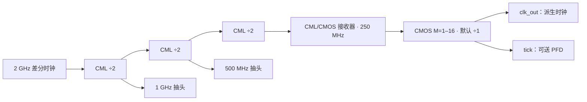
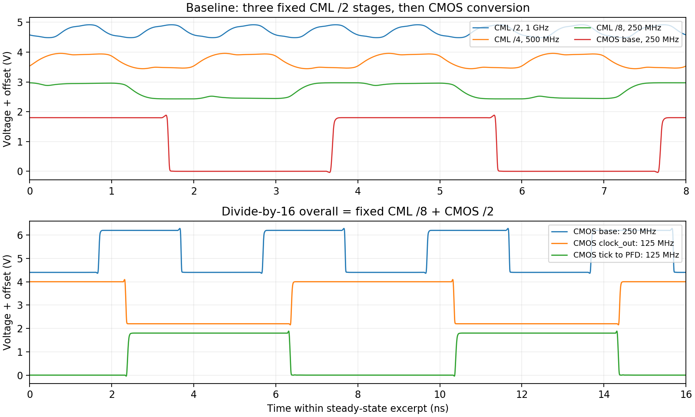

# 固定 CML ÷8 与 CMOS 后级分频

**架构定义已修正：**用户所指的 CMOS 自由分频是多相 CML 转换后的最高 2 GHz CMOS 时钟域。
本页保留的是此前误放在 250 MHz 后级的实验，不代表新时钟分发路径或其功耗/时序已验证。
当前定义见 [时钟域修正](clock_domain_clarification.md)，该纠正未运行时钟仿真。

当前按用户确认，以 **CML ÷8 为默认基准**：2 GHz 经三级二分频得到 250 MHz，
再转换为 CMOS。可编程整数分频放在 CMOS，默认 M=1 旁路。
前三级自然保留 ÷2、÷4、÷8 抽头；不在默认链中增加第四级 CML ÷16。
旧的全 CML 整数计数器退出当前路径，源码与结果保留用于复现。

高速固定 CML 前端配低速 CMOS 后级的电路风格划分可参考
[Sam Palermo，Divider Circuits，p.14–16](https://people.engr.tamu.edu/spalermo/ecen620/lecture12_ee620_dividers.pdf)。
本项目使用该划分，但保留 ÷8 基准，不把默认交接点提前到 ÷2。

## 实现与目录

| 文件 | 当前职责 |
|---|---|
| [cml_prescaler8.spice](../analog/pll/divider/spice/cml_prescaler8.spice) | 三个现有 CML ÷2 单元，输出 /2、/4、/8 |
| [cmos_divider_programmable.spice](../analog/pll/divider/spice/cmos_divider_programmable.spice) | 四位 CMOS 递减/重装计数器、周期脉冲和注册时钟 |
| [cmos_logic.spice](../analog/common/devices/spice/cmos_logic.spice) | CMOS 门、MUX、XOR、比较器 |
| [cmos_dff_reset.spice](../analog/common/devices/spice/cmos_dff_reset.spice) | PFD 和 CMOS 分频器共享的静态复位 DFF/锁存器 |
| [clock_division.toml](../config/clock_division.toml) | 当前基准、编码及配置约束 |

PFD 保留原 DFF 名称的兼容包装。提取共享单元后重跑 250 MHz 同相 PFD 基准，
UP/DN 脉宽和积分差与提取前一致；没有为复用而改变触发器电路。

CMOS 分频器端口是 `clk rst_b m0 m1 m2 m3 tick clk_out vdd vss`，m3…m0 编码 M−1。
M=1 时输出旁路有效输入时钟，计数器时钟关闭；M>1 时状态非零减一，到零重装 M−1。
零译码经 DFF 注册后输出 tick，半周期比较同样注册后输出 clk_out。
内部比较器/多位状态的组合跳变不直接输出为功能时钟。

tick 高电平目标为一个输入周期；clk_out 对偶数 M 为一半周期高、一半低，
对奇数 M>1 为 ceil(M/2) 个输入周期高、floor(M/2) 个输入周期低。
因此奇数分频不是精确 50%。两个端口的相位也不保证相同，例如 M=2 时使用不同的计数状态置位。
实际边沿延迟和负载会让端口占空比偏离理想的整数周期比例。

配置只在 rst_b 低时更新，并留出稳定时间。释放复位的使能在输入低相位锁存，
断言复位可能截断当前脉冲，期间时钟/数据无效。没有动态无毛刺切比、完整异步复位相位扫描或字对齐验证。
CML 前端尚无确定相位复位，CMOS 复位不能消除其初始相位不确定性。

## 分层验证

使用 ngspice 47、SKY130A、1.8 V，除标注外 TT、27°C。运行产物保留输入快照、SHA256、
日志、波形、run.json 与 metrics.json，规格判定均为 ungraded。

### 组合逻辑

[稳态逻辑测试台](../analog/pll/divider/tb/logic_truth/tb_cmos_next_state_settled_ngspice.cir.in)
穷举 16 个配置码 ×16 个状态，共 256 个输入向量，均使用实际 MOS 门。
每个向量保持 4 ns，在切换后 3.5 ns 采样；没有行为逻辑替代被测组合电路。
检查递减/重装 next-state、零检测和半周期比较，三项错误数均为 **0**，
六个输出距 0.9 V 门限的最小裕量约 **0.89961 V**。
这证明所测条件下的稳态逻辑真值，不是全部 M 的时序或 PVT 证明。

早期 DC 扫描频繁回退到 gmin/source/transient-OP，在执行时限内未完成，因而没有用于逻辑覆盖结论。
最终用明确的 PWL 向量做稳定后采样；该完成运行没有额外数值对地分流电阻。
DC 探索、超时日志和输入均保留，不能把超时直接解释为电路逻辑错误。

### CMOS 后级动态

[独立测试台](../analog/pll/divider/tb/functional/tb_cmos_divider_ngspice.cir.in)
输入 250 MHz、40 ps 边沿，tick 和 clk_out 各 20 fF。

| 配置/条件 | 输出频率，两个端口相同 | tick 占空比 | clk_out 占空比 | CMOS 后级功耗 |
|---|---:|---:|---:|---:|
| M=1，TT | 250 MHz | 49.857% | 49.857% | 0.181 mW |
| M=3，TT | 83.333 MHz | 33.001% | 66.331% | 1.033 mW |
| M=4，TT，2 ps 最大步长 | 62.500 MHz | 24.751% | 49.751% | 0.997 mW |
| M=16，TT | 15.625 MHz | 6.188% | 49.937% | 0.966 mW |
| M=4，SS、27°C | 62.500 MHz | 24.510% | 49.505% | 1.067 mW |
| M=4，TT、125°C | 62.500 MHz | 24.821% | 49.823% | 1.065 mW |

以上动态点的逐周期计数状态均符合递减/重装顺序；M=1 始终保持计数状态为零，
计数器时钟残余摆幅约 8.6 µV，未出现有效时钟翻转。
M=16 后半窗口只有三个输出正沿，属于短记录功能检查，不能代替长期漏计数统计。

M=4 从 10 ps 初版记录细化到 2 ps 后，频率变化不足 0.01 ppm，
clk_out 占空比变化约 0.00031 个百分点，平均功耗变化约 0.15%。
较快的过冲峰值对采样步长更敏感，粗步长数据不能用作尖峰可靠性签核。
动态瞬态覆盖的是上述代表点；并未逐个 M×全部 PVT 做瞬态扫描。

## 真实 CML ÷8 → 接收器 → CMOS → PFD

[耦合测试台](../analog/pll/top/tb/hybrid_divider_pfd/tb_hybrid_divider_pfd_ngspice.cir.in)
使用 2 GHz、400 mV 差分峰峰值、1.632 V 共模的理想差分激励。
三级 CML 输出每端 5 fF，前两级还带下一级输入的真实晶体管负载，第三级带接收器输入。
RX 正端额外 5 fF 并驱动 CMOS 后级，负端 20 fF；tick/clk_out 各 20 fF，tick 还驱动真实 PFD。

| 配置 | CMOS 输入 | tick / clk_out | 总反馈比 |
|---|---:|---:|---:|
| CML ÷8，CMOS M=1 | 250 MHz | 250 MHz | 8 |
| CML ÷8，CMOS M=2 | 250 MHz | 125 MHz | 16 |

默认 M=1 的实测功耗：

| 部分 | 功耗 |
|---|---:|
| 三级 CML | 6.517 mW |
| CML/CMOS 接收器 | 1.312 mW |
| CMOS 后级，旁路且关闭计数器时钟 | 0.189 mW |
| PFD，在本测试相位下 | 0.555 mW |
| 合计 | **8.573 mW** |

该总计不含理想偏置参考源的 1.53 mW，也不含 VCO。
旧全 CML 可编程计数器本身约 29.1 mW；因此将自由分频下放 CMOS 有明确的功耗收益。
新旧负载与参考/反馈相位并非完全相同，这不是匹配所有条件后的最终功耗签核。

M=2 的四部分分别约 6.517、1.312、1.077、0.278 mW，总计约 **9.184 mW**，
也不需要第四级 CML。两次记录分别为 40 ns 和 48 ns，只覆盖短时功能；
参考与反馈未构成闭环锁相，UP/DN 不要求等宽。理想源驱动下的接口通过不等于实际 VCO 加载或完整 PLL 已通过。

矢量图：[SVG](figures/clocking/dividers/hybrid_divider_waveforms.svg)。核心动态点和执行状态见
[CSV](data/hybrid_divider_points.csv)。图中 M=2 的 tick 和 clk_out 使用不同计数状态，不能假定同相。

## 频率规划与使用边界

固定 ÷8 后，CMOS M=1–16 产生的是 250 MHz 及以下的整数分频时钟。
例如 M=2/3/4/5/16 对应 125/83.333/62.5/50/15.625 MHz；这些是分频算术，
其中未列入动态验证表的 M 尚无对应瞬态覆盖。
500 MHz 与 1 GHz 的高速串化时钟仍应使用保留的 CML ÷4/÷2 抽头或对应 VCO 时钟网络，
不能从 250 MHz 用分频获得。额外接收器的扇出、相位及负载要重新验证。

若 CMOS 只是派生辅助时钟，PLL 反馈可以保持默认 ÷8。
若 CMOS M 级也进入反馈，则 `fVCO = 8M × fref`，总分频只覆盖 8 的整数倍，不能声称任意总整数。

| 配置例子 | 锁定所需 VCO |
|---|---:|
| 250 MHz 参考，M=1 | 2 GHz |
| 125 MHz 参考，M=2 | 2 GHz |
| 50 MHz 参考，M=1 | 400 MHz，VCO 该低频覆盖仍待实现 |
| 50 MHz 参考，M=5 | 2 GHz，分频算术允许，不是用户必须维持最高线速的要求 |
| 250 MHz 参考，M=2 | 4 GHz，超过当前 2 GHz 目标，不是合法工作点 |

因此增加反馈 M 不会在同一参考下自动降低线速。改变通信速率还要协调 VCO、各级串化时钟和数据重定时。
500 MHz 参考在 VCO≤2 GHz 时需要另选 ÷4 抽头等路径；默认 ÷8 路径不能覆盖，
当前未实现动态抽头切换及未用 CML 级关断。

当前实现也未证明奇数精确 50% 占空比、动态无毛刺切频、确定性字对齐、失配、噪声、版图提取或闭环锁定。

## 结果路径

独立后级在 `results/analog/pll/divider/cmos_functional/`，组合逻辑在 `divider/logic_truth/`，
耦合接口在 `results/analog/pll/top/hybrid_divider_pfd/`。
已完成的基准接口为 `20261027T153415Z_*_baseline_cml8_cmos1`，
总 ÷16 接口为 `20261027T154226Z_*_baseline_cml8_cmos2_short`。
原较长 M=2 记录超时后保留，缩短记录完成，不把超时当作功能失败。
组合逻辑完成记录为 `20261027T154843Z_*_cmos_truth_settled`。
DC 探索的三个超时与长记录 M=2 的一个超时均保留。更严格的 2 ps 检查完成后，
另一个冗余 5 ps 运行已取消并标记 cancelled，不计为电路失败。
