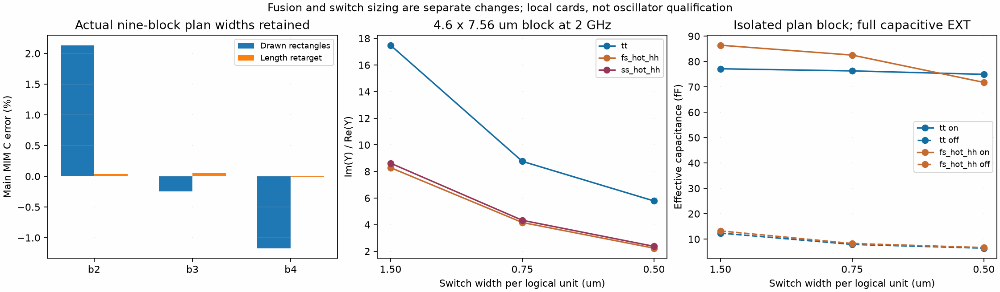

# 电容融合、矩形 bank 与开关 Q（2026-11-15）

**同电极、同控制域的电容可以研究融合，形状不要求方形；融合后的尺寸、寄生和物理参考必须一起更新。当前9块镜像规划可继续，`Coff=17.2 fF、Con保持不变、Q≈14`尚不是全角验证结果。** 在规划的4.6×7.56 µm矩形块上，0.50 µm/u开关的端口Q实测TT约5.78、FS低压热角2.24，FF高压冷角才到13.53；不能用单一Q估算直接确定开关宽度。

本轮保留采用的r6原理图、已安装版图和规划图。新生成物都是独立物理/局部电气候选；无噪声DC偏置AC不能转作环振相噪、启动或全PVT资格。固定输入、结果和脚本身份在[小数据](../data/capacitor_fusion.json)与[索引](../../results/catalog/capacitor_fusion.json)。

## 融合的边界

| 对象 | 可融合范围 | 必须保留的边界 |
|---|---|---|
| 当前VCO | 同一bit内可用一颗或左右镜像两颗矩形替代单位MIM | b0…b4五个控制域、正负相位节点、MIM上/下极板方向 |
| 原r6独立开关半单元 | 共用浮动底板属于明确电路迭代 | 原先各底板的电荷状态、漏电、失配和切码行为不再独立；不能称为原网表严格等价 |
| 既有同bit共底板物理候选 | 同一对电极的多个capm可改成一个矩形 | 主C、边缘C、底板C、串联R和匹配重校准；即使连接不变也不是同一个几何器件 |
| LDO、BG、CML固定电容 | 同一节点对、同一电极方向可以重分块 | 各滤波节点、Miller两端、不同本地偏置节点不能并在一起 |
| PLL积分电容 | `z–vss`组内及`z–vdd`组内分别重分块 | 当前6/12 pF电源分接不能合成18 pF对地，否则改变供电耦合抵消 |

MIM是上下极板不同的器件。即使理想C的两端可交换，物理下极板对地及对邻线的寄生也不能按无向节点对任意合并。`mf`在本机SPICE模型中只进入失配项，不能用`mf=N`替代N颗并联的名义电容。

## 按实际9块矩形规划定尺寸

固定读取[bank规划](../../analog/pll/vco/layout/plan/cap_bank_plan.png)及其JSON，保留中央b0、左右成对的b1…b4和各自宽度。下面只将PDK主MIM电容量对齐原2×2 µm单位，不把绘图形状改成统一方形。

| bit / 每侧逻辑单位数 | 规划每块W×L（µm） | 主C相对原单位和的误差 | 保持W的主C匹配初值（µm） |
|---|---|---:|---|
| b0 / 1，中央一块 | 2×2 | 0 | 2×2 |
| b1 / 1，左右各一块 | 2×2 | 0 | 2×2 |
| b2 / 2，左右各一块 | 2×4.24 | +2.134% | **2×4.15** |
| b3 / 4，左右各一块 | 2.6×6.56 | −0.247% | **2.6×6.58** |
| b4 / 8，左右各一块 | 4.6×7.56 | −1.170% | **4.6×7.65** |

这三类原矩形和长度微调对照，以及2×2基准，共7份真实MIM＋原开关叶单元均通过full-rule DRC、LVS、导出端口和尺寸检查。TT/27°C、相位DC1.5 V、控制0/1.8 V的1 MHz/2 GHz AC已完整完成，采用原0.75 µm指宽、每单位两指；不是缩开关后的规划实现。**表中微调值是主MIM匹配初值，不是完整9块bank的最终尺寸。**

本机TT模型使用：

\[
C_\text{MIM}=a(W+d)(L+d)+2p(W+L+2d),\quad
a=2\ \mathrm{fF/\mu m^2},\ p=0.19\ \mathrm{fF/\mu m},\ d=-0.025\ \mathrm{\mu m}.
\]

给定规划宽W，直接求长度：

\[
L=\frac{C_\text{target}-2p(W+d)}{a(W+d)+2p}-d.
\]

[公共换算](../../src/serdes_flow/cap_fusion.py)直接读取安装PDK的系数，支持给定宽度求长度；候选再按实际几何网格量化。不能只用`W×L`相等来判断：16颗2×2的TT主C是148.836 fF，一颗8×8只有133.262 fF，少10.464%；若串联R不变，单极点截止频率约上升11.69%。即使TT补回主C，面积项、周长项及尺寸偏差在角点的变化不同，权重和进位间隙仍需重测。

九块规划在x方向镜像有利于抵消一阶横向梯度；b0、b1及外侧各bit的y重心不同，不能据此视为完整二维共质心。极板边缘环境、上下覆盖金属和dummy需要按实际匹配预算决定。

## Q究竟影响什么

这里测的是导通电容支路的端口Q：

\[
Q_\text{port}=\frac{\operatorname{Im}Y}{\operatorname{Re}Y}.
\]

若近似为理想C串联开关电阻Rs，则：

\[
Q\simeq\frac1{\omega R_sC},\qquad
C_\text{eff}=\frac C{1+1/Q^2},\qquad
\angle I=90^\circ-\arctan(1/Q).
\]

| Q（纯串联RC示意） | 有效电容/理想C | 电流偏离理想90°的角度 |
|---:|---:|---:|
| 33 | 99.91% | 1.74° |
| 14 | 99.49% | 4.09° |
| 5.8 | 97.11% | 9.78° |
| 2.24 | 83.38% | 24.06° |

有效电容只是一部分影响。更小开关会增加耗散导纳，改变环振负载、幅度及所需跨导；开关自身热噪声和周期内相位敏感度也会改变。**该支路Q不是整颗环振或LC谐振腔的Q，不能直接用Q平方比例推整机相噪。** 更低Coff和更低损耗之间需要共同选择。

### 实际矩形＋合法指宽扫描

固定规划的4.6×7.56 µm矩形（约8个逻辑单位），用PDK绘制三份真实开关并提取AD/AS、结周长及电容矩阵。每逻辑单位W=1.5/.75/.5 µm分别实现为：16指×0.75、8指×0.75、8指×0.50，三个叶均DRC0/LVS通过。不能简单把原两指宽度缩成0.375或0.25 µm；它们低于安装PCell的0.42 µm最小指宽。

| 条件，2 GHz，nodeDC1.5 V | Q：W1.50 | Q：W0.75 | Q：W0.50 |
|---|---:|---:|---:|
| TT / 1.8 V / 27°C / RCtt | 17.49 | 8.76 | **5.78** |
| FS / 1.65 V / 85°C / RChh | 8.29 | 4.17 | **2.24** |
| SS / 1.65 V / 85°C / RChh | 8.62 | 4.33 | 2.37 |
| SS / 1.65 V / −40°C / RChh | 13.61 | 6.82 | 3.59 |
| FF / 1.95 V / −40°C / RCll | 35.96 | 18.00 | **13.53** |
| TT / 1.8 V / 27°C / RChh | 15.35 | 7.69 | 5.08 |
| TT / 1.8 V / 27°C / RCll | 20.32 | 10.18 | 6.71 |

| 同一矩形的有效C | W1.50 | W0.75 | W0.50 |
|---|---:|---:|---:|
| TT关断（fF） | 12.378 | 7.911 | 6.429 |
| TT导通（fF） | 77.123 | 76.297 | 74.932 |
| FS低压热hh关断（fF） | 13.234 | 8.276 | 6.668 |
| FS低压热hh导通（fF） | 86.415 | 82.525 | 71.764 |

FS热角缩到0.50后，Coff约减半，但Con减少16.95%，端口耗散导纳约为原来的3.1倍。TT小宽度的Coff约0.804 fF/逻辑单位，尚不含完整bank相位总线；本卡没有证明0.55 fF/u。图中“Q≈33→14”和“Con不变”不能作为全角事实；Q≈14在受检FF高压冷点才接近成立。当前没有独立的Q规格，本轮Q与导纳记为表征量；是否接受由调谐窗口、振荡幅度、噪声/抖动预算决定。

原五位共底板整bank在另一份相同偏置AC中，码31的Q为TT16.91、FS低压热hh7.78。其端口包含总线、所有bit及其耦合，不能与单块或只计R_on的Q混为一列。

### Ron、LVT与native器件选择

导通支路的Q主要由开关Ron与C决定，但降低Coff还同时受漏结、栅漏、底板和走线影响。换管型必须比较导通和关断两侧。没有从本机通用器件目录及公开说明中确认可直接用于此处的独立“埋沟NMOS开关”模型；能直接比较的是普通1.8 V、1.8 V LVT、3 V/5 V native。LVT的公开结构说明是改变阈值调整注入，native则阻挡VT注入，名称本身不能作为埋沟器件的证明。[官方器件说明](https://skywater-pdk.readthedocs.io/en/main/rules/device-details.html)

native两种PCell的最小L分别为0.5/0.9 µm，普通/LVT是0.15 µm。其SPICE宽度分箱也很窄：0.5 µm单指虽可画图，却不在本机native模型有效分箱；1 µm单指在四种模型中均有支持。因此另做一组**四种均为4指×1 µm、总W4 µm**的真实几何；不是前节8指×0.5 µm的宽度卡。四叶均通过DRC/LVS，采用各自实际AD/AS及电容矩阵。

| TT / 1.8 V / 27°C，W总4 µm | L（µm） | MOS-only Ron（Ω） | 整个块2GHz导通Q | 块Coff / Con（fF） |
|---|---:|---:|---:|---:|
| 普通1.8 V | 0.15 | 168.04 | 6.32 | 6.076 / 75.340 |
| 1.8 V LVT | 0.15 | 155.62 | 6.82 | 5.966 / 75.640 |
| 3 V native | 0.50 | 483.86 | 2.23 | 6.116 / 63.218 |
| 5 V native | 0.90 | 1144.52 | 1.07 | 6.603 / 36.220 |

Ron用独立MOS阵列在VDS10 mV、VGS=VDD测量，Q/Coff/Con仍在同一4.6×7.56 µm电容块、相位DC1.5 V、控制0/VDD下测量，二者不混为同一个R。另做VDS0.1/0.3/0.6 V、栅0的独立关断电流卡。TT的VDS0.6 V电流为普通约2.65 pA、LVT5.17 pA、native3约7.80 µA、native5约65.1 nA；这是独立MOS偏置下电流，不是电容bank的直流供电电流。

六个局部条件（TT、FS/SS低压热hh、SS低压冷hh、FF/SF高压热ll）均已完成，完整值在固定数据。FS低压热角Ron为293.31/261.66/799.82/1761.82 Ω，导通Q为3.20/3.58/1.25/0.77；受检FF/SF高压热角native3的VDS0.6 V关断电流约31.5/40.2 µA。这里低阈值的过驱动收益不足以抵消native的长沟道/厚氧化层等特性，关断漏电也明显增大。

当前可把同尺寸1.8 V LVT列为局部备选：受检Ron改善约6%–11%，不能据此把开关W直接缩到1/3。native不作为此bank的优先替代；若改变栅驱动、体偏置或使用特殊器件，需另列器件电压、关断和接口边界。没有运行这些替代驱动，也没有给新管型全PVT、失配或相噪资格。native在LDO中的用途及其原验证边界不受这一局部对比影响。

### 按实际选码分配开关宽度

目标/约束、工艺角联合概率、局部失配、校准策略和有限叶目录的Pareto研究已另列[bank鲁棒优化](../design/vco_bank_optimization.md)。该研究在旧码包络下比较方案，本节原最佳码单点结果保持其原边界。

**小位给较强开关、大位适度放松是有依据的候选，但不能只按SS/FF标签定尺寸。** 普通SVT仍作为本轮管型；LVT仅保留备选。这里分配的是MOS宽度所决定的Ron，不另加实体串联电阻；仅加电阻不能减少开关结电容。

快环振需要更多接入电容、慢环振需要更少接入电容，这个相关性可以利用：在小码角，大位通常关断，缩小大位开关可以减少一直挂在相位节点上的Coff。不过，环振快慢还受偏置、无源角和温度影响，不能等同于bank NMOS快慢；二进制大码也不等于每个小位都接通。

固定读取r6原理图的135条件码表 `results/analog/pll/vco/r6/map_20261112T062237Z/table.json`，SS低压热角在hh/ll的最佳码分别为3/16，SF低压冷ll为29，FS低压热hh为0。SS的27条最佳码中有7条打开b4；不能把最大位仅按FF进行设计。这些是原r6的选码，不是本轮新几何已重新校准的码。

令每位容量为Ck、开关总宽为Wk，低损耗近似下 `Ron∝1/Wk`、`Gk≈ω²Ck²Ron`。若约束是所有位同时导通且总W固定，最小总损耗的解为 `Wk∝Ck`，即各位近似相同RC/Q。实际设计可借不同角下的选码放松某些位，但要用对应角点约束逐条检验，不能把135个条件当作芯片出现概率加权。

保持实际9块MIM的原规划尺寸，比较三份**相同总W31µm**分配及原宽度对照。下表的数值是每个2×2等效逻辑单位的开关宽度；每位实际W还要乘1/2/4/8/16，最大位开关仍比小位宽得多。

| 分配 | b0 | b1 | b2 | b3 | b4 | 总W（µm） |
|---|---:|---:|---:|---:|---:|---:|
| 原比例对照 | 1.50 | 1.50 | 1.50 | 1.50 | 1.50 | 46.5 |
| 等比例减宽 | 1.00 | 1.00 | 1.00 | 1.00 | 1.00 | 31.0 |
| 小位优先 | 2.20 | 2.00 | 1.20 | 1.00 | 0.75 | 31.0 |
| 大位优先 | 1.00 | 1.00 | 1.00 | 0.60 | 1.20 | 31.0 |

14个不同的真实SVT/MIM叶单元全部通过full-rule DRC、LVS属性/端口和指宽/指数量核对。小器件的地回路使用闭合M2回流面避免体接触与源汇流的同网浅缺口；所有分配使用同一种处理，旧生成器默认行为不变。0.625µm指宽会被本机PCell量化为0.63µm，早期准备因精确尺寸核对被拒，最终采用整0.01µm指宽；未放宽核对容差。

7个局部条件各做20MHz/2GHz、栅0/VDD的小信号AC；相位DC1.5V，保留实际器件AD/AS及EXT电容矩阵。将9份叶导纳按理想互连相加构成32码代理。**没有完整相位总线、块间耦合或分布金属RC；b1两块各自底板独立，不覆盖规划中两块共底板的细节。** 因此只能比较分配趋势，绝对Coff不能当成最终bank提取值。所有Q/G为ungraded表征量，没有额外引入通过门槛。

| 2GHz局部代理指标 | 原比例 | 等比例减宽 | 小位优先 | 大位优先 |
|---|---:|---:|---:|---:|
| TT关断C（fF） | 51.600 | 39.873 | 39.691 | 40.918 |
| TT全开C（fF） | 302.247 | 301.185 | 300.287 | 299.912 |
| SS低压热hh、原码3的G（µS） | 51.53 | 90.80 | **33.57** | 90.79 |
| SS低压热ll、原码16的G（µS） | 145.97 | 190.61 | **283.49** | 233.04 |
| SF低压冷ll、原码29的G（µS） | 97.52 | 141.95 | 163.92 | 141.96 |
| FS低压热hh、7→8电容步长（fF） | 8.396 | 10.192 | 12.104 | **1.057** |

小位优先相对等比例减宽，在SS热hh原码3将耗散G减少约63%，而Coff几乎不变，说明按选码分配有实际收益；代价是SS热ll原码16耗散增加约49%，SF冷ll原码29增加约15%。相对原宽度对照，小位优先TT的Coff约减23.1%、全开C约减0.65%，但收益主要来自总宽下降，不能全部归给宽度重分配。耗散G不是整环功耗或相噪。

两频点、七条件下四份代理32码均单调，但大位优先将FS热hh的7→8步长压到约1.06fF，显示牺牲中间位会制造近空洞；另一侧也必须检查15→16，不可只看码0/31。**保留等比例31µm作为减宽比较基准、小位优先作为有条件优化候选；当前不采用激进重分配。** 下一次实际bank/ring窗口校准应同时约束SS热hh小码、SS热ll码16和SF冷ll大码，并看幅度、有效调谐跨度、切码和噪声。原码下的导纳对照不能证明新候选仍在原码锁定2GHz。

固定[数据](../data/vco_switch_allocation.json)、[索引](../../results/catalog/vco_switch_allocation.json)、[叶单元与AC入口](../../analog/pll/vco/tb/layout_cap_unit/switch_allocation.py)、[固定汇总导出](../../verification/analysis/vco_switch_allocation.py)单独保存，未覆盖前轮结果、采用参数或9块规划。

### 规划右图的拆分应如何理解

`Coff=51.4→35.3→22.2→17.2 fF`的后三项在规划脚本中是手填的估计分量，未绑定对应几何提取或AC记录。它们可以作为优化目标，但不是当前测量分账。

关断支路的简化关系是：

\[
C_\text{off}\approx C_\text{direct}+\frac{C_\text{MIM}C_\text{plate}}{C_\text{MIM}+C_\text{plate}},
\]

其中`Cplate`还包含漏结、栅漏及布线耦合；这些项经浮动节点折算后才体现到相位端口，不能把裸结C、裸底板C、全部MIM边缘C当成互不影响的对地电容直接相加。源漏M2分离或缩短总线有帮助，但要由实际提取确认；部分相邻结构移开后屏蔽变弱，耦合也可能上升。

## 独立五块融合卡：证明可实现，不替代九块镜像规划

先完成一份五位各一颗MIM的可实现性对照，采用原开关总宽46.5 µm及62个0.75 µm指。每位主MIM尺寸2、2.89、4.15、5.94、8.46 µm见方，由同一尺寸映射生成物理参考；五叶及完整bank均DRC0/LVS/端口/精确尺寸通过。外框47.37×16.05 µm、760.29 µm²，较既有51.07×18.61 µm共底板bank小约20.0%。这不是最终镜像布局，也不含整个环振的面积。

其7个局部条件、每个1 MHz/20 MHz/2 GHz的32码均单调。TT关断/导通为49.564/304.364 fF，对照原共底板51.456/311.874 fF；融合保住主MIM标称值后，Con仍因实际寄生变化少约2.4%。其它角下变化更大，不能直接复用旧码表。此卡同样没有达到Coff<20 fF，也没有缩开关。

用新器件尺寸生成的参考LVS通过；刻意改与旧16颗2×2参考比较时，Netgen虽报告连接唯一匹配，但同时报告W/L和M属性错误，**不是LVS通过**。安装Netgen规则允许并联电容归并、忽略部分属性，LVS不能替代面积/周长及电容量检查。本轮既查属性，也独立查实际未合并器件数、尺寸、电极和指宽。

## 固定pF电容、截止频率与其它融合点

本机MIM PCell参数检查限制W、L各为2–30 µm，30×30的TT模型约1.82 pF。公开工艺表的最大面积栏是N/A，不能把工具默认值说成已确认的工艺最大面积，也不能绕过PCell检查后只凭Magic DRC零错误批准任意大极板。[官方规则](https://skywater-pdk.readthedocs.io/en/main/rules/periphery.html#capm)

固定电容可在总容量附近重分块，不要求继续用1 pF单位。按当前模型和PCell范围：32 pF可探索18块约29.65 µm见方，16 pF可探索9块同尺寸；5 pF可探索3块约28.71 µm，6 pF可探索4块约27.23 µm。它们只是可实现尺寸估计，**未绘制并验收这些固定电容新阵列**。

对16×约1 pF和9×29.65² µm MIM，用相同理想1 MΩ、DC1.5 V作完整PDK被动卡：TT截止约9.947172/9.947081 kHz；五种RC角中相对变化约−0.496%至+0.414%。这是隔离重分块本身的结果，不含真实高阻电阻、宏布线、下游门负载或LDO环路，因此不覆盖既有滤波/PSRR/噪声资格。

| 其他对象 | 候选做法 | 电气代价或禁止项 |
|---|---|---|
| PLL积分18 pF | 6/12 pF两组可共用相同约1.5 pF几何，分别4/8块，总12块 | 保持电源分接比例及同单元匹配；不能只追求最少块数导致两组不同几何/角漂移 |
| LDO/BG/Miller电容 | 同端点组内重分块、共底板、共顶板与就近多点接触 | 不跨滤波节点/补偿节点；同时检查ESR、下极板对地、供电注入、分布RC和稳定性 |
| VCO同bit开关 | 共享扩散、门/源汇流、适当折指；必要时单独缩总宽 | 原共享漏极已实现过，不能重复计算收益；nf、单指W、AD/AS/PD/PS、栅漏注入需一起改 |
| VCO两只并联2p85负载 | 可比较更宽定宽卡、共接触与匹配放置 | 不直接换成一只相同总W；端头电阻、宽度专用模型、温度/RC角和对地C需重校准 |
| BG/LDO无抽头串阻 | 可研究连续蛇形、共享接触、减少段数 | 总长度相加不能保持阻值；n段改一段少了n−1份端头R。BG Rz已存在约5.7%的实测反例，见[BG复核](../design/bias_cap_review.md#版图反馈串段端头不能在电气上合并) |
| 修调电阻链 | 共护环、走线和电源回流 | 保留抽头及每个旁路开关，不跨抽头融合电阻 |
| 偏置镜像/差分对 | 共享源区、阱、护环及交错指布局 | 不合并不同漏端/栅端；保持比值、匹配和噪声隔离 |
| MIM1＋MIM2叠层 | 同节点对可上下并联，已有LDO物理候选可参考 | 提取仍是两种器件；上下极板方向、层间耦合和M5回流分别建模 |

非理想检查还包括局部随机失配、系统梯度、切码电荷历史和控制偏斜。融合改变随机器件数，同seed也不再代表旧样本的同一颗芯片；应使用新统计身份。大极板的分布电阻和接触覆盖也需单独核实；当前矩阵包含电容与器件集总R，不含完整分布金属RC。官方给出面积/周长项及上下两层MIM构造，和上述本机模型边界一起使用。[官方器件说明](https://skywater-pdk.readthedocs.io/en/main/rules/device-details.html#mim-capacitors)

## 给版图实现的交付约定

保留逻辑容量、端口、电极方向和控制域；每个物理候选另有“逻辑实例→物理矩形”的映射。由同一份W/L参数生成版图和物理LVS参考，再把真实提取用于局部电气卡。通过所需窗口/匹配/噪声检查并接受后，才同步采用原理图。这样可以明确区分连接等价、标称容量接近和完整电气可替换性，版图侧无需临时改旧原理图来隐藏尺寸差异。

建议按9块镜像形态继续：先校准矩形主C及完整bank寄生，再把0.75和0.50 µm/u作为独立开关候选。0.75的受检热角Q也只有约4.2，仍需窗口/幅度/噪声校准；0.50不能据当前图直接采用。当前仅完成物理与局部卡，没有关闭I-32或I-05。

复跑入口：[融合构造](../../analog/pll/vco/layout/build_fused_cap_bank.py)、[实际规划矩形卡](../../analog/pll/vco/layout/audit_bank_plan.py)、[全码局部AC](../../analog/pll/vco/tb/layout_cap_unit/fusion.py)、[开关Q卡](../../analog/pll/vco/tb/layout_cap_unit/switch_q.py)、[管型卡](../../analog/pll/vco/tb/layout_cap_unit/switch_devices.py)、[汇总与绘图](../../verification/analysis/capacitor_fusion.py)。输入路径在固定索引中显式给出，不搜索“最新一次”。所有结果追加；早期未执行的准备、首轮导出列格式诊断、初始宽松排布、native接触层/局部M2间距诊断及不支持0.5 µm模型分箱的冒烟保留，不计为新增电气覆盖。
