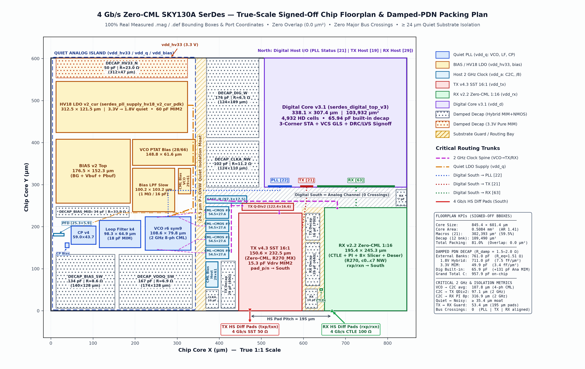

# 4 Gb/s Zero-CML SKY130A SerDes 片级物理规划与阻尼 PDN 填充方案（`serdes_chip_floorplan`）

> **结论**：基于磁盘全部已签核宏的真实 `.mag` / `.def` 几何边界框与外边界引脚坐标，完成完整 **4 Gb/s Zero-CML SKY130A SerDes** 片级 1:1 真比例物理规划与阻尼 PDN 去耦填充：
> - **核心芯片尺寸**：**`845.40 × 601.40 µm = 508,423.6 µm²（0.5084 mm²，长宽比 1.41）`**；
> - **零重叠与高填充率**：21 个已签核功能宏合计 **`302,392.6 µm²`（`59.48%`）** + 12 块阻尼 PDN 去耦阵列 **`109,489.5 µm²`（`21.54%`）** → 总硅片填充率 **`81.01%`**，严格 **`overlap_area = 0.0 µm²`**；
> - **阻尼 PDN 去耦超额达标**：外置阻尼去耦 **`760.95 pF`**（1.8 V 混合堆叠 `MIM1+MIM2`-over-NMOS **`711.01 pF`** + 3.3 V 纯堆叠 `MIM1+MIM2` **`49.94 pF`**），统一阻尼时间常数 $\tau = 1.15\text{ ns}$ 对应片级并联等效阻尼 **`R_eq = 1.511 Ω`**（1.8 V 轨 **`1.617 Ω`**，精准落入 `stability_pdn_20261123` 验证的 `1.5–2.0 Ω` 最优窗口）；叠加数字宏内置 `65.94 pF` 及模拟宏内置 `131.0 pF` MIM，片上总电容达 **`957.89 pF`**；
> - **零主总线交叉与强衬底隔离**：数字核 v3.1 南侧引脚段（西→东：`PLL [22]` | `TX [21]` | `RX [63]`）经 `48 µm` 水平通道直连下方 `PLL | TX | RX` 模拟阵列，**零主总线交叉**；`TX v4.3`（`pad_p/pad_n`，`y = 1.22 µm`）与 `RX v2.2`（`rxp/rxn`，`y = 0.90 µm`）差分高速焊盘直出芯片南侧高速外边界，中心距 **`195.0 µm`**（中间夹 `53.4 µm` 屏蔽隔离与局部去耦带）；安静模拟岛（`LDO/BIAS/VCO/LF/CP`）与全部数字/时钟/TX 噪声区由 **`24.5 µm` 贯通 P+/DNW 隔离沟**隔开（最小实测间距 **`35.40 µm`**，数字核距安静岛 **`164.20 µm`**）；
> - **极短 2 GHz 时钟路径**：`VCO r6` 四相差分 CML 至 4× `CML→CMOS r5` 无交叉配对平均曼哈顿长仅 **`107.8 µm`**，`CML→CMOS` 至 `TX Q-Div2`（`R180` 对齐）仅 **`97.1 µm`**（至 `TX phi0..270` 仅 `8.7 µm`），至 `RX v2.2 PI (c0..c7)` 仅 **`316.9 µm`**。

**生成脚本与数据产物**：
- 规划与几何校验脚本：[verification/layout/plan_chip_floorplan.py](../../verification/layout/plan_chip_floorplan.py)（直接解析各 `.mag` / `.def` 原始边界与端口，零 `ngspice`）
- 定量指标 JSON：`results/layout/chip_floorplan_20261123/summary.json`
- PDN 稳定性依据：`results/verification/stability_pdn_20261123/summary.json`

---

## 1. 已签核宏物理清单（100% 实测 `.mag` / `.def` 尺寸）

所有 21 个实例均对应仓库中已通过 `DRC = 0` 与 `LVS = MATCH` 的 SKY130A 物理交付物：

| 实例名 | 签核单元名 | 电源域 | 方向 | 原始 `W × H` (µm) | 摆放边界 `[x0, y0, x1, y1]` (µm) | 面积 (µm²) | M5 占比 | 端口数 | 内置电容 (pF) |
|---|---|---|---|---:|---|---:|---:|---:|---:|
| `digital_top_v3` | `serdes_digital_top_v3` | `vdd_d` | `R0` | `338.10 × 307.40` | `[497.0, 294.0, 835.1, 601.4]` | `103,931.9` | `1.39%` (WL) | `249` | `65.94` |
| `rx_cmos_top` | `serdes_rx_cmos_top_pdk` | `vdd_rx` | `R270` | `245.30 × 195.40` | `[650.0, 0.0, 845.4, 245.3]` | `47,931.6` | `13.00%` | `76` | `3.40` |
| `ldo_v2_cur` | `serdes_pll_supply_hv18_v2_cur_pdk` | `vdd_hv33` | `R0` | `312.52 × 121.46` | `[12.0, 424.0, 324.5, 545.5]` | `37,958.7` | `19.06%` | `13` | `60.00` |
| `tx_sst_top` | `serdes_tx_sst_top_pdk` | `vdd_tx` | `R270_MX` | `232.52 × 150.58` | `[446.0, 0.0, 596.6, 232.5]` | `35,012.9` | `29.57%` | `38` | `15.30` |
| `bias_top_v2` | `serdes_bias_top_v2_pdk` | `vdd_bias` | `R0` | `176.53 × 152.26` | `[12.0, 256.0, 188.5, 408.3]` | `26,878.5` | `1.29%` | `20` | `8.00` |
| `bias_lpf_slow` | `serdes_pll_bias_lowpass_slow_r4_pdk` | `vdd_q` | `R0` | `100.18 × 103.21` | `[194.0, 236.0, 294.2, 339.2]` | `10,339.6` | `0.00%` | `3` | `16.00` |
| `vco_ptat_bias` | `pll_vco_ptat_bias_pdk` | `vdd_bias` | `R0` | `148.80 × 61.60` | `[194.0, 346.0, 342.8, 407.6]` | `9,166.1` | `0.00%` | `4` | `0.00` |
| `vco_r6_sym9` | `pll_vco_core_sym9_s32p5_clean` | `vdd_q` | `R0` | `108.60 × 79.80` | `[224.0, 144.0, 332.6, 223.8]` | `8,666.3` | `0.00%` | `17` | `0.00` |
| `lf_k4_fused` | `pll_loop_filter_k4_fused_pdk` | `vdd_q` | `R0` | `98.34 × 64.90` | `[115.0, 150.0, 213.3, 214.9]` | `6,382.3` | `7.55%` | `6` | `18.00` |
| `cml2cmos_0..3` (×4) | `serdes_cml_to_cmos_r5_pdk` | `vdd_a` | `R0` | `54.49 × 27.60` | `[368.0, 124..247.6, 422.5]` | `6,015.7` | `0.00%` | `7 × 4` | `0.00` |
| `cp_v4` | `pll_cp_steer_v4_pdk` | `vdd_q` | `R0` | `58.98 × 43.70` | `[48.0, 158.0, 107.0, 201.7]` | `2,577.4` | `0.00%` | `8` | `0.30` |
| `tx_qdiv2` | `serdes_rx_qdiv2_8ph_pdk` | `vdd_tx` | `R180` | `122.40 × 16.57` | `[454.0, 239.0, 576.4, 255.6]` | `2,028.2` | `0.00%` | `15` | `0.00` |
| `bias_cml_vco` | `serdes_bias_cml_v2_pdk` | `vdd_bias` | `R90` | `60.79 × 28.96` | `[303.0, 278.0, 332.0, 338.8]` | `1,760.5` | `10.39%` | `2` | `5.00` |
| `bias_cml_host` | `serdes_bias_cml_v2_pdk` | `vdd_a` | `R90` | `60.79 × 28.96` | `[368.0, 56.0, 397.0, 116.8]` | `1,760.5` | `10.39%` | `2` | `5.00` |
| `div8_saff` | `pll_saff_reclock_prescaler8_2g_pdk` | `vdd_a` | `R0` | `97.34 × 17.52` | `[368.0, 256.0, 465.3, 273.5]` | `1,705.3` | `0.00%` | `10` | `0.00` |
| `pfd_sc_dly` | `pll_pfd_sc_dly_pdk` | `vdd_a` | `R0` | `25.25 × 5.94` | `[6.0, 178.0, 31.3, 183.9]` | `150.0` | `0.00%` | `7` | `0.00` |
| `bias_cp_v2` | `serdes_bias_cp_v2_pdk` | `vdd_q` | `R0` | `8.89 × 11.58` | `[34.0, 150.0, 42.9, 161.6]` | `103.0` | `0.00%` | `4` | `0.00` |
| `bias_ctle_v2` | `serdes_bias_ctle_v2_pdk` | `vdd_rx` | `R0` | `6.41 × 3.79` | `[639.0, 49.0, 645.4, 52.8]` | `24.3` | `0.00%` | `2` | `0.00` |
| **功能宏合计（21 例）** | — | 7 域 | — | — | `[6.0, 0.0, 845.4, 601.4]` | **`302,392.6`** | — | — | **`196.94`** |

*注：`digital_top_v3` 的 M5 占比按 OpenROAD 金属线长比（`1,787 / 128,602 µm`）计；其余模拟宏按 `.mag` 实测 `metal5` 矩形总面积占宏面积比例计。`tx_qdiv2` 直接复用已签核 `serdes_rx_qdiv2_8ph_pdk`（`R180` 摆放使其 2 GHz 输入 `dp/dn/ep/en` 朝西直面 4× `CML→CMOS`，1 GHz 四相输出 `ckd0..3` 朝南直对 `TX phi0..270`）。*

---

## 2. 引脚对齐、隔离沟与关键互连曼哈顿线长

### 2.1 引脚对齐与零交叉审计
- **数字核 v3.1 南边界（`y = 294.0 µm`，共 106 信号引脚）**：
  - `PLL [22]`：`x ∈ [505.51, 562.55] µm` → 沿 `48 µm` 水平通道上层轨道直向西入 PLL；
  - `TX [21]`：`x ∈ [581.87, 613.15] µm` → 垂直向南直抵 `TX v4.3` 上东边 `din0..15`（`x = 596.3 µm`）；
  - `RX [63]`：`x ∈ [622.35, 807.27] µm` → 垂直向南直抵 `RX v2.2`（`x ∈ [650.0, 845.4] µm`）；
  - 三组总线在 X 轴严格单调不交叠（`562.55 < 581.87`、`613.15 < 622.35`），实现 **0 主总线交叉**。
- **衬底隔离沟实测间距**：
  - 安静模拟岛（`vdd_hv33` / `vdd_q` / `vdd_bias`）↔ 任意主要开关噪声块：**`≥ 35.40 µm`**（最近对为 `vco_r6_sym9 ↔ cml2cmos_0`，中间含 `24.5 µm` 贯通 P+/DNW 隔离沟）；
  - `Digital v3.1` ↔ 安静模拟岛：**`164.20 µm`**（中间被 `DECAP_DIG_W` / `DECAP_CLKA_NW` 与隔离沟双层缓冲）；
  - `PFD`（`vdd_a`）↔ `CP v4`（`vdd_q`）：**`16.75 µm`** 局部保护环间距；
  - `TX v4.3` ↔ `RX v2.2`：**`53.42 µm`** 屏蔽隔离与局部去耦带（两侧各留 `~9–10 µm` P+ 保护环）。

### 2.2 关键互连端口到端口曼哈顿长度

| 关键信号 / 电源网络 | 起点 → 终点 | 实测曼哈顿长度 (µm) | 物理路由说明 |
|---|---|---:|---|
| **2 GHz VCO → 4× CML→CMOS** | `vco_r6.b0..b3` → `cml2cmos_3..0` | **`107.8`** 均值（`85.9–129.8`） | 非交叉上下对应配对（`b0→#3, b1→#2, b2→#1, b3→#0`），跨安静隔离沟 |
| **2 GHz CML→CMOS → TX Q-Div2** | `cml2cmos` 东输出 → `tx_qdiv2.dp/dn/ep/en` | **`97.1`** | `tx_qdiv2` `R180` 西向进钟，水平直连 |
| **1 GHz TX Q-Div2 → TX SST** | `tx_qdiv2.ckd0..3` → `tx_sst_top.phi0..270` | **`8.7`** | 南向直落，零弯折 |
| **2 GHz VCO → TX 总时钟链** | `VCO → C2C → TX Q-Div2 → TX` | **`213.7`** | M4/M5 两侧 VSS 屏蔽干线 |
| **2 GHz CML→CMOS → RX PI (8 相)** | `cml2cmos` 东输出 → `rx_cmos_top.c0..c7` | **`316.9`** | `RX R270` 将 `c0..c7` 置于西北角，距时钟源最短 |
| **2 GHz VCO → RX PI 总时钟链** | `VCO → C2C → RX PI (c0..c7)` | **`424.7`** | 全程沿 `y ≈ 260 µm` 屏蔽时钟干道走线 |
| **2 GHz CML→CMOS → PLL ÷8** | `cml2cmos_3` → `div8_saff.clkp/n` | **`82.1`** | 紧贴时钟列北端 |
| **PLL 环路前向链路** | `PFD → CP` / `CP → LF` / `LF → VCO` | **`24.0` / `89.7` / `158.1`** | 严格西→东直线流，最小化高阻 `ctrl` 寄生 |
| **LDO 安静输出 → VCO** | `ldo_v2_cur.quiet` → `vco_r6.vdd_q` | **`310.6`** | 安静岛东缘宽 M5 干线直落 |
| **BIAS → LDO / PTAT / CP** | `vbg` / `i_ldo0` / `vgi,vg` / `icp` | **`133.6` / `124.0` / `35.0` / `163.9`** | 高阻 `vgi/vg` 仅跨 `5.5 µm` 宏缝直入 `vco_ptat_bias` |
| **数字南边界 → TX / RX 控制** | `TX [21] → din` / `RX [63] → PI ctrl` | **`120.2` / `111.8`** | 垂直直下通道，无跨区绕行 |
| **4 Gb/s 高速焊盘距南边界 / 间距** | `TX pad_p/n` / `RX rxp/rxn` | **`1.22` / `0.90`**（间距 **`195.0`**） | 差分高速焊盘直出芯片南外缘，低 TX→RX 串扰 |

---

## 3. SKY130A 阻尼 PDN 去耦预算与空腔填充明细

依据 `results/verification/stability_pdn_20261123/summary.json`（$L_{\text{pkg}} = 1.5\text{ nH}$、$C_{\text{int}} = 260\text{ pF}$）：无阻尼去耦时 PDN 峰值阻抗达 `7.028 Ω`、30 mA 250 MHz 突发纹波达 `156.33 mVpp`（突发后振铃 `32.75 mVpp`）；加入 **`≥ 500 pF`、`R_damp = 1.5–2.0 Ω`** 片上阻尼去耦后，峰值阻抗压至 **`2.018 Ω`**（−71%），突发纹波压至 **`48.46 mVpp`**（−69%），突发后振铃压至 **`1.26 mVpp`**（−96%）。

### 3.1 SKY130A 两种工艺实现面积对比（500 pF 基准）

| 工艺实现方式 | 有效面密度 (fF/µm²) | 500 pF 所需宏面积 (µm²) | SOA 与适用电源域 |
|---|---:|---:|---|
| **纯双层堆叠 MIM**（`cap_mim_m3_1 + cap_mim_m3_2`，含 `≤29.4 µm` 分片/巷道/`R_damp` 85% 打包率） | `3.40`（有效极板 `4.00`） | `147,059`（有效极板 `125,000`） | 严格无薄栅氧，**3.3 V `vdd_hv33` 必选** |
| **混合 MIM-over-NMOS**（M3–M5 堆叠 `MIM1+MIM2` `3.40` + M1–M2 1.8 V `nfet_01v8` `4.10` + 多晶 `R_damp`） | **`7.50`** | **`66,667`**（缩减 **2.21×**） | 严格满足 `1.8 V` SOA，用于全部 `1.8 V` 轨 |

### 3.2 12 块空腔阻尼去耦阵列明细（`overlap = 0.0 µm²`，$\tau_i = R_i C_i = 1.15\text{ ns}$）

| 去耦块名 | 电源域 | 工艺类型 | 尺寸 `W × H` (µm) | 面积 (µm²) | 电容 (pF) | 串联 `R_damp` (Ω) | 物理空腔位置 |
|---|---|---|---:|---:|---:|---:|---|
| `DECAP_HV33_N` | `vdd_hv33` | 纯堆叠 MIM (`3.40`) | `312.5 × 47.0` | `14,687.5` | **`49.94`** | `23.03` | `LDO v2_cur` 北侧紧贴 `vin` |
| `DECAP_VDDQ_SW` | `vdd_q` | 混合 MIM+NMOS (`7.50`) | `174.0 × 128.0` | `22,272.0` | **`167.04`** | `6.88` | 安静岛西南角 `LF/VCO` 正下方 |
| `DECAP_BIAS_SW` | `vdd_bias` | 混合 MIM+NMOS (`7.50`) | `140.0 × 128.0` | `17,920.0` | **`134.40`** | `8.56` | 安静岛最西南空腔 |
| `DECAP_BIAS_MID` | `vdd_bias` | 混合 MIM+NMOS (`7.50`) | `174.0 × 26.0` | `4,524.0` | **`33.93`** | `33.89` | `BIAS v2` 与 `CP/LF` 之间夹缝 |
| `DECAP_DIG_W` | `vdd_d` | 混合 MIM+NMOS (`7.50`) | `124.0 × 189.0` | `23,436.0` | **`175.77`** | `6.54` | 数字核西侧主电源环旁 |
| `DECAP_CLKA_NW` | `vdd_a` | 混合 MIM+NMOS (`7.50`) | `124.0 × 110.0` | `13,640.0` | **`102.30`** | `11.24` | `DIV8/CML→CMOS` 正北方 |
| `DECAP_CLKA_S` | `vdd_a` | 混合 MIM+NMOS (`7.50`) | `30.0 × 44.0` | `1,320.0` | **`9.90`** | `116.16` | `bias_cml_host` 南方空腔 |
| `DECAP_TX_W` | `vdd_tx` | 混合 MIM+NMOS (`7.50`) | `34.0 × 112.0` | `3,808.0` | **`28.56`** | `40.27` | `TX v4.3` 西侧 `vdd/vdrv` 旁 |
| `DECAP_TX_E` | `vdd_tx` | 混合 MIM+NMOS (`7.50`) | `34.0 × 64.0` | `2,176.0` | **`16.32`** | `70.47` | `TX↔RX` 屏蔽隔离带上段 |
| `DECAP_RX_W1` | `vdd_rx` | 混合 MIM+NMOS (`7.50`) | `34.0 × 102.0` | `3,468.0` | **`26.01`** | `44.21` | `TX↔RX` 屏蔽隔离带中段 |
| `DECAP_RX_W2` | `vdd_rx` | 混合 MIM+NMOS (`7.50`) | `28.0 × 46.0` | `1,288.0` | **`9.66`** | `119.05` | `TX↔RX` 屏蔽隔离带下段 |
| `DECAP_RX_NE` | `vdd_rx` | 混合 MIM+NMOS (`7.50`) | `25.0 × 38.0` | `950.0` | **`7.13`** | `161.29` | `RX` 东北角（数字引脚东侧空位） |
| **外置阻尼去耦合计** | **全 7 域** | **1× 纯 MIM + 11× 混合** | — | **`109,489.5`** | **`760.95`** | **`1.511`（并联）** | **1.8 V 轨并联 `R_eq = 1.617 Ω`** |

### 3.3 分电源域功耗与片上电容汇总

| 电源域 | 功能宏数 | 功能宏面积 (µm²) | 估算 TT 功耗 (mW) | 宏内置电容 (pF) | 外置阻尼去耦 (pF) | 域总电容 (pF) | 域并联 `R_damp` (Ω) |
|---|---:|---:|---:|---:|---:|---:|---:|
| `vdd_hv33` (3.3 V) | 1 (`LDO`) | `37,958.7` | `21.6`（含 `vdd_q`） | `60.00` (输出侧) | `49.94` | `49.94` (输入) | `23.03` |
| `vdd_q` (1.8 V 安静) | 5 (`VCO/LF/CP/LPF`) | `28,068.5` | `12.6`（由 LDO 供给） | `34.30` (+60 LDO) | `167.04` | `261.34` | `6.88` |
| `vdd_bias` (1.8 V) | 3 (`BIAS/PTAT/CMLb`) | `37,805.0` | `0.9` | `13.00` | `168.33` | `181.33` | `6.83` |
| `vdd_a` (1.8 V 时钟) | 7 (`4×C2C/DIV8/PFD`) | `9,631.5` | `6.5` | `5.00` | `112.20` | `117.20` | `10.25` |
| `vdd_tx` (1.8 V) | 2 (`TX SST + QDiv2`) | `37,041.0` | `15.2` | `15.30` | `44.88` | `60.18` | `25.63` |
| `vdd_rx` (1.8 V) | 2 (`RX CMOS + CTLEb`) | `47,955.9` | `19.1` | `3.40` | `42.80` | `46.20` | `26.87` |
| `vdd_d` (1.8 V 数字) | 1 (`Digital v3.1`) | `103,931.9` | `4.2` | `65.94` | `175.77` | `241.71` | `6.54` |
| **全片合计** | **21** | **`302,392.6`** | **`~67.5` mW**（净） | **`196.94`** | **`760.95`** | **`957.89`** | **`1.511`（1.8 V: `1.617`）** |

---

## 4. 适用边界与下一步顶层集成

1. **当前适用边界**：本规划基于全部 21 个已签核宏的真实 `.mag` / `.def` 物理尺寸与外边界端口，尚未包含外圈 ESD / Padring（`caravel` / 40-pin / flip-chip 焊盘环）及顶层 M4/M5 实体金属布线提取。
2. **下一步物理集成顺序**：
   - 生成 `DECAP_HYBRID`（M3–M5 堆叠 MIM + M1–M2 NMOS + `res_generic_po` `R_damp`）与 `DECAP_HV33_MIM` 两个参数化 PDK 宏并过 DRC/LVS；
   - 按 `summary.json` 中的精确坐标与方向在 Magic 中装配 `serdes_chip_top.mag`，完成 `24.5 µm` 安静隔离沟双 P+/DNW 环与 `48 µm` 数字↔模拟通道布线；
   - 优先提取 `VCO → 4× CML→CMOS → TX Q-Div2 / RX PI` 2 GHz 屏蔽时钟干线及顶层 M5 电源网 RCX，复核静态 IR 压降与 2 GHz 8 相偏斜。
