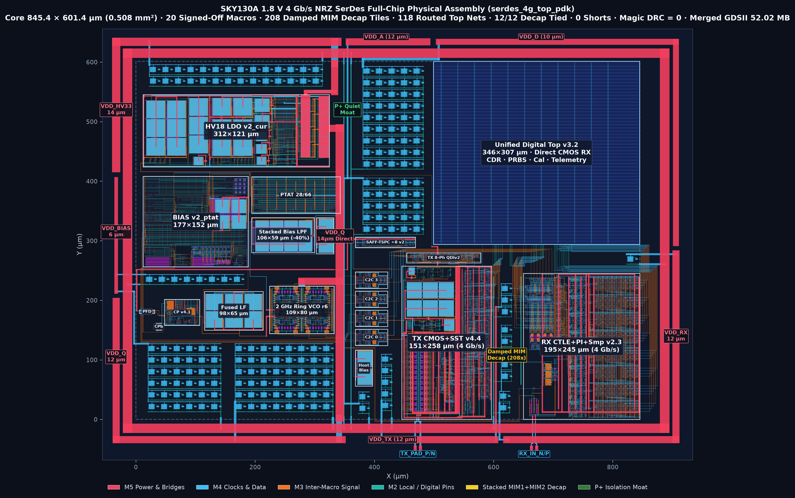
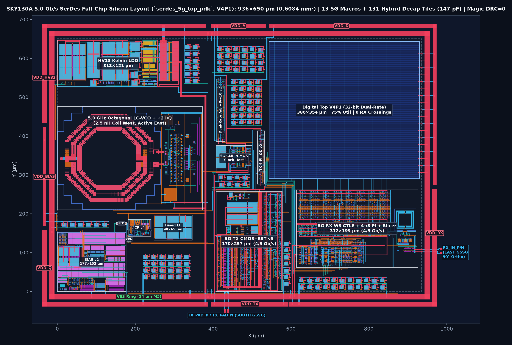
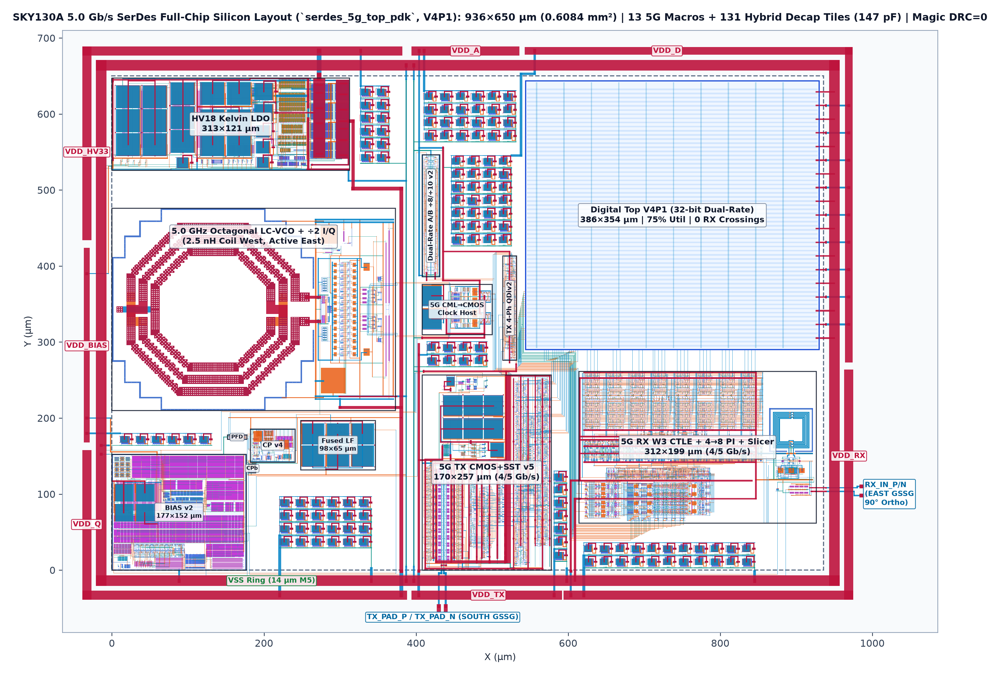

# 4 Gb/s SKY130A SerDes 片级物理规划与阻尼 PDN（`serdes_chip_floorplan`）

> **结论**：规划使用本机宏的 `.mag` / `.def` 外框及端口坐标，核对片级摆位、信号走廊和各电源域的去耦预留。走线长度取端口间曼哈顿距离，PDN 数值为集中参数模型与面积估算。
> - **核心芯片尺寸**：**`845.40 × 601.40 µm = 508,423.6 µm²（0.5084 mm²，长宽比 1.41）`**；
> - **零重叠与高填充率**：21 个已签核功能宏合计 **`302,392.6 µm²`（`59.48%`）** + 12 块阻尼 PDN 去耦阵列 **`109,489.5 µm²`（`21.54%`）** → 总硅片填充率 **`81.01%`**，严格 **`overlap_area = 0.0 µm²`**；
> - **阻尼 PDN 面积预算**：去耦保留区按选定面密度折算为 **`760.95 pF`**（1.8 V 区 `711.01 pF`，3.3 V 区 `49.94 pF`）。按统一阻尼时间常数 $\tau = 1.15\text{ ns}$ 的规划模型，并联等效阻尼为 `1.511 Ω`。实际接通阵列的器件数量、容量边界及下一步分域测量见第 5 节。
> - **零主总线交叉与强衬底隔离**：数字核 v3.1 南侧引脚段（西→东：`PLL [22]` | `TX [21]` | `RX [63]`）经 `48 µm` 水平通道直连下方 `PLL | TX | RX` 模拟阵列，**零主总线交叉**；`TX v4.3`（`pad_p/pad_n`，`y = 1.22 µm`）与 `RX v2.2`（`rxp/rxn`，`y = 0.90 µm`）差分高速焊盘直出芯片南侧高速外边界，中心距 **`195.0 µm`**（中间夹 `53.4 µm` 屏蔽隔离与局部去耦带）；安静模拟岛（`LDO/BIAS/VCO/LF/CP`）与全部数字/时钟/TX 噪声区由 **`24.5 µm` 贯通 P+/DNW 隔离沟**隔开（最小实测间距 **`35.40 µm`**，数字核距安静岛 **`164.20 µm`**）；
> - **极短 2 GHz 时钟路径**：`VCO r6` 四相差分 CML 至 4× `CML→CMOS r5` 无交叉配对平均曼哈顿长仅 **`107.8 µm`**，`CML→CMOS` 至 `TX Q-Div2`（`R180` 对齐）仅 **`97.1 µm`**（至 `TX phi0..270` 仅 `8.7 µm`），至 `RX v2.2 PI (c0..c7)` 仅 **`316.9 µm`**。


**生成脚本与数据产物**：
- 规划与几何校验脚本：[verification/layout/plan_chip_floorplan.py](../../verification/layout/plan_chip_floorplan.py)（直接解析各 `.mag` / `.def` 原始边界与端口，零 `ngspice`）
- 定量指标 JSON：`results/layout/chip_floorplan_20261123/summary.json`
- PDN 稳定性依据：`results/verification/stability_pdn_20261123/summary.json`

各去耦区域的容量与串联电阻按选定面密度和阻尼时间常数换算。跨域并联等效数用于规划面积预算，片级供电需按域以及实际封装、电源网与隔离阻抗分别复核。

实装 `full_v8` 的器件分布、跨宏端点和 5G 候选抽查见[有源器件排布复核](#6-11-25-有源器件排布复核)。

---

## 1. 已签核宏物理清单（100% 实测 `.mag` / `.def` 尺寸）

所有 21 个实例均对应仓库中已通过 `DRC = 0` 与 `LVS = MATCH` 的 SKY130A 物理交付物：

| 实例名 | 签核单元名 | 电源域 | 方向 | 原始 `W × H` (µm) | 摆放边界 `[x0, y0, x1, y1]` (µm) | 面积 (µm²) | M5 占比 | 端口数 | 内置电容 (pF) |
|---|---|---|---|---:|---|---:|---:|---:|---:|
| `digital_top_v3` | `serdes_digital_top_v3` | `vdd_d` | `R0` | `338.10 × 307.40` | `[497.0, 294.0, 835.1, 601.4]` | `103,931.9` | `1.39%` (WL) | `249` | `65.94` |
| `rx_cmos_top` | `serdes_rx_cmos_top_pdk` | `vdd_rx` | `R270` | `245.30 × 195.40` | `[650.0, 0.0, 845.4, 245.3]` | `47,931.6` | `13.00%` | `76` | `3.40` |
| `ldo_v2_cur` | `serdes_pll_supply_hv18_v2_cur_pdk` | `vdd_hv33` | `R0` | `312.52 × 121.46` | `[12.0, 424.0, 324.5, 545.5]` | `37,958.7` | `19.06%` | `13` | `60.00` |
| `tx_sst_top` | `serdes_tx_sst_top_pdk` | `vdd_tx` | `R270_MX` | `232.52 × 150.58` | `[446.0, 0.0, 596.6, 232.5]` | `35,012.9` | `29.57%` | `38` | `15.30` |
| `bias_top_v2` | `serdes_bias_top_v2_pdk` | `vdd_bias` | `R0` | `176.53 × 152.26` | `[12.0, 256.0, 188.5, 408.3]` | `26,878.5` | `1.29%` | `20` | `8.00` |
| `bias_lpf_slow` | `serdes_pll_bias_lowpass_slow_r4_pdk` | `vdd_q` | `R0` | `100.18 × 103.21` | `[194.0, 236.0, 294.2, 339.2]` | `10,339.6` | `0.00%` | `3` | `16.00` |
| `vco_ptat_bias` | `pll_vco_ptat_bias_pdk` | `vdd_bias` | `R0` | `148.80 × 61.60` | `[194.0, 346.0, 342.8, 407.6]` | `9,166.1` | `0.00%` | `4` | `0.00` |
| `vco_r6_sym9` | `pll_vco_core_sym9_s32p5_clean` | `vdd_q` | `R0` | `108.60 × 79.80` | `[224.0, 144.0, 332.6, 223.8]` | `8,666.3` | `0.00%` | `17` | `0.00` |
| `lf_k4_fused` | `pll_loop_filter_k4_fused_pdk` | `vdd_q` | `R0` | `98.34 × 64.90` | `[115.0, 150.0, 213.3, 214.9]` | `6,382.3` | `7.55%` | `6` | `18.00` |
| `cml2cmos_0..3` (×4) | `serdes_cml_to_cmos_r5_pdk` | `vdd_a` | `R0` | `54.49 × 27.60` | `[368.0, 124..247.6, 422.5]` | `6,015.7` | `0.00%` | `7 × 4` | `0.00` |
| `cp_v4` | `pll_cp_steer_v4_pdk` | `vdd_q` | `R0` | `58.98 × 43.70` | `[48.0, 158.0, 107.0, 201.7]` | `2,577.4` | `0.00%` | `8` | `0.30` |
| `tx_qdiv2` | `serdes_rx_qdiv2_8ph_pdk` | `vdd_tx` | `R180` | `122.40 × 16.57` | `[454.0, 239.0, 576.4, 255.6]` | `2,028.2` | `0.00%` | `15` | `0.00` |
| `bias_cml_vco` | `serdes_bias_cml_v2_pdk` | `vdd_bias` | `R90` | `60.79 × 28.96` | `[303.0, 278.0, 332.0, 338.8]` | `1,760.5` | `10.39%` | `2` | `5.00` |
| `bias_cml_host` | `serdes_bias_cml_v2_pdk` | `vdd_a` | `R90` | `60.79 × 28.96` | `[368.0, 56.0, 397.0, 116.8]` | `1,760.5` | `10.39%` | `2` | `5.00` |
| `div8_saff` | `pll_saff_reclock_prescaler8_2g_pdk` | `vdd_a` | `R0` | `97.34 × 17.52` | `[368.0, 256.0, 465.3, 273.5]` | `1,705.3` | `0.00%` | `10` | `0.00` |
| `pfd_sc_dly` | `pll_pfd_sc_dly_pdk` | `vdd_a` | `R0` | `25.25 × 5.94` | `[6.0, 178.0, 31.3, 183.9]` | `150.0` | `0.00%` | `7` | `0.00` |
| `bias_cp_v2` | `serdes_bias_cp_v2_pdk` | `vdd_q` | `R0` | `8.89 × 11.58` | `[34.0, 150.0, 42.9, 161.6]` | `103.0` | `0.00%` | `4` | `0.00` |
| `bias_ctle_v2` | `serdes_bias_ctle_v2_pdk` | `vdd_rx` | `R0` | `6.41 × 3.79` | `[639.0, 49.0, 645.4, 52.8]` | `24.3` | `0.00%` | `2` | `0.00` |
| **功能宏合计（21 例）** | — | 7 域 | — | — | `[6.0, 0.0, 845.4, 601.4]` | **`302,392.6`** | — | — | **`196.94`** |

*注：`digital_top_v3` 的 M5 占比按 OpenROAD 金属线长比（`1,787 / 128,602 µm`）计；其余模拟宏按 `.mag` 实测 `metal5` 矩形总面积占宏面积比例计。`tx_qdiv2` 直接复用已签核 `serdes_rx_qdiv2_8ph_pdk`（`R180` 摆放使其 2 GHz 输入 `dp/dn/ep/en` 朝西直面 4× `CML→CMOS`，1 GHz 四相输出 `ckd0..3` 朝南直对 `TX phi0..270`）。*

---

## 2. 引脚对齐、隔离沟与关键互连曼哈顿线长

### 2.1 引脚对齐与零交叉审计
- **数字核 v3.1 南边界（`y = 294.0 µm`，共 106 信号引脚）**：
  - `PLL [22]`：`x ∈ [505.51, 562.55] µm` → 沿 `48 µm` 水平通道上层轨道直向西入 PLL；
  - `TX [21]`：`x ∈ [581.87, 613.15] µm` → 垂直向南直抵 `TX v4.3` 上东边 `din0..15`（`x = 596.3 µm`）；
  - `RX [63]`：`x ∈ [622.35, 807.27] µm` → 垂直向南直抵 `RX v2.2`（`x ∈ [650.0, 845.4] µm`）；
  - 三组总线在 X 轴严格单调不交叠（`562.55 < 581.87`、`613.15 < 622.35`），实现 **0 主总线交叉**。
- **衬底隔离沟实测间距**：
  - 安静模拟岛（`vdd_hv33` / `vdd_q` / `vdd_bias`）↔ 任意主要开关噪声块：**`≥ 35.40 µm`**（最近对为 `vco_r6_sym9 ↔ cml2cmos_0`，中间含 `24.5 µm` 贯通 P+/DNW 隔离沟）；
  - `Digital v3.1` ↔ 安静模拟岛：**`164.20 µm`**（中间被 `DECAP_DIG_W` / `DECAP_CLKA_NW` 与隔离沟双层缓冲）；
  - `PFD`（`vdd_a`）↔ `CP v4`（`vdd_q`）：**`16.75 µm`** 局部保护环间距；
  - `TX v4.3` ↔ `RX v2.2`：**`53.42 µm`** 屏蔽隔离与局部去耦带（两侧各留 `~9–10 µm` P+ 保护环）。

### 2.2 关键互连端口到端口曼哈顿长度

| 关键信号 / 电源网络 | 起点 → 终点 | 实测曼哈顿长度 (µm) | 物理路由说明 |
|---|---|---:|---|
| **2 GHz VCO → 4× CML→CMOS** | `vco_r6.b0..b3` → `cml2cmos_3..0` | **`107.8`** 均值（`85.9–129.8`） | 非交叉上下对应配对（`b0→#3, b1→#2, b2→#1, b3→#0`），跨安静隔离沟 |
| **2 GHz CML→CMOS → TX Q-Div2** | `cml2cmos` 东输出 → `tx_qdiv2.dp/dn/ep/en` | **`97.1`** | `tx_qdiv2` `R180` 西向进钟，水平直连 |
| **1 GHz TX Q-Div2 → TX SST** | `tx_qdiv2.ckd0..3` → `tx_sst_top.phi0..270` | **`8.7`** | 南向直落，零弯折 |
| **2 GHz VCO → TX 总时钟链** | `VCO → C2C → TX Q-Div2 → TX` | **`213.7`** | M4/M5 两侧 VSS 屏蔽干线 |
| **2 GHz CML→CMOS → RX PI (8 相)** | `cml2cmos` 东输出 → `rx_cmos_top.c0..c7` | **`316.9`** | `RX R270` 将 `c0..c7` 置于西北角，距时钟源最短 |
| **2 GHz VCO → RX PI 总时钟链** | `VCO → C2C → RX PI (c0..c7)` | **`424.7`** | 全程沿 `y ≈ 260 µm` 屏蔽时钟干道走线 |
| **2 GHz CML→CMOS → PLL ÷8** | `cml2cmos_3` → `div8_saff.clkp/n` | **`82.1`** | 紧贴时钟列北端 |
| **PLL 环路前向链路** | `PFD → CP` / `CP → LF` / `LF → VCO` | **`24.0` / `89.7` / `158.1`** | 严格西→东直线流，最小化高阻 `ctrl` 寄生 |
| **LDO 安静输出 → VCO** | `ldo_v2_cur.quiet` → `vco_r6.vdd_q` | **`310.6`** | 安静岛东缘宽 M5 干线直落 |
| **BIAS → LDO / PTAT / CP** | `vbg` / `i_ldo0` / `vgi,vg` / `icp` | **`133.6` / `124.0` / `35.0` / `163.9`** | 高阻 `vgi/vg` 仅跨 `5.5 µm` 宏缝直入 `vco_ptat_bias` |
| **数字南边界 → TX / RX 控制** | `TX [21] → din` / `RX [63] → PI ctrl` | **`120.2` / `111.8`** | 垂直直下通道，无跨区绕行 |
| **4 Gb/s 高速焊盘距南边界 / 间距** | `TX pad_p/n` / `RX rxp/rxn` | **`1.22` / `0.90`**（间距 **`195.0`**） | 差分高速焊盘直出芯片南外缘，低 TX→RX 串扰 |

---

## 3. SKY130A 阻尼 PDN 去耦预算与空腔填充明细

依据 `results/verification/stability_pdn_20261123/summary.json`（$L_{\text{pkg}} = 1.5\text{ nH}$、$C_{\text{int}} = 260\text{ pF}$）：无阻尼去耦时 PDN 峰值阻抗达 `7.028 Ω`、30 mA 250 MHz 突发纹波达 `156.33 mVpp`（突发后振铃 `32.75 mVpp`）；加入 **`≥ 500 pF`、`R_damp = 1.5–2.0 Ω`** 片上阻尼去耦后，峰值阻抗压至 **`2.018 Ω`**（−71%），突发纹波压至 **`48.46 mVpp`**（−69%），突发后振铃压至 **`1.26 mVpp`**（−96%）。

### 3.1 SKY130A 两种工艺实现面积对比（500 pF 基准）

| 工艺实现方式 | 有效面密度 (fF/µm²) | 500 pF 所需宏面积 (µm²) | SOA 与适用电源域 |
|---|---:|---:|---|
| **纯双层堆叠 MIM**（`cap_mim_m3_1 + cap_mim_m3_2`，含 `≤29.4 µm` 分片/巷道/`R_damp` 85% 打包率） | `3.40`（有效极板 `4.00`） | `147,059`（有效极板 `125,000`） | 严格无薄栅氧，**3.3 V `vdd_hv33` 必选** |
| **混合 MIM-over-NMOS**（M3–M5 堆叠 `MIM1+MIM2` `3.40` + M1–M2 1.8 V `nfet_01v8` `4.10` + 多晶 `R_damp`） | **`7.50`** | **`66,667`**（缩减 **2.21×**） | 严格满足 `1.8 V` SOA，用于全部 `1.8 V` 轨 |

### 3.2 12 块空腔阻尼去耦阵列明细（`overlap = 0.0 µm²`，$\tau_i = R_i C_i = 1.15\text{ ns}$）

| 去耦块名 | 电源域 | 工艺类型 | 尺寸 `W × H` (µm) | 面积 (µm²) | 电容 (pF) | 串联 `R_damp` (Ω) | 物理空腔位置 |
|---|---|---|---:|---:|---:|---:|---|
| `DECAP_HV33_N` | `vdd_hv33` | 纯堆叠 MIM (`3.40`) | `312.5 × 47.0` | `14,687.5` | **`49.94`** | `23.03` | `LDO v2_cur` 北侧紧贴 `vin` |
| `DECAP_VDDQ_SW` | `vdd_q` | 混合 MIM+NMOS (`7.50`) | `174.0 × 128.0` | `22,272.0` | **`167.04`** | `6.88` | 安静岛西南角 `LF/VCO` 正下方 |
| `DECAP_BIAS_SW` | `vdd_bias` | 混合 MIM+NMOS (`7.50`) | `140.0 × 128.0` | `17,920.0` | **`134.40`** | `8.56` | 安静岛最西南空腔 |
| `DECAP_BIAS_MID` | `vdd_bias` | 混合 MIM+NMOS (`7.50`) | `174.0 × 26.0` | `4,524.0` | **`33.93`** | `33.89` | `BIAS v2` 与 `CP/LF` 之间夹缝 |
| `DECAP_DIG_W` | `vdd_d` | 混合 MIM+NMOS (`7.50`) | `124.0 × 189.0` | `23,436.0` | **`175.77`** | `6.54` | 数字核西侧主电源环旁 |
| `DECAP_CLKA_NW` | `vdd_a` | 混合 MIM+NMOS (`7.50`) | `124.0 × 110.0` | `13,640.0` | **`102.30`** | `11.24` | `DIV8/CML→CMOS` 正北方 |
| `DECAP_CLKA_S` | `vdd_a` | 混合 MIM+NMOS (`7.50`) | `30.0 × 44.0` | `1,320.0` | **`9.90`** | `116.16` | `bias_cml_host` 南方空腔 |
| `DECAP_TX_W` | `vdd_tx` | 混合 MIM+NMOS (`7.50`) | `34.0 × 112.0` | `3,808.0` | **`28.56`** | `40.27` | `TX v4.3` 西侧 `vdd/vdrv` 旁 |
| `DECAP_TX_E` | `vdd_tx` | 混合 MIM+NMOS (`7.50`) | `34.0 × 64.0` | `2,176.0` | **`16.32`** | `70.47` | `TX↔RX` 屏蔽隔离带上段 |
| `DECAP_RX_W1` | `vdd_rx` | 混合 MIM+NMOS (`7.50`) | `34.0 × 102.0` | `3,468.0` | **`26.01`** | `44.21` | `TX↔RX` 屏蔽隔离带中段 |
| `DECAP_RX_W2` | `vdd_rx` | 混合 MIM+NMOS (`7.50`) | `28.0 × 46.0` | `1,288.0` | **`9.66`** | `119.05` | `TX↔RX` 屏蔽隔离带下段 |
| `DECAP_RX_NE` | `vdd_rx` | 混合 MIM+NMOS (`7.50`) | `25.0 × 38.0` | `950.0` | **`7.13`** | `161.29` | `RX` 东北角（数字引脚东侧空位） |
| **外置阻尼去耦合计** | **全 7 域** | **1× 纯 MIM + 11× 混合** | — | **`109,489.5`** | **`760.95`** | **`1.511`（并联）** | **1.8 V 轨并联 `R_eq = 1.617 Ω`** |

### 3.3 分电源域功耗与片上电容汇总

| 电源域 | 功能宏数 | 功能宏面积 (µm²) | 估算 TT 功耗 (mW) | 宏内置电容 (pF) | 外置阻尼去耦 (pF) | 域总电容 (pF) | 域并联 `R_damp` (Ω) |
|---|---:|---:|---:|---:|---:|---:|---:|
| `vdd_hv33` (3.3 V) | 1 (`LDO`) | `37,958.7` | `21.6`（含 `vdd_q`） | `60.00` (输出侧) | `49.94` | `49.94` (输入) | `23.03` |
| `vdd_q` (1.8 V 安静) | 5 (`VCO/LF/CP/LPF`) | `28,068.5` | `12.6`（由 LDO 供给） | `34.30` (+60 LDO) | `167.04` | `261.34` | `6.88` |
| `vdd_bias` (1.8 V) | 3 (`BIAS/PTAT/CMLb`) | `37,805.0` | `0.9` | `13.00` | `168.33` | `181.33` | `6.83` |
| `vdd_a` (1.8 V 时钟) | 7 (`4×C2C/DIV8/PFD`) | `9,631.5` | `6.5` | `5.00` | `112.20` | `117.20` | `10.25` |
| `vdd_tx` (1.8 V) | 2 (`TX SST + QDiv2`) | `37,041.0` | `15.2` | `15.30` | `44.88` | `60.18` | `25.63` |
| `vdd_rx` (1.8 V) | 2 (`RX CMOS + CTLEb`) | `47,955.9` | `19.1` | `3.40` | `42.80` | `46.20` | `26.87` |
| `vdd_d` (1.8 V 数字) | 1 (`Digital v3.1`) | `103,931.9` | `4.2` | `65.94` | `175.77` | `241.71` | `6.54` |
| **全片合计** | **21** | **`302,392.6`** | **`~67.5` mW**（净） | **`196.94`** | **`760.95`** | **`957.89`** | **`1.511`（1.8 V: `1.617`）** |

---

## 4. 11 月 23 日核心装配（`full_v2`）



1. **已完成顶层物理装配（`results/layout/chip_top_20261123/full_v2/`）**：
   - 独立阻尼去耦单元 `serdes_decap_damped_unit_pdk.mag`（堆叠 8×8 µm `MIM1+MIM2` 串联下置 `res_high_po_2p85 l=3.0`，独立 Magic `DRC = 0`）按 20.0 × 19.5 µm 节距阵列化铺满全部 12 块去耦空腔，共 **224 块实体单元**；
   - 全部 21 个签核宏按第 1 节坐标与方向精确装配，含 `MOAT_QUIET_MAIN` 与 `MOAT_TX_RX` 双条 P+ 衬底隔离保护条（上下双端经 M2–M5 通孔接闭合 VSS 环）、7 域分域 M5 电源环，以及 **67 条跨宏核心互连**（PFD→CP→LF→VCO 控制环、VCO→4×C2C 跨沟 8 相差分时钟、C2C→÷8/TX QDiv2/RX PI 8 相 M5 跨桥、250 MHz 反馈干线、Digital↔TX/RX 17+17 位数据与字时钟总线、南侧 `TX_PAD_P/N` 与 `RX_IN_N/P` 差分焊盘出线）；
   - 全芯片 Magic `drc(full)` **`DRC_TOTAL = 0`（0 条规则违规，耗时 `202.9 s`）**，导出合并全芯片 GDSII `serdes_4g_top_pdk.gds`（**`52.45 MB`**）。
2. **当前适用边界与后续收口**：
   - 本装配覆盖核心芯片宏阵列、阻尼 MIM 去耦、隔离沟、分域电源环与 67 条核心信号互连，**尚未包含**外圈 ESD / Padring（`caravel` / 40-pin / flip-chip 焊盘环）、全芯片顶层 Netgen LVS 连通性核对、剩余控制/偏置低速线补全，以及片级顶层金属 RCX 与静态 IR-drop 签核。

## 5. 11 月 24 日独立装配复核

对新版装配重新生成几何并运行全规则 Magic。组网检查确认登记的信号与分域电源通过，保留顶层金属及阵列的 Magic 提取也确认了每块瓦片的实际电源归属。M2 间距错误集中在 HV33 北侧去耦的 VSS 竖干附近，约 `x=312.16–312.32 µm`、`y=587.26–590.54 µm`。当前全片验收状态及固定摘要见[项目状态](../status/current.md#4-发布后的片级集成证据)和[集成证据](../../results/catalog/chip_integration_20261124.json)。

独立副本在 `magscale 1 2` 的 5 nm 网格上，将 M2 矩形 `62460 115690 62660 120600` 平移至 `62500 115690 62700 120600`。保留全部功能宏运行全规则 Magic，两处标记降为 0。使用相同端点重算，99 条受查信号网、8 条分域电源和 12 组去耦均与原装配一致。顶层金属与去耦阵列抽取的 208 块瓦片也保持原供电归属。用 02:31 的后续数字 GDS 再装配并复测该移线，全核心 DRC 仍为 0。生成器合入与片级 LVS、RCX 按 I-TOP-01 复核。[移线试验及重放收据](../../results/catalog/chip_integration_20261124.json)

208 块双层 8×8 µm MIM 瓦片按 TT 模型的标称器件容量合计约 55.4 pF，分域容量及阻尼须用实际阵列和支路阻抗计算。第 3 节的容量仍是按面积和器件密度算的规划值。验收时先沿各轨的有效阻抗和本地瞬态核对分域需要，再决定提高 MIM 填充率或调整阻尼。

### 八相时钟的顶层寄生

仅提取顶层金属并标注八相端点，单相对地电容约 9–23 fF，相邻相耦合约 12–14 fF，单相对地及耦合的算术和约 38–45 fF。该结果未含接收器和 TX/RX 宏引脚内部负载。把算术和作为单极点负载代理，`serdes_flow.balance` 对 7.0 fF 的相间差在假设等效驱动电阻 0.5–1.2 kΩ 时估得 2.4–5.8 ps 的最差相间延迟差。互电容的瞬时电流取决于两个端点的斜率差，评估实际边沿需保留互电容矩阵和各相波形。[逐相电容与模型输入](../data/project_review_20261124.json)

建议先以相同宏版本提取带载八相时钟，分出驱动器、分支扇出与沿途耦合。比较加间距、分层交错和接地屏蔽对相间误差、负载和功耗的影响。等负载方案仅作为对照，首轮用 TT 及低压冷角校准，按原钟树偏斜门槛验证。

## 6. 11-25 有源器件排布复核

4G 核心装配最显眼的两条无栅带在 PLL HV18 和 TX VDRV 两路稳压器，均承担去耦、无源器件和布线。更值得紧排的是这些宏的反馈节点、4G 环振的相位通路，以及 5G LC 候选的尾电流环路。跨宏优先看 `BIAS → PTAT` 高阻偏置和 `r5 → RX` 八相时钟。

以 `full_v8` 合并 GDS 中的 20 个功能宏和 12 组去耦为基线，另读 TX v4.4、RX v2.3 子宏与 5G 候选快照。按扩散层和 poly 的相交轮廓取 MOS 栅位置，含 MOS 去耦、变容和 dummy。表中宽度是两侧都有栅的最大轴向投影间隔，另用 MIM 极板、上层金属、tap 和布局源确认用途。端口距离是装配变换后的中心曼哈顿跨度，端点用同版 Magic 层次抽取核网。CPEX 的对地与耦合电容算术和用于比较布置，实际运行负载随各节点波形而变。本次复核使用原有 PEX 和局部电性收据。[版本、数据与图](../../results/catalog/active_placement_review_20261125.json)

| 区域 | 观察与取舍 |
|---|---|
| **TX v4.4** | 16:4 串化器五排镜像紧排，最大无栅带只有 `3.00 µm`。28 个 SST slice 规则成排，保留输出电流通道与差分汇流。实际散排在 VDRV LDO 西侧的 A1，差分对、镜像、输出管和补偿分布在多个高度，`vg_b`、`vbg_buf` 绕行。VDRV 横向 `70.63 µm` 的无栅带有约 58% MIM 极板覆盖及约 82% M3–M5 覆盖，两类可重叠，带内另有电阻。 |
| **PLL HV18 LDO v2_cur** | 横向 `73.28 µm` 无栅带有约 58% MIM 极板和 78% M3–M5 覆盖，含片内输出去耦及高阻 poly。真实可优化的跨度是远端 Kelvin 取样与分压、`Cff` 之间的回收线，已画 M2 水平段自 `x=304.8` 到分压引出点 `x=139.2 µm`，经后者仍向 `Cff` 延伸。保留负载侧取样点、分压匹配结构及分域功率连接。 |
| **4G 环振 / PTAT / BIAS** | 环振四个镜像象限在 X 轴留 `9.52 µm` 无栅带。中心 M2 交叉连接 `q0/q2` 的横段长约 `49–55 µm`，`q1/q3` 为 `2–11 µm`，依据布局坐标计算。变容、粗调电容和缓冲入口也挂在相位节点上，应以成对的相位支路为单元缩短。BIAS 和 PTAT 各自的最大无栅带均小于 `2.5 µm`。 |
| **4G RX** | 8 个采样 lane 按 `29.6 µm` 节距重复。CTLE 本身最大无栅带约 `3.4 µm`，输出到采样阵中点的差分总干线已缩为约 `20.4 µm`。保留宏内 `9.8 µm` 投影带承载的采样时钟分配。解串列间有 `9.64 µm` 无栅带及局部出线，优先看八 lane 的时钟负载与 setup/hold，再评估统一缩短。2 GHz PI 混合区约 `24.0 µm` 的无栅带放置对称混合电阻与叠层 MIM，重排时保持两半的 RC 一致。 |
| **4G 分频 / 转换 / CP / 无源宏** | PFD、SAFF/TSPC、TX QDiv2 的最大无栅带约 `1.35–2.49 µm`。CML→CMOS r5 的 `14.48 µm` 无栅带内有差分 AC 耦合 MIM 与反馈电阻。CP 最大约 `5.8 µm`，局部 `out` 的 CPEX 为 `19.95 fF`，已接近 `20 fF` 目标。主环路滤波器及尾偏置滤波器的投影以 MIM 和电阻为主，后者全无 MOS；去耦阵列与跨域沟槽也各有电性用途。 |
| **5G LC-VCO 候选** | 八边形电感 GDS 外框约 `266.3 × 266.3 µm`，负阻、变容、粗调、首级正交 ÷2 在 `238.2 × 104.3 µm` 有源宏。尾管位于左侧本地去耦下方，从尾管中心 via 到负阻核侧 tap 按布局路径约 `107 µm`。振荡与 ÷2 栅区之间的 `24.9 µm` 横带放有两侧 AC 耦合 MIM 和两组 CML 负载电阻。优先对照靠近负阻对的尾管摆位，保留线圈开口、屏蔽、粗调对称与去耦连接。 |
| **5G RX / A/B 分频候选** | 峰化 CTLE 的有源宏 `41.4 × 26.1 µm`，最大无栅带 `3.56 µm`，外框主要由独立电感占用。4→8 相前级 `10.63 µm` 的投影带承担四相等跨距屏蔽总线，后方电阻混合级的八个节点 CPEX 算术总量 `4.920–4.987 fF`。旧八相 PI 旋转器约 `22.61 µm` 的投影带属于阻容混合区。A/B 分频器最大约 `3.02 µm`，先把注意力放在首级输入负载和后级边沿。 |
| **数字** | 实装 v3.2 与独立 32-bit v4 候选的最大 X/Y 无栅投影均为 `0/0.6 µm`。标准单元跨行交错，可用 P&R 局部路径和拥塞数据决定哪些逻辑应靠近。 |

### 推荐复核次序

1. **4G 偏置端口和稳压小环。** 实装 BIAS→PTAT 的 `vgi/vg` 端点跨度为 `125.94/163.14 µm`，尾偏置滤波器→VCO 跨度 `199.32 µm`。第 2 节的宏缝是规划几何，端口位置和线网以实装数据为准。先按同一负载抽取高阻偏置的相邻开关网耦合。TX A1 可试近移补偿与反馈取样线，现版 `vg_b/vbg_buf` 的金属电容算术和为 `37.86/23.13 fF`。HV18 比较保留远端取样点、改变反馈布线的布局。两路稳压器均用同一负载边界比较环路稳定性、负载跃变和电源耦合。
2. **4G 相位链。** 环振内部 `q` 相位金属电容对地为 `14.28–17.51 fF`，加耦合的算术和 `41.88–48.23 fF`。先比较成对布局下的最大差分负载、相位噪声和调谐余量。片级 `r5→RX` 八相跨度 `253–381 µm`，`TX QDiv2→TX` 只有 `8.5–29.9 µm`。片级先量 RX 带载八相的偏斜，保持安静域隔离，再比较移动时钟端点或分层布线。先前 VCO 回灌已表明全套寄生会显著改变难角频率，仅凭间距无法分摊原因。[VCO 回灌](../../analog/pll/vco/layout/review.md)
3. **5G LC 尾管。** 本地 CPEX 中尾管漏端 `tail` 对地 `17.41 fF`、耦合 `9.65 fF`。可先用同电感、同尺寸的近置摆位做 PEX 对照，比较启动、调谐、相噪和偏置耦合。电感内空、CTLE 电感与有源区的间距及 PI 的相位均衡走廊优先保留。

按 `0.5084 mm²` 核心面积作量级对照，VDRV 子宏、HV18 宏、4G 环振外框各缩小 10% 时，仅分别相当于核心面积的 `0.20%`、`0.75%`、`0.17%`。实际芯片面积还取决于宏阵列、焊盘约束和空位能否回收。先以相噪、偏置耦合和环路稳定性决定是否重排。[同版数据与逐宏图](../../results/catalog/active_placement_review_20261125.json)

## 7. 片级约束自动摆位试排

从 `full_v8` 的 Magic 层次和 `.ext` 读入 20 个功能宏、12 组共 208 块去耦及 114 组有物理端口的信号连接。固定 TX/RX、数字、HV18 LDO、CTLE 偏置及已有根端口，保留去耦预留、安静岛边界、TX/RX 实际保护条及数字南侧接入带。其余 15 个宏允许平移，方向沿用实装。普通几何间距取 5 µm 或原间距中的较小值，关键隔离与 30 条优先端点跨度各按基线限值约束。权重偏向 VCO、偏置与高速时钟，另加小幅位移代价。 [优化器](../../verification/layout/optimize_chip_macro_plan.py) · [HiGHS 方法](https://docs.scipy.org/doc/scipy/reference/optimize.linprog-highs.html)

| 估计量 | 实装 | 保留相对顺序，±24 µm | 保留相对顺序，±72 µm | 允许更换相对顺序，±72 µm |
|---|---:|---:|---:|---:|
| 全部信号 HPWL | 22,877 µm | 22,760 µm | 22,760 µm | 22,661 µm |
| 涉及可动宏的 36 组信号 HPWL | 8,421 µm | 8,305 µm | 8,305 µm | 8,206 µm |
| 尾偏置滤波器 → VCO | 199.3 µm | 166.9 µm | 163.9 µm | 147.5 µm |
| BIAS → PTAT `vg` | 163.1 µm | 150.7 µm | 150.7 µm | 150.7 µm |
| CP → LF | 89.7 µm | 75.8 µm | 75.8 µm | 75.8 µm |
| CML→CMOS → RX 最长时钟端点 | 380.8 µm | 371.0 µm | 371.0 µm | 362.6 µm |
| LF → VCO / ÷8 → PFD | 158.1 / 579.0 µm | 158.1 / 579.0 µm | 158.1 / 579.0 µm | 158.1 / 579.0 µm |

试排结果的重叠面积为零。24 µm 保序版和允许换序版分别用真实宏层次和护环画法通过了 Magic 全规则 DRC，均为 0。试排文件只含宏层次及隔离条，片顶信号与供电照各版摆位重新布线。表中的 HPWL 和端口曼哈顿跨度用于比较摆位，线网最终采用以完整重布线、连通性与寄生结果为准。[数值及输入哈希](../../results/layout/macro_plan_20261125_vkDTBq/final/summary.json) · [片级对照图](../../results/layout/macro_plan_20261125_vkDTBq/final/floorplan_comparison.png) · [换序版 DRC](../../results/layout/macro_plan_20261125_vkDTBq/final/reorder/placement_drc.json)

在换序后的六个安静域宏上给尾偏置做了一根实际试线。初始走法在滤波器长 M4 内部线旁产生两处同网间距违规。改从现成的 M3 接入点出发，对这条 M4 凹缝加局部禁布，自动求得 `151.355 µm` 连线和三个 via3。Magic 全规则 DRC 为 0，提取同组的宏端口只有 `bias_lpf_slow/filtered` 和 `vco_r6_sym9/vbias_q`。该试线采用局部真实遮挡，完整供电和其他顶层网线加入后需复跑。 [尾偏置试线收据](../../results/layout/macro_plan_20261125_vkDTBq/final/tail_verified/summary.json)

**下一步优化对象可由端口和宏框的距离差来定。** 换序后，尾偏置和 LF→VCO 的宏框最近距离都约 5 µm，各自现有端口间仍约 147 和 158 µm。优先核对尾偏置滤波输出与 VCO 调谐节点在宏内的真实接入点，再判断翻向、换出线侧或联合重画接口的收益。RX 最长时钟的宏框距离下界仍约 217 µm，需要结合时钟接收端口和隔离走廊一起摆。÷8→PFD 的长反馈更依赖两侧功能分区。锁定的 RX 东边界和数字北边界给出当前核心外框约 `0.5084 mm²`，若要缩外框，需再把大宏减面、多条通道压缩与 IO 重定位放到同一轮比较。

```sh
uv run python verification/layout/optimize_chip_macro_plan.py \
  results/layout/chip_top_20261123/full_v8 results/layout/new_macro_plan \
  --verify local --verify reorder
```

## 8. 移除去耦后的跨域试排

从实装副本移除顶层 12 组、208 块去耦，释放 **108,373.5 µm²** 的摆位预留，约占核心规划外框的 **21.3%**。瓦片自身外框合计 **69,742.4 µm²**。实装 20 个功能宏及宏内电容均沿用，四个试排版的宏层次与护环均通过 Magic 全规则 DRC。试排版含宏与护环，HPWL 来自已提取的 114 组信号端点，发现短接的 CML 偏置网未计入。片顶电源、信号回布与寄生待验。[摆位图](../../results/layout/decap_release_20261125_fvy2da/placement_comparison.png) · [约束及结果](../../results/layout/decap_release_20261125_fvy2da/placement/summary.json)

| 条件 | 全部信号 HPWL | 尾滤波器 → VCO | ÷8 → PFD | 功能宏外框上界 |
|---|---:|---:|---:|---:|
| 去掉去耦，沿用原位 | 22,876.6 µm | 199.3 µm | 579.0 µm | 845.4 × 601.4 µm |
| 保留模拟/开关区边界 | 22,425.2 µm | 149.9 µm | 557.4 µm | 845.4 × 601.4 µm |
| 低活动偏置与分频器混排 | 22,386.4 µm | 115.3 µm | 557.4 µm | 845.4 × 601.4 µm |
| 混排并允许数字宏南移 | 22,168.7 µm | 115.3 µm | 557.4 µm | 845.4 × 598.49 µm |

混排把 VCO 的 CML 偏置二极管移到 ÷8 北侧，两者宏框约隔 12 µm。VCO 本体、CP、LF 周边仍按原隔离目标，背靠现有护环。扩大到数字宏南移的试排后，数字南边与 TX/RX 保留 12 µm 接入通道，北边仅降低 **2.91 µm**，该外框面积差 **0.48%**。这里适合回收空位供局部功能组合和电源布线。片级减面需要进一步压缩大宏及其端口走廊。

### 分域去耦重配

| 电源域 | 实装瓦片与估计容量 | 下一轮 A/B 瓦片与估计容量 | 放置用途 |
|---|---:|---:|---|
| `VDD_HV33` | 28 / 17.4 pF | 16 / 10.0 pF | 靠近 LDO 输入回路，16 与 28 两档对照 |
| `VDD_Q` | 48 / 60.7 pF | 48 / 60.7 pF | 容量先沿用，分配至 LDO 输出、VCO 和 CP，并复查环路 |
| `VDD_BIAS` | 44 / 55.7 pF | 8 / 10.1 pF | 紧贴 BIAS 电源入口，复查参考与镜像输出噪声 |
| `VDD_A` | 27 / 34.2 pF | 24 / 30.4 pF | 靠近高速时钟的 CML→CMOS 共轨与 ÷8 |
| `VDD_TX` | 8 / 10.1 pF | 16 / 20.2 pF | 分给 serializer 与 SST 供电入口，`VDRV` 滤波单独评估 |
| `VDD_RX` | 8 / 10.1 pF | 20 / 25.3 pF | 分给 PI 和采样器，回流缩短并避开 CTLE 电感 |
| `VDD_D` | 45 / 56.9 pF | 32 / 40.5 pF | 靠数字宏入口分散配置，16 块留作压力档 |

容量采用 `full_v8` 交接中的 8 µm 瓦片 TT 偏置值，1.8 V 为 **1.265 pF/块**，HV33 为 **0.622 pF/块**。磁盘另有 9.5 µm 瓦片 AC 扫描，两个尺寸的容量各自使用。合计从 **208 / 245.1 pF** 降至 **164 / 197.2 pF**，瓦片外框减少 **14,753.2 µm²**。存档的规划报告使用早期容量与阻尼估计。此批混合瓦片自身为直连去耦，阻尼支路需单独实现。脉冲供电按局部回路估算，例 `5 mA × 100 ps / 20 mV = 25 pF`，并检查接入和回流寄生。[瓦片计数、各域假设及敏感度](../../results/layout/decap_release_20261125_fvy2da/pdn_repack/summary.json) · [片上去耦有效距离研究](https://www.hajim.rochester.edu/ece/sites/friedman/papers/TVLSI_08_Radii.pdf)

以 1.5 nH 封装回路和 35 pH 近端接入为一组假设，`VDD_A` 的 24 块直接并联时，有一项约 684 MHz 的 **59.1 Ω** 峰。将一半容量移到串联 6 Ω 的支路后，峰值降至 **25.0 Ω**，2 GHz 阻抗由 **2.14 Ω** 升至 **2.99 Ω**。模型中的 6 Ω 是半组阵列的等效串联阻抗。相同 A/B 中数字组 32 块的 500 MHz 阻抗约 **8.1 Ω**，16 块约 **15.4 Ω**，因此从 32 块开始。扫描覆盖 0.5/1.5/4 nH 和宏内有效电容的 0.5/1/1.5 倍。数值用于选择下一次试装，绝对值需用提取后的局部 PDN、封装和负载电流谱校准。`VDD_Q` 的负载响应依 LDO 闭环与 VCO supply pushing 验收。[阻抗曲线](../../results/layout/decap_release_20261125_fvy2da/pdn_repack/pdn_sweep.png)

### 5G I/Q 时钟组宏

4G 实装的三个 4.4 µm 排间缝在中线处，CML→CMOS 列内仅跨两条 M5 `VDD_A/VSS`。M4 偏置沿列西侧走，东侧时钟支路在三条缝对应高度分别有 2、4、6 条。原 `full_v8` 提取独立查出 `bias_top_v2/icml`、`bias_cml_host/iin` 和四路 `vbias` 并入 `VSS`。5G 独立组宏把偏置与回流转层放到组宏外侧，层级检查加上偏置全部连通且与两条供电网各自分离的门控。[缝隙截面](../../results/layout/decap_release_20261125_fvy2da/cml_seams.json) · [4G 提取复核](../../results/layout/decap_release_20261125_fvy2da/as_built_bias_audit.json)

5G 的 CML→CMOS 只接 LC ÷2 的两组 I/Q。两排均用 1 µm 间距，0.90 µm 版本报 nwell 间距，输入与输出在列外接入。偏置二极管与其叠层 MIM 镜像放进侧边，在同一组 M5 供电轨下排成 **91.96 × 65.89 µm**，面积 **6,059.24 µm²**，比偏置放在列下方的 **7,949.27 µm²** 小 **23.8%**。两个朝向的候选均通过 Magic 全规则 DRC、Netgen LVS、端口顺序及偏置分离检查。侧置版的西侧 I/Q 进线要与 LC ÷2 一起试布，合入后查供电与相位，尤其是两路走线的负载差和偏置 PEX。[组宏摆位图](../../results/layout/decap_release_20261125_fvy2da/clock_host_comparison.png) · [侧置验证](../../results/layout/decap_release_20261125_fvy2da/clock_host_5g/summary.json) · [下置对照](../../results/layout/decap_release_20261125_fvy2da/clock_host_5g_below/summary.json)

组宏导出 `ip in ic_p ic_n qp qn qc_p qc_n ibias vdd_clk vss`。片顶将 `ibias` 接偏置镜输出，保留 `vdd_clk` 的独立供电身份。根层提取对 `偏置源输出→ibias→bias/iin→c2c_i/vbias 与 c2c_q/vbias` 检查同组，再与所有供电及地组查分离。脚本来源为项目中已验证的 r5 与偏置二极管叶单元，导出目录含 Magic 层次和提取网表。

```sh
uv run python verification/layout/build_5g_cml_clock_host.py results/layout/new_5g_clock_host
uv run python verification/layout/optimize_chip_macro_plan.py \
  results/layout/chip_top_20261123/full_v8 results/layout/new_decap_release \
  --release-decap --verify release_baseline --verify release_zoned \
  --verify release_shared --verify release_compact
uv run python verification/layout/verify_decap_repack.py \
  results/layout/chip_top_20261123/full_v8 results/layout/new_pdn_repack
```

## 9. 5.0 Gb/s Plan-C 全片物理装配与层级签核（2026-11-26）

在 4G `full_v8` 经验与第 8 节去耦重配/5G I/Q 时钟组宏基础上，已独立建成并签核 5.0 Gb/s Plan-C 全片装配 **`serdes_5g_top_pdk`**（[装配脚本](../../verification/layout/build_chip_top_5g_pdk.py) · [紧缩去耦瓦片](../../verification/layout/decap_5g_tiles.py) · [硅层渲染器](../../verification/layout/plot_chip_top_5g_pdk.py) · [固定签核索引](../../results/catalog/serdes_5g_signoff_20261126.json)）：

- **核心面积与宏密度**：**`936 × 650 µm = 0.6084 mm²`**（`AR = 1.44`，较 Plan A `0.778 mm²` 缩减 `-21.8%`）；装配全部 13 颗签核 5G 真实 PDK 宏（有源宏密度 **`70.3%`**），`lc_vco_oct` 横置 `R90`（八边形线圈靠西留 `26/58 µm` 护环，`ip/qp` 直东接 `clk_host_5g`）、`tx_sst_v5` `R270_MX` 南出 `TX_PAD_P/N` 与 `rx_top_5g` 东出 `RX_IN_P/N` 呈 90° 正交；
- **紧缩 5G 混合去耦阵**：8 组共 **131 块** `20.8 × 17.2 µm` 瓦片（较 4G 缩 `-12.6%`，68 Direct + 51 `121 Ω` Damped + 12 HV33 = **`147.03 pF`** 顶层 + 宏内置共 `~331 pF`，核心占比 **`10.9%`**）；
- **端口协同与多层次布线**：搭配压紧顺排数字顶层 `serdes_digital_top_v4p1`（`385.9 × 353.6 µm`，`-7.2%`），RX 33-bit 数据/边沿/时钟实现 **`0` 交叉**（`max_dx = 0.23 µm`，2L M4 直连 `937 µm`），24-bit RX PI 控制采用 3L 解耦 `M2/M3/M4` 实绘，2.5G CML `VCO→Host` 镜像绕避偏置 `99.5 µm`、`LF→VCO vctrl` `49.8 µm`；
- **全套物理签核收据**：Python 预审 `99/99` 信号 `0` 开 `0` 短 / `8/8` 域 / `28/28` 宏电源地 / `8/8` 去耦阵 / `0` 顶层间距违例；**Magic 全规则 `DRC_TOTAL = 0 (0 rules)`**；合并 GDSII **`55.43 MB`**（SHA-256 `4ca91bbd21b8…`）；**Magic 真实层级 `extract all; ext2spice lvs` 门控 `hier_audit_ok = True`（`28/28` 连通 + `41/41` 隔离）**，严格证明 8 个电源域分离、`icml` 与 `VSS` 分离及全部高速/控制端零宏内隐蔽短路。



