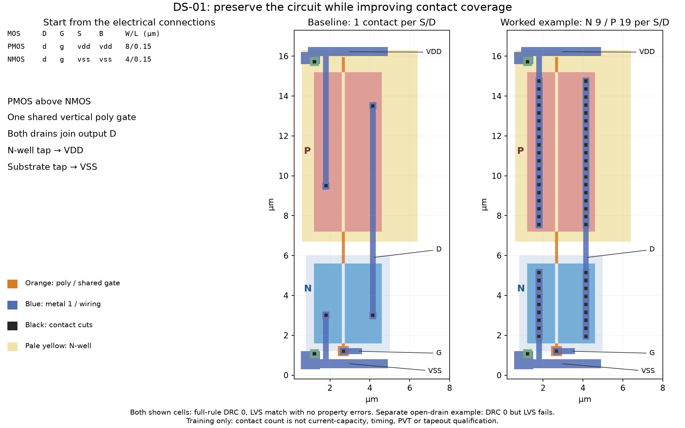

# 给DeepSeek的版图入门：从反相器到可复核交付

**先学会把一张确定的电路图，画成连接正确、器件正确、可重建的几何图形。** 第一课只做反相器，不更改SerDes的电路参数。教学脚本已在独立目录实际跑过：原版和增加接触的版本均DRC/LVS通过；断开漏极的反例DRC为0但LVS失败。完整任务可直接复制[DS-01工作单](training/DS-01-inverter.md)给执行者。



## 1. 版图究竟在画什么

网表定义“哪些端子相连”，版图定义“用哪些材料、放在哪里、怎样接触和连线”。反相器的四张网是：

| 网络 | 必须连接的端子 |
|---|---|
| `g`，输入 | NMOS.G、PMOS.G |
| `d`，输出 | NMOS.D、PMOS.D |
| `vdd` | PMOS.S、PMOS.B、N阱接触 |
| `vss` | NMOS.S、NMOS.B、衬底接触 |

本课NMOS W4、PMOS W8，L均0.15µm，都是单指。不要把“长得像反相器”当作连接正确的证据；完成后要从提取网表里读回同一张端子表。

摆位采用上PMOS、下NMOS，左源右漏。一根竖直poly栅穿过两管，金属把两管漏极连成输出。PMOS在N阱内，N阱接VDD；NMOS体端通过衬底接触接VSS。本课是普通1.8V器件，不把它推广为所有隔离阱/HV结构的通用接法。

## 2. 认清材料和电气连接

| 层/对象 | 作用 | 常见错误 |
|---|---|---|
| nwell/pwell | 器件所在的阱/体区 | 用文字标签代替实际阱接触，体端仍未按要求接好 |
| ndiff/pdiff | 源漏有源区 | 把所有扩散当导线，忽略栅下的沟道器件 |
| poly与器件识别区 | 定义栅和沟道 | L画错；把识别层铺成大片，提取出错误的大管子 |
| 扩散/poly接触→LI→mcon→M1 | 把器件端子接到金属 | 只把不同层叠在一起，没打对应接触 |
| M1/M2等金属与via | 单元内和跨层连线 | 没有via，或只有接角/不足包边 |
| label与port | 给已有网络命名并导出引脚 | 标签落在另一层/另一张网；端口顺序与参考不一致 |

**先画器件，再画连接，最后加标签。** 标签不是凭空连接两块材料的导线。也不要把所有内部节点都改成端口；只对该子电路真正的接口做`port make`，并保持参考网表顺序。

## 3. 数值从哪里来

先读任务给定的参考网表、器件类型和当前PDK，再画器件/连线。LVS参考是设计输入，不能随着版图结果一起改到“相符”。本课把参考和检查器保存为只读教学快照，每次运行检查SHA。

项目MOS包装层的`w`是总宽，`nf`是指数量，单指宽为`w/nf`。例如W4分两指，每指应为2µm，而不是两指各4µm。Magic绘图参数和SPICE导入转换不是同一个入口：本机`sky130A.tcl`的`mos_convert`会把总宽除以nf，绘图端再生成多指。不要猜某个调用入口是否已经做了转换；先做一只器件，核对提取出来的总宽、指数量和实际连接。多指栅也不一定自动短接。

几何规则查本机`sky130A.tech`并跑`drc(full)`；不要把其他工艺或网页示例的最小数值直接搬过来。可读[SKY130器件说明](https://skywater-pdk.readthedocs.io/en/main/rules/device-details.html)理解器件分类；本机PDK及任务快照决定实际检查版本。

现有资料有冲突时，以本课冻结参考和现行[任务单](tasks.md)为依据，列出冲突交集成者处理。尤其是：

- `batch_status.md`旧“经验8”允许CML负载用通用poly，但现行任务单明确要求与偏置参考同类的高阻poly，**不能据旧经验替换**。
- `high_po_notes.md`第1、2节的“779.8Ω地板”已被文件顶部更正作废；不要只读旧表。
- 第一批起步文档里的旧Rz器件/长度，不替代任务单后来给出的值。

## 4. 第一课怎样动手

### 4.1 创建自己的练习目录

从仓库根目录运行：

```bash
uv run python verification/layout_training/run.py prepare
```

记下打印的完整目录，例如`results/layout_training/ds01/<run_id>`，后续显式传同一路径，不取“最新一次”。它包含`baseline/`、`student/`和输入清单；每次检查另建`attempts/<run_id>/`，不覆盖旧日志。五个必要源码来自入库的只读教学快照，当前工作区里其他agent未提交的版图不作为练习依赖。

```bash
DS_LAYOUT_WORK=results/layout_training/ds01/<上一步打印的run_id>
uv run python verification/layout_training/run.py run "$DS_LAYOUT_WORK" --view baseline
```

`run`会先重建`.mag`，再调用未改判定逻辑的检查器，参考固定取`baseline/`那份。读`build_inv_std.py`的几何与网络连接，再读新生成的`inv_std_lvs.spice`。生成器脚本和`.mag`分别回答“如何画”和“实际画出了什么”。

### 4.2 学一个具体改进：源漏接触成列

原示例每个源/漏区只有一个接触，适合讲清连线，但DRC通过不代表接触足够承载设计电流。先只增加接触覆盖，不改W/L/nf和电路。

教学解答可逐行阅读并实际运行：

```bash
uv run python verification/layout_training/contacts_example.py "$DS_LAYOUT_WORK"
uv run python verification/layout_training/run.py run "$DS_LAYOUT_WORK"
```

该解答只改尚未编辑的`student/`构建器；已有自己改动时会拒绝覆盖，可另建练习目录。NMOS每个源/漏区9个接触，PMOS每区19个，共56个源漏接触，另有栅/体接触。中心距0.40µm，距有源区上下边各至少0.35µm，并把LI与M1连成连续竖条。这组几何已经过当前PDK检查，不是通用的电流容量规则。

这里为什么不用只满足扩散接触间距的节距？因为同一接触列还包含mcon，各层间距/包边都要同时满足。只有重复小方块、没有连续LI/M1，也可能留下小间距或断线问题。几何修改后重新做DRC/LVS，不靠手工数接触代替检查。

### 4.3 看一个反例：DRC为0，电路仍接错

```bash
uv run python verification/layout_training/run.py fault-demo "$DS_LAYOUT_WORK"
```

它在另外一份`faults/`副本中删掉连接两管漏极的M1竖条，保留学生版和参考。实际结果：DRC=0，提取侧5张网、参考4张网，LVS失败。`expected_open_detected`表示教学程序成功捕获了预期错误，**不表示该版图通过**；其内部检查器退出码是1。

## 5. 如何看懂检查结果并修错

| 结果 | 先查什么 | 正确修法 |
|---|---|---|
| 金属最小面积/间距错误 | 规则号、错误框、相邻材料 | 补足相应金属/调整间距，再测；不要屏蔽规则 |
| LVS器件数量不符 | 沟道识别、器件是否被短掉、多指是否合并 | 对照提取实例与原网络表定位，不删参考器件 |
| LVS网络数不符 | 少via、漏接、桥接、错层标签 | 从不匹配的端子往回追线 |
| 拓扑匹配但属性错误 | W/L、nf总宽、器件型号、电阻尺寸 | 修几何或报告约束冲突，不能为了过检查改参考 |
| DRC/LVS都通过 | 接触覆盖、器件应力、寄生、时序/噪声 | 进入电气复核，尚不是模块签核 |

通过本课的布局检查必须同时看到检查器退出码0及三个字段：

```text
DRC_TOTAL 0
LVS_MATCH True  LVS_PROPERTY_ERRORS False
```

字段不一定各占一行；缺字段记未完成。不要用`命令 | grep ...`后grep的退出码替代检查器退出码。批处理DRC要等`drc catchup`完成再读计数；这也是[Magic官方命令说明](https://opencircuitdesign.com/magic/commandref/drc.html)中该命令的用途。

## 6. 从练习过渡到SerDes模拟模块

推荐顺序：单指反相器与接触→折指与总宽核对→已明确参考的被动单元→已明确匹配要求的差分单元。实际下一任务仍按[现行任务单](tasks.md)，教学通过不自动授权改其他块。

模拟单元多四件事：

1. 器件匹配：相同单元、方向与邻近环境；需要时交错/共质心和dummy。不能只比较外形是否对称。
2. 布线匹配：看实际R/C、邻线耦合和负载，不只看两条线等长；屏蔽本身也会加电容。
3. 电源/衬底：host与quiet按接口分开；tap与保护环接对域；不给VCO域擅加去耦或把数字尖峰负载搬进去。
4. 提取后回测：记录有意器件和额外寄生，回到相同激励/负载/PVT测电气变化，不按`.pex`后缀就宣称RC验证完成。

本课检查器执行了电路提取与电容输出；**仅出现`ext2spice extresist on`并不证明已完成电阻网络提取**，还需要相应`extresist`流程及实际输出核对。[Magic提取教程](https://opencircuitdesign.com/magic/tutorials/tut8.html)区分这些步骤。MIM有意电容与附加电容也要按模型/提取视图核对，不能凭“像重复”就删条目。

## 7. 交付应让下一人能复核

每次交付给出输入清单/哈希、改动文件、构建命令、检查器退出码和原始字段、关键提取实例、图片、接触数及未做事项。正文解释为什么这样摆、怎样接、错误怎样定位；日志作为证据。

本课已验证的数据和图索引在[教学结果](../data/layout_training_ds01.json)、[结果目录](../../results/catalog/layout_training_ds01.json)。它只证明本机这一课的DRC/LVS与故障识别，尚未做接触电流容量、速度、PVT、噪声或流片签核。脚本使用当前本机Magic/netgen/PDK配置；换机器先复核工具路径与PDK身份。

后续[DS-02折指与端口复核](training/DS-02-folding-review.md)、[中间引G/加宽金属/保护环VAR](inverter_folding_var.md)已有实际版图对照。另发现一例“外部D未接但LVS仍匹配”，因此交付还须检查端口实际使用；本反相器可补跑`inverter_audit.py <提取LVS网表> --cell <单元名>`，原三字段只是必要条件。
