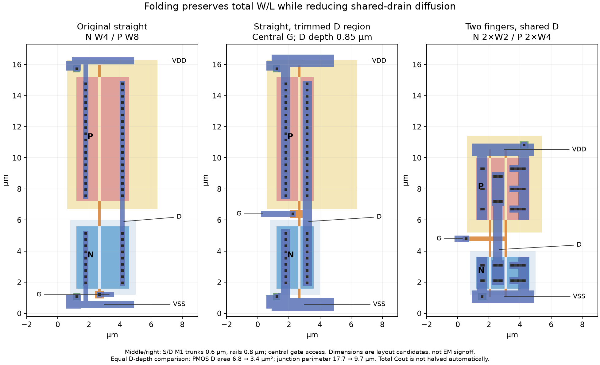
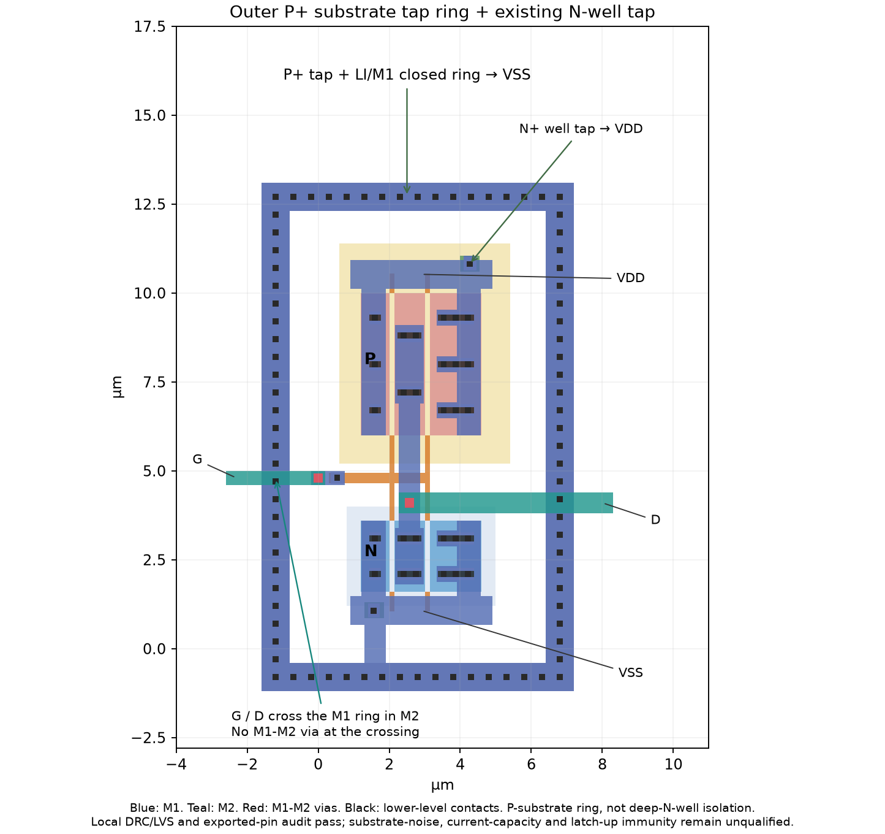

# 反相器版图VAR：折指、中间引栅、金属与保护环

**两指共享漏极方案已做成可复核的版图VAR。** 与原直条、收窄D区的直条比较，保持NMOS总W4、PMOS总W8、L0.15µm不变。紧凑直条、两指版及加外圈P+环版均通过当前DRC/LVS和补充端口/总宽审计；仍是教学/规划候选，未替换SerDes中的单元。



## 上管“长”的是什么

原图上管竖向较长的是沟道宽W=8µm，沟道长度L仍是0.15µm。它可以折成两根W4的指，并联后总宽仍是W8；NMOS相应是两根W2，总宽W4。沿横向的安排为：

```text
源扩散 — 栅1 — 共用漏扩散 — 栅2 — 源扩散
  S        G        D         G       S
```

两根栅连输入G，两边源连同一电源/地，中间漏扩散连输出D。共享的是一个物理D区，不是画两套独立漏区再用金属接起来。

为公平核对“减半”，新增紧凑直条：D扩散深度取与折指版相同的0.85µm。原图D区深1.85µm，因此从原图直接比较时，既有折指收益，也有收窄扩散的收益，不能都归因于折指。

这里“紧凑”只指D区收窄；中间G引出及加宽电源会增加外框，不能把它直接理解为整个单元面积变小。

| 几何 | PMOS输出扩散面积 µm² | PMOS结周长 µm | NMOS输出扩散面积 µm² | NMOS结周长 µm |
|---|---:|---:|---:|---:|
| 原直条 | 14.8 | 19.7 | 7.4 | 11.7 |
| 紧凑直条，D深0.85µm | 6.8 | 17.7 | 3.4 | 9.7 |
| 两指共享D，同D深 | **3.4** | **9.7** | **1.7** | **5.7** |

数值从实际输出端连接的AD/AS、PD/PS取出。折指提取中有些实例D/S命名对调，因此不能只加所有`ad`。在同D深比较里，面积确实减半，结周长却没有减半。

## 金属是否太窄

原教学图M1主干约0.28µm，接触列约0.35µm。增加源漏接触并未消除主干瓶颈，DRC通过也不等于电流容量足够。SKY130公开规则把电迁移电气要求标为不由几何DRC检查，见[规则x.4](https://skywater-pdk.readthedocs.io/en/main/rules/periphery.html#x)。

本次紧凑直条/两指对照使用源漏主干0.6µm、电源横轨0.8µm，作为加宽的VAR。相同材料和长度下电阻近似随1/W下降，但增加金属也会加寄生电容。正式选宽要用单元实际负载、边沿电流、平均/RMS电流、允许压降、温度及接触/via容量；这里没有给出某个安全电流值，0.6/0.8也不是新的项目硬门槛。

加宽时还要看与原tap金属连接处的凹口。紧凑直条首轮出现4个M1间距错误，原因是宽主干和原tap接头之间残留0.1µm窄缝；合并该处同网金属后消除。不是所有“加宽”都只需要改一条线的宽度。

## G为什么可以从P/N中间引出

两管间留有无有源区的通道，可在这里给poly做接触，转为LI/M1引出。此例直条在y=6.4µm引出，折指版在y=4.8µm引出；原来的下方G接触移除，端口标签也随实际线一起移动。

这样通常能减少远端栅到接触的poly距离。折指进一步缩短每根栅；若高速单元仍受栅电阻限制，可比较更多指、两端栅接触或金属栅总线。不能只移动文字G标签，也不能让G金属碰到输出或电源主干。

## 保护环怎样插



原图两颗绿色方块是局部体接触，并非完整保护环。这次示范的是：

- **外圈P+衬底接触环接VSS。** 环放在整个单元外围、N阱之外，由真实P+ tap扩散、连续接触、LI/M1构成，给衬底电流提供低阻回流；不是只画一圈金属。环在此例有0.8µm宽的几何框，不是通用保护强度指标。
- **PMOS的N阱仍由阱内N+接触接VDD。** 若要进一步做完整N+阱接触环，需要给它在N阱内预留位置；不能把外圈P+接地环直接塞进N阱，也不能把两种环短在一起。
- **信号跨环走更高层。** 此例G/D用M2跨过闭合的M1环，只在信号本体处放M1↔M2 via，跨环处不放这种via；图中红色是M1↔M2 via，黑点是较低层的tap/LI接触，不能混为一谈。环仍闭合，信号也不会短到VSS。

该环不是深N阱隔离。它未验证基底噪声隔离度或闩锁免疫，只是已检查连通与几何的实现例。生产中一般按模拟块/匹配组安排保护环，数字标准单元按行和tap规则布置，不必给每颗小反相器都加一个大环。环、供电回流、邻近注入源和寄生要一起规划。

本例折指版绘制外框约60.1µm²，加环及信号外引后约155.9µm²。这也是实际设计常在模块外围共享保护结构，而非给每个小单元分别套环的原因之一。

## 面积减半，不代表总输出电容减半

输出电容含结面积、结侧壁、栅漏重叠以及互连/邻线耦合。总W保持不变时，不能指望所有部分随D面积一起缩小。

| 对照 | PEX中连接到D的显式电容端点合计 fF |
|---|---:|
| 紧凑直条，中间G/加宽M1 | 2.2010 |
| 两指共享D，中间G/加宽M1 | 1.5535 |
| 两指＋P+环＋跨层信号引出 | 2.4428 |

此表只统计Magic输出的显式C，**不是总Cout**；MOS模型内的结电容/重叠项另计，且随偏置变化。加环方案同时增加了外引M2线，差值不能全归因于环。本次说明折指有实际扩散收益，也显示保护和布线可能吃掉一部分电容收益；最终以相同负载/输入的电气回测决定。

## 给DS的补充：必须查外部端口

捕获的原折指草稿在三字段检查中显示DRC0/LVS匹配，但提取网表的外部`d`未被任何MOS使用，实际两管漏极连在内部网`a_430_320#`。netgen日志也有`disconnected node: d`。这是端口标签落在孤立金属上的问题，不是共享漏极结构的问题。

新VAR把D标签放到实际漏极连接上，额外用[反相器端口审计器](../../verification/layout_training/inverter_audit.py)核对四张网及总宽；只在教学副本中修改，其他agent的工作文件保持。现有LVS绿色结果不能取代外部引脚使用检查。[DS-02工作单](training/DS-02-folding-review.md)给出具体复核方法。

## 复现与边界

输入是DS-01完整目录和固定教学快照；运行：

```bash
uv run python verification/layout_training/folded_variants.py <DS-01工作目录>
```

每次创建新的比较目录，保留原草稿的失败审计及各VAR。当前通过的比较为`results/layout_training/folded/20261111T123749.246896Z_cc6dd642`；前一次紧凑直条的DRC失败也保留在`20261111T123450.017767Z_281735c5`。没有启动ngspice，也没有宣称电流容量/速度/噪声/闩锁已完成。

[比较数据](../data/inverter_folding_variants.json)、[图与结果索引](../../results/catalog/inverter_folding_variants.json)、[独立重算与绘图](../../verification/plotting/layout_folded_variants.py)。
