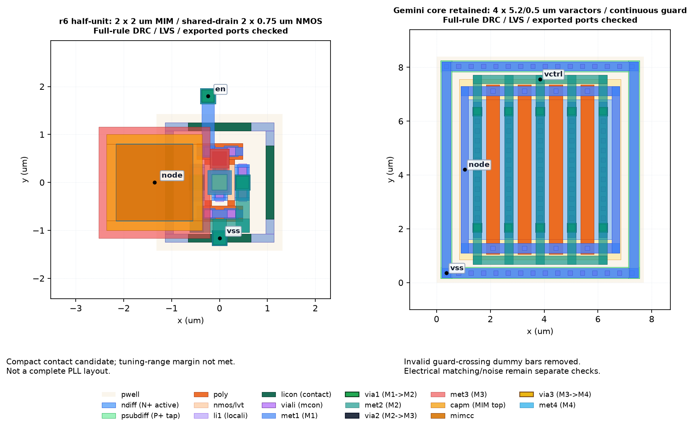

# PLL 版图推进

目标是完成当前 `pll_core_r6k4q` 的真实版图和关键寄生回测。当前采用状态统一见[项目当前状态](../status/current.md)，原理图参数以实际 SPICE 为准。[结果索引](../../results/catalog/pll_layout_r6.json)定位本轮几何、提取和局部仿真。

## 边界与顺序

模拟核包含 VCO/5 bit 阵列、四支路抽出 buffer、真实 ÷8 与反馈接收、轻 dummy、标准单元 PFD、CP、LF/预充及慢尾线滤波。HV18 LDO、全局带隙、自动粗搜数字控制先作为外部供电/偏置/控制接口；不能因为参考图没有这些模块就删掉核内实例。

先完成叶单元的器件/连接/寄生，再排相位单元、四级环、前端和完整核。PFD 按当前标准单元网络实现，不能以形状类似的互补 MOS 阵列代替逻辑。完整宏逐级做 full-rule DRC、LVS、导出端口/体端/实际指宽检查；关键回灌过后再扩必要压力点，不先铺满网格。

物理参考须明确处理非实体占位：`Vlink` 为零压测量连接，可并网；`Rdc=1T` 是浮动板 DC 数值参考，不能画成实体电阻。相位线 `cwire` 与单元 `Cfr/Cbp` 必须逐项列替换关系。LF 的真实电容与 CP 的 `Cdum` 则必须实现，不能当作占位删除。前端 tap/反馈的 wiring allowance 同样须和真实提取对账。

## Gemini 排布如何使用

它的价值在局部结构草案：四级 2×2 折叠，左右对称的差分单元，宽管折指与接触覆盖，开关置于 MIM 下方，以及 PFD/CP/LF 相邻。这些思路保留，但要用实际器件和可连接的端口重建。

顶层需要重新组织：原环实际装入 4 bit bank；相位阵列在 buffer 外侧并排，正负节点到两组阵列的距离不同；控制线绕过外围；缺当前轻 dummy、反馈接收和尾线滤波。单看外形紧凑，不能确认关键路径短，也不能使用其面积作为完整 r6 核的面积。

新的摆位以相位节点的连接树为先：延迟输出、MIM、变容器、buffer 输入相邻；正负支路使用一致的连接拓扑和层次。CP/LF 的控制端朝向 VCO，分频第一输入级靠近 b0；PFD 的数字复位网络离开相位线，host/quiet 分开供电和回流。先根据合格叶单元更新实际外框，再收紧大宏，不能为填满外框牺牲节点电容。

## 已实现的局部迭代

[生成器与候选几何](../../analog/pll/vco/layout/variants/r6_pdk/README.md)包括真正的 r6 电容半单元，以及沿用 Gemini 对称主体的变容器。半单元有两指共享漏极、正确的 MIM 上/下极板与三个外部端口；变容器去掉穿入保护环的错误 dummy，保留四个真实指、走线与保护环。

半单元同时进行了放置对照和局部回灌。它的结构是振荡节点→MIM→浮动底板/开关漏极→NMOS→VSS。关断时相位节点看到的是 MIM 与底板回地寄生的串联，再加直接寄生；不能把底板当理想悬空，也不能直接把整颗 MIM 算到地。裸 MIM、开关/局部连接的拆件提取用于辨识来源，拆件改变场与屏蔽，不能将两个结果当成严格可加的分账。

目前优先校准此单元的关断残余与阵列连线。叶单元能通过 DRC/LVS 不表示可接入当前 VCO 量程；两端点回灌只替换单元器件和寄生，保留未提取的相位线余量，不改变 Fable 的电路参数或 r6 全角证据。

后续继续实现延迟级/负载、buffer 和标准单元 PFD；阵列与 VCO 宏只有在局部寄生进入可行区后才扩展。
