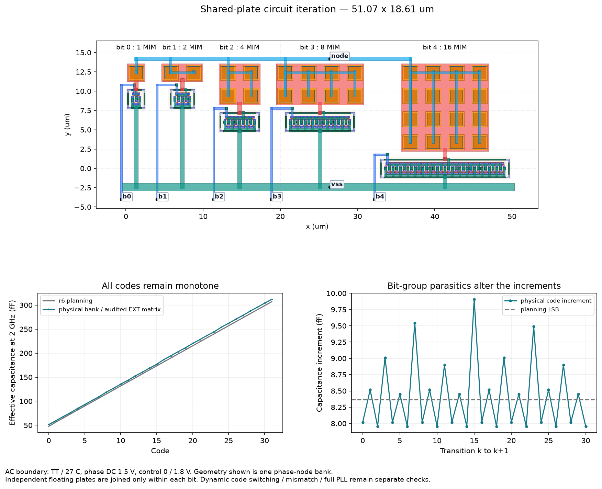

# PLL 版图推进

目标是完成当前 `pll_core_r6k4q` 的真实版图和关键寄生回测。当前采用状态统一见[项目当前状态](../status/current.md)，原理图参数以实际 SPICE 为准。[结果索引](../../results/catalog/pll_layout_r6.json)定位本轮几何、提取和局部仿真。

## 边界与顺序

模拟核包含 VCO/5 bit 阵列、四支路抽出 buffer、真实 ÷8 与反馈接收、轻 dummy、标准单元 PFD、CP、LF/预充及慢尾线滤波。HV18 LDO、全局带隙、自动粗搜数字控制先作为外部供电/偏置/控制接口；不能因为参考图没有这些模块就删掉核内实例。

先完成叶单元的器件/连接/寄生，再排相位单元、四级环、前端和完整核。PFD 按当前标准单元网络实现，不能以形状类似的互补 MOS 阵列代替逻辑。完整宏逐级做 full-rule DRC、LVS、导出端口/体端/实际指宽检查；关键回灌过后再扩必要压力点，不先铺满网格。

物理参考须明确处理非实体占位：`Vlink` 为零压测量连接，可并网；`Rdc=1T` 是浮动板 DC 数值参考，不能画成实体电阻。相位线 `cwire` 与单元 `Cfr/Cbp` 必须逐项列替换关系。LF 的真实电容与 CP 的 `Cdum` 则必须实现，不能当作占位删除。前端 tap/反馈的 wiring allowance 同样须和真实提取对账。

## Gemini 排布如何使用

它的价值在局部结构草案：四级 2×2 折叠，左右对称的差分单元，宽管折指与接触覆盖，开关置于 MIM 下方，以及 PFD/CP/LF 相邻。这些思路保留，但要用实际器件和可连接的端口重建。

顶层需要重新组织：原环实际装入 4 bit bank；相位阵列在 buffer 外侧并排，正负节点到两组阵列的距离不同；控制线绕过外围；缺当前轻 dummy、反馈接收和尾线滤波。单看外形紧凑，不能确认关键路径短，也不能使用其面积作为完整 r6 核的面积。

新的摆位以相位节点的连接树为先：延迟输出、MIM、变容器、buffer 输入相邻；正负支路使用一致的连接拓扑和层次。CP/LF 的控制端朝向 VCO，分频第一输入级靠近 b0；PFD 的数字复位网络离开相位线，host/quiet 分开供电和回流。先根据合格叶单元更新实际外框，再收紧大宏，不能为填满外框牺牲节点电容。

## 已实现的局部迭代

[生成器与候选几何](../../analog/pll/vco/layout/variants/r6_pdk/README.md)包括真正的 r6 电容半单元，以及沿用 Gemini 对称主体的变容器。半单元有两指共享漏极、正确的 MIM 上/下极板与三个外部端口；变容器去掉穿入保护环的错误 dummy，保留四个真实指、走线与保护环。

半单元同时进行了放置对照和局部回灌。它的结构是振荡节点→MIM→浮动底板/开关漏极→NMOS→VSS。关断时相位节点看到的是 MIM 与底板回地寄生的串联，再加直接寄生；不能把底板当理想悬空，也不能直接把整颗 MIM 算到地。裸 MIM、开关/局部连接的拆件提取用于辨识来源，拆件改变场与屏蔽，不能将两个结果当成严格可加的分账。

叶单元与阵列分开验收，回灌不改变 Fable 的电路参数或原 r6 全角证据。安装的 Magic 8.3.685 的电容导出有节点错移，首次报告的 2.17 fF 底板值、1.933 GHz 等端点结论撤回；原结果只作诊断记录。当前采用下述 EXT 电容矩阵导出及新仿真。

后续继续实现延迟级/负载、buffer 和标准单元 PFD；阵列与 VCO 宏只有在局部寄生进入可行区后才扩展。

## 同 bit 共底板的 bank 候选

保持31颗2×2 µm MIM、总开关宽46.5 µm和1/2/4/8/16权重。每一 bit 内的下极板合成一块M3，开关折成2N指并共用漏极走线；不同bit仍是五个独立浮动节点。这是显式电气迭代，有独立参考，不能称作原31个独立浮动板网表的LVS等价版本。名义静态可比；切码电荷历史、控制偏斜和失配还须检查。

实际bank为51.07×18.61 µm，五组和整体均full-rule DRC 0、LVS/导出端口通过；另外核对31颗MIM、62指0.75/0.15 NMOS、体接VSS及五组连接。共用底板减少重复接触和小单元的周长开销；MIM上极板接相位，底板经NMOS接地的拓扑保留。

当前2×2 µm MIM的TT标称为9.30225 fF：PDK面积项2 fF/µm²，周长项0.19 fF/µm，含尺寸修正−0.025 µm。不是仅用面积4×2=8 fF，也不是5 fF/µm²。

校准边界：TT/27°C，相位DC 1.5 V、控制0/1.8 V，2 GHz小信号。规划半单元关断/导通1.538/9.904 fF；修正提取后收紧半单元为2.039/9.878 fF。完整共底板bank为51.456/311.874 fF，规划为47.684/307.036 fF；32码均单调，步长7.956–9.906 fF。完整/精简PDK库逐码相同。局部AC不能代替振荡波形或全角码表。

回灌按完整bank替换原估算Cfr/Cbp及开关AD/AS/PD/PS，并将实际bank覆盖的相位走线从原12 fF预算中扣除：相位到地/控制4.523 fF，加超出原Cfr估计的0.277 fF，剩余7.200 fF供未提取的延迟级、变容器、buffer和环连接。此处是明确的预算分配，最终必须由完整相位版图核实。

开环r6 ring＋四个30 fF buffer、真实偏置、固定电阻卡的两压力点：FS 1.65 V 85°C hh/码0/Vctrl1.21 V为2.19877 GHz；SF 1.65 V −40°C ll/码31/Vctrl0.90 V为1.82742 GHz。5 ns测量窗内频率漂移满足原规则，2 GHz量程两端暂有9.94%/8.63%余量。尚不是完整提取环、PLL闭环、全角或失配资格。

## 电容导出修正

在副本EXT中只把相位节点对地电容改为1000 fF，旧ext2spice却将增量写到浮动底板对地；原相位对地和部分栅对地电容没有保留原节点。已隔离复现，不能再按旧导出把所有寄生都归给底板或MOS漏结。

`verification/layout/flat_cap_export.py`从flat EXT的node/substrate/cap记录直接保留电容矩阵，器件及AD/AS由独立LVS网表提供。仅支持无别名的平铺MOS/MIM/变容器，遇层级、节点合并或电阻体模型会拒绝，不静默丢弃。回归注入顶板/栅/底板三种对地电容及耦合，确认节点与数值不变。生成器同时保留旧`_pex.spice`作诊断，电气台使用`_cap.spice`。

三档电源压力扩展完成：保留完整额外12 fF/相位，FS热hh/码0为2.139/2.164/2.188 GHz，SF冷ll/码31为1.805/1.778/1.772 GHz，依次对应1.65/1.8/1.95 V；六点量程余量均正且漂移合格。其目的为边界余量复核，不是135条件新码表。

工具源代码中的两处非电阻子电路π分配已一并修复，独立安装批量版本，GUI AppImage不动；[重建与回归](../../verification/layout/patches/README.md)。修复版Magic和独立EXT矩阵的真实半单元/bank逐项比较，对地归属一致；最大0.000187 fF差来自打印为0的极小耦合，仿真采用保留原精度的矩阵。
