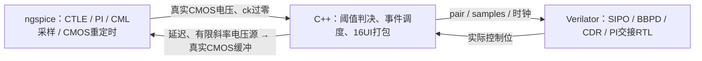
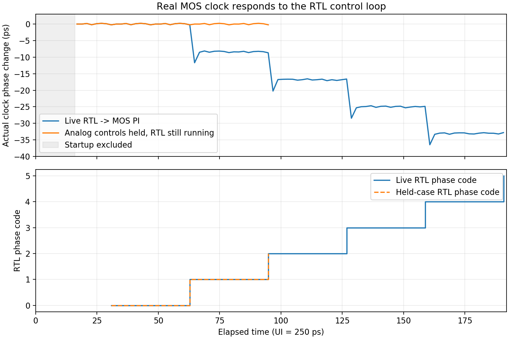
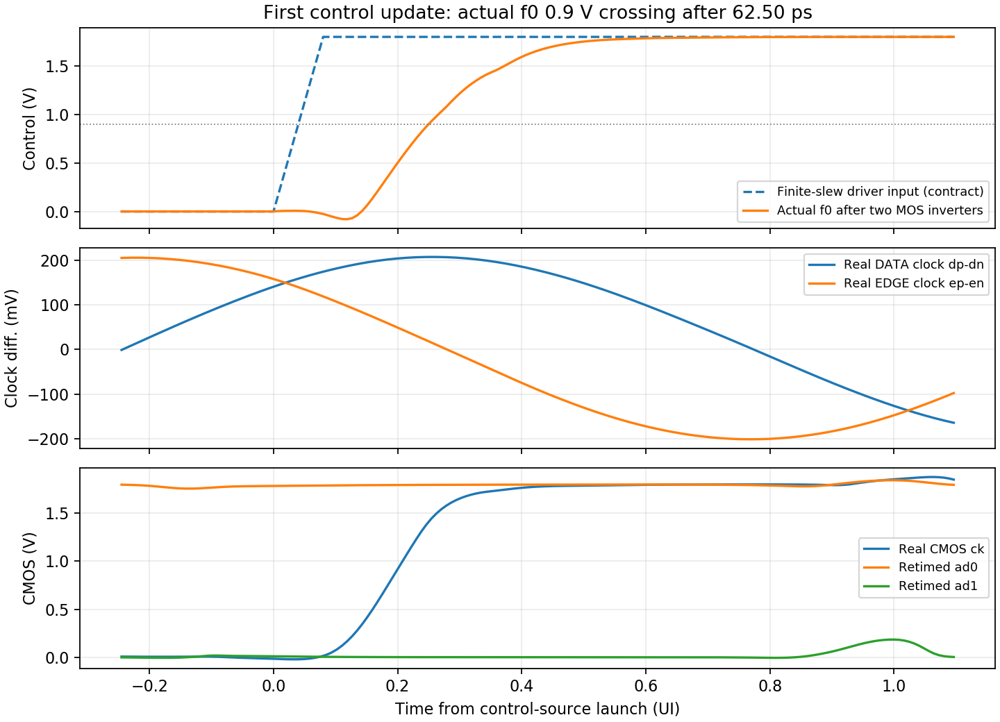

# RX 的 RTL / 晶体管实时联调

2026-10-29。已建立 SystemVerilog → Verilator C++ 模型，与 shared ngspice 47 连续 transient 双向连接的运行入口。数字端运行既有投票、CDR 滤波、逐步 PI 交接及训练/16 位串转并 RTL；模拟端包含真实 MOS PI、CTLE、采样器、静态 CMOS 转换、pair 重定时和控制缓冲。

Verilog/SystemVerilog 是设计语言；Verilator 把 RTL 编译成可执行的 C++ 模型。若前面说的“dib”指 DPI-C，它是 HDL 与 C/C++ 相互调用的接口选项。本轮直接从 C++ 写模型端口、调用 `eval()`，已经能连接 ngspice，不需要额外包一层 DPI。两种连接方式见 [Verilator 官方说明](https://verilator.org/guide/latest/connecting.html)；逐点读取、后台求解与反馈接口见 [ngspice shared API](https://ngspice.sourceforge.io/shared.html)。本机实际测试版本为 Verilator 4.028，未依赖新版本的延迟调度功能。

## 数模边界对应什么硬件

片上的电平转换由实际 CML→CMOS 接收器完成；模型边界处的“电压→bit”只是数字仿真器需要的解释规则，并不额外插入一个多位 ADC。先由真实 CMOS DFF 对齐，再在真实 `ck` 边沿后 350 ps 读出。≤0.54 V 为 0、≥1.26 V 为 1，中间区记录 unknown；该标志用于仿真诊断，不是硬件亚稳态探测器。

当前每 500 ps 读取一个两位 pair。C++ 将 8 个 pair 按时间顺序组成 16 位控制包，保存边沿样本和前一位数据，50 ps 后交给真实 RTL。串转并 RTL 仍连续接收每一个 pair，质量 locked 标志不截断数据流。这部分**16UI降速/打包为行为实现**，后续可换成 CML 移位与整字保持 bank；当前没有验证 2 GHz CMOS 移位链的门级时序。

反方向，实际 RTL 控制位经 50 ps 发射延迟、20 ps 有限电压边沿，再通过每根控制线上两级真实 CMOS 反相器，驱动真实 PI 负载。因此本轮已包含控制端的电平、斜率、模拟缓冲延迟和反馈效应。发射延迟仍是待 STA/物理实现标定的接口参数；所有可能码型、PVT 下的控制更新安全裕量还未完成。

## 测试与结果

输入为理想有限边沿 NRZ，4 Gb/s、350 mVpp 差分、0.9 V 共模；前 96 UI 为 `b5e3` 训练，随后连续发送递增规则数据字。使用理想相关的 2 GHz 多相锚点。短窗采用 KP=65536 的快速接口测试配置，生产 RTL 的 KP=8192 保持原值。

| 项目 | 实时闭环 | 固定模拟控制端对照 |
|---|---:|---:|
| 仿真长度 | 192 UI / 48 ns | 96 UI / 24 ns |
| RTL 相位更新 | 5 次，最终码 5 | 2 次，最终码 2 |
| 实际时钟相位变化 | -32.805 ps | -0.230 ps |
| 完整 payload 字 / 错字 | 5 / 0 | 训练段内，未要求 payload |
| 数据/边沿 unknown | 0 / 0 | 0 / 0 |
| ngspice 留存点数 | 1 | 1 |
| 外部环形窗峰值 | 1020 点 | 1013 点 |

末次码 5 在截止前才发出；相位变化取最后已观测的完整过零，不能作为码 5 的稳态相位表征。图中相位以 16 UI 后的首次过零为基准，启动段单独排除。

在相同的前约 94.82 UI 范围，闭环相位变化 -8.683 ps，对照 -0.230 ps。首个实际 f0 控制脚过 0.9 V 发生在源启动后 62.50 ps，包含有限源边沿及真实缓冲传播。

恢复的数据字依次为 1200、1337、146e、15a5、16dc，逐字与源匹配；记录时间采用 UI。完整数值见[结果数据](data/mixed_signal_cosim.json)。两次运行输入和实际电路快照分别保存在 results/verification/mixed_signal/20261029T045417Z_live48 与 results/verification/mixed_signal/20261029T045417Z_hold24。

边界单测通过阈值/未知区、完整 NRZ 边沿、D/A 斜率/延迟和乱序试探查询。整理时修正了初版激励漏掉前半段边沿的问题；上表只采用修正后重跑的数据，旧记录标记为 superseded。

这里验证了“真实模拟判决 → 数字运算 → 真实 PI 调相 → 后续模拟采样”的因果链，以及其中的训练和串转并顺序。测试时长尚未达到现有质量判定窗口要求，`locked=false`，不据此判断捕获时间、频偏跟踪上限或 BER。

本夹具不包含 TX/PCB 或原生 PLL，也未加入频偏/噪声。真实输出级/PCB/RX 短窗、行为 plant + 实际 RTL 的长时跟踪记录仍见[既有阶段结果](rx_cdr_closed_loop.md)。分层证据可以并用；本次结果也不替代物理 16 UI 降速和时序收口。

## 常驻运行与窗口

模拟器保持一个连续状态，不为每个观测窗重启。只有已接受的模拟时间点推进数字状态；源的试探查询不会消耗控制事件。下一步受读出、打包、控制边沿和数字时钟下降沿约束，数字输出从将来开始作用于模拟端，避免零延迟循环。

ngspice `.save none` 仅保留当前点，外部环形窗保留最近 2 ns。记录启动窗和控制变化前后各 2 ns，完成即落盘释放；点数/窗数有上限，超限显式失败。短测的 VCD/文本日志仍随时间增长。完整 PDK 模型占用约 700 MB；这套机制控制的是历史波形增长，不会删除电容电荷、锁存状态等影响未来的电路状态。

每约 5 秒输出模拟 UI、完成比例、ETA、RSS。启动的 PDK 解析单列阶段，ETA 随求解速度更新。构建命令、边界约定、各输出文件和验收条件见[运行说明](../verification/mixed_signal/README.md)，参数见[测试契约](../verification/mixed_signal/case.toml)，哈希与实际输入快照见[证据清单](data/mixed_signal_cosim_evidence.json)。
