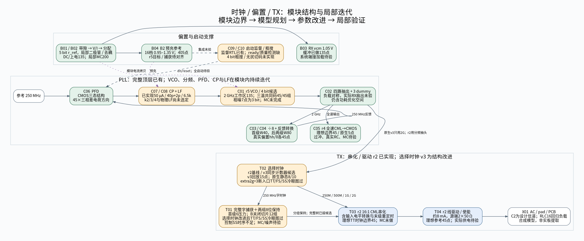
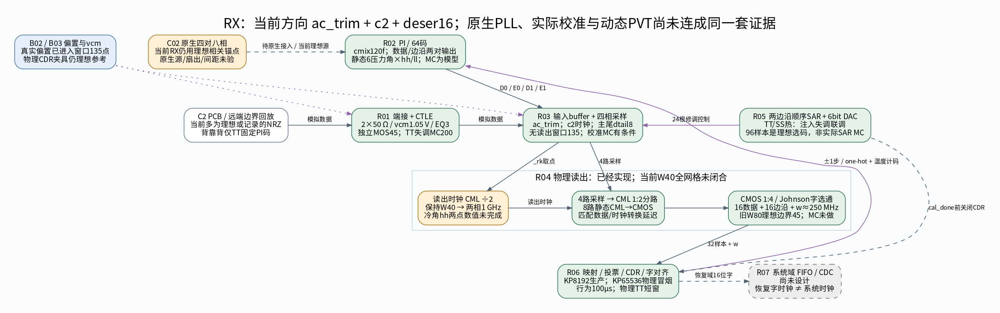

# 架构与接口

> 一个共享 2 GHz 多相 PLL 驱动本地 TX 串化器和每路 RX 的相位插值器；TX 是 16:1 的 2:1 CML 选择树，RX 是半速四相采样加数字 PI-CDR。所有电路先按模块独立验证，再用实际负载/电平/边界条件逐层衔接。

当前修订、采用与验证汇总见 **[current.md](../status/current.md)**，模块资料见[模块地图](development_map.md)，开发依赖见[执行计划](../status/prelayout_plan.md)。本页维护连接关系和接口，不代表所有箭头已在同一套实际电路中验证。

## 系统框图

## 时钟域

| 时钟域 | 来源 | 用途 | 边界责任 |
|---|---|---|---|
| VCO 多相 CML | 2 GHz环振，四路差分抽出、八个极性 | TX选择时钟、RX PI锚点、PLL反馈 | 相位节点与buffer输出分别约束加载；实际接入范围查current.md |
| PLL 反馈 | 支路0→三级CML ÷2→CML→CMOS→250 MHz | PFD | 与TX派生时钟分开；真实源、负载和启动由PLL接口验收 |
| TX 选择时钟 | v3：同一2G源同步计数器＋复制单元；r2独立抽头保留历史 | 串化器四级选择 | 与字捕获/保持的共同纪元、相对时序及物理guard/blank对应 |
| 自由 CMOS 分频 | 可选的多相CML→CMOS后按需分频 | 其他时钟域 | 规划/历史接口，不是当前精简PLL前端的必经路径 |
| RX 恢复时钟 | PI输出四相2 GHz | 数据/边沿采样 | 以连续调相跟踪每路远端频偏，不调共享VCO |
| RX 恢复字时钟 | PI后取点→CML ÷2→CMOS Johnson ÷4，w每16 UI | CDR控制、字输出 | 物理读出映射与动态PI控制时序由RX接口共同验收 |
| 系统时钟 | 外部 | 并行接口 | [map→align→FIFO](../design/rx_host_cdc.md)连接恢复字域；容量、频偏、溢出恢复和物理CDC分别约束 |

PLL 反馈与时钟分发是两项独立功能：调整后级派生时钟不改变 VCO；默认反馈总分频为 8。500 MHz 参考在 VCO ≤ 2 GHz 时不能走 ÷8，要用 ÷4 抽头（选择与未用级关断尚未集成）。低参考（如 50 MHz → 400 MHz VCO）只用于低线速，现有电容阵列未证明覆盖 400 MHz。

## VCO 八相顺序

物理级号不是相位顺序。实测上升过零顺序（d_k = q_kp − q_kn）：

| 相位 | 0° | 45° | 90° | 135° | 180° | 225° | 270° | 315° |
|---|---|---|---|---|---|---|---|---|
| 时钟极性 | d0 | −d1 | d2 | −d3 | −d0 | d1 | −d2 | d3 |

2 GHz 下相邻相位约 62.5 ps（0.25 UI）。

## 串化分配

当前实现 2:1 × 4 级（8 + 4 + 2 + 1 个选择器），bit0 先出，配对保持连续位序：

| 级次 | 配对 | 选择时钟 | 每路数据率 |
|---|---|---|---|
| 16 → 8 | d[j] 与 d[j+8] | 250 MHz | 0.5 Gb/s |
| 8 → 4 | 上级 j 与 j+4 | 500 MHz | 1 Gb/s |
| 4 → 2 | 上级 j 与 j+2 | 1 GHz | 2 Gb/s |
| 2 → 1 | 偶数流与奇数流 | 2 GHz | 4 Gb/s |

末级是两只 CML 重定时锁存器（A/B）加最终 2:1 选择器。4:1 × 2 级是备选方案，需要约 25% 的选择窗口，未实现。

## 多端口 PI-CDR

每个时钟组一个共享 PLL，供本地所有 TX 和各 RX 的 PI；每路 RX 有独立的 PI 相位组、采样器和数字跟踪环，不调共享 VCO。多个远端节点各有独立的 ppm 偏差，所以每路必须独立跟踪。

持续调相补偿频差：采样相位 φ(t) = 2π f_base t + θ(t)，f_sample = f_base + (1/2π) dθ/dt。64 码时每码 7.8125 ps = 0.03125 UI；远端快 100 ppm（半速频差 200 kHz）时平均约 78 ns 前进一码，5 µs 转一圈。相位码 0–63 回卷，物理输出必须跨扇区连续无毛刺。

采样相位：数据 0°/180°、边沿 90°/270°，2 GHz 半速，bang-bang（Alexander）鉴相。首版保留 CTLE，不做 DFE。

## 编码与速率

当前目标是 4 Gb/s 原始线速、16 bit × 250 MHz，不含编码。若加 8b/10b：保持 4 Gb/s 线速时有效载荷上限 3.2 Gb/s；保持 4 Gb/s 有效载荷则线速需 5 Gb/s，现有时钟计划不支持。可选 16 bit × 200 MHz → 20 bit 编码 → 20→16 gearbox。编码、加扰、gearbox 尚未加入；模拟开发用训练标记/PRBS。

## 目录与所有权

| 目录 | 内容 |
|---|---|
| `analog/common/` | 公共单元：偏置、CML buffer/延迟单元、CML 选择器/锁存器、CML↔CMOS 转换、器件适配器 |
| `analog/pll/` | VCO、分频器、PFD、CP、LF、顶层集成 |
| `analog/tx/` | 时钟分发、串化器、输出驱动 |
| `analog/rx/` | 输入端接、CTLE、PI、采样器、顶层联调 |
| `digital/` | PLL 启动监督、RX CDR/解串 RTL |
| `verification/` | 共享激励、PVT 计划、契约、信道模型、混合仿真 |

每个模块含 `spice/`（权威实现）、`behavioral/`、`schematic/`、`layout/`、`tb/<case>/`。子电路名带模块前缀（`serdes_`、`pll_`）。DUT 只放电路和参数；电源、源阻抗、负载、激励、测量放测试台，不在 DUT 里写理想负载、绝对路径或 `.end`。Xschem 原理图是历史导出，未同步 r3/TX r2，见 [原理图记录](../history/schematics.md)。

## 接口约定

| 模块 | 端口 |
|---|---|
| bias | 偏置电压/参考电流、vdd、vss；注明电流输出顺从范围 |
| cml_buffer | inp、inn、outp、outn、vbias、vdd、vss（非反相） |
| cml_to_cmos | inp、inn、outp、outn、vbias、vdd、vss；时钟版带状态恢复，输入停钟时保持状态 |
| cmos_to_cml | clk_in/数据、outp、outn、偏置、vdd、vss |
| pfd | ref、fb、rst_b、up、dn、vdd、vss；rst_b 低有效，UP/DN 高有效 |
| cp | up、dn、out、vbn、vbp、vdd、vss；UP 注入电荷 |
| vco | r6叶单元：q0p/q0n…q3p/q3n、vctrl、b0…b4（5 bit）、vbias、vdd、vss；PLL核外部对应cfg0…cfg4，参考[实际VCO网表](../../analog/pll/vco/spice/vco_ring4_r6.spice)与[quiet core](../../analog/pll/top/spice/pll_core_r6k4q.spice) |
| divider（prescaler8） | clkp、clkn、q2/q4/q8 差分抽头、vbias、vdd、vss |
| loop_filter | cp_in、ctrl、z、pre_ref、pre_en、vdd、vss（预充版） |
| rx_input_termination | inp、inn、vcm；两只 50 Ω |
| rx_ctle_rc | inp、inn、outp、outn、eq0、eq1、vbias、vdd、vss |

信号约定：差分电压为 `v(outp) − v(outn)`，共模为两端平均；电流先注明 SPICE 支路方向再换算；所有时间指标注明边沿、阈值和负载。
