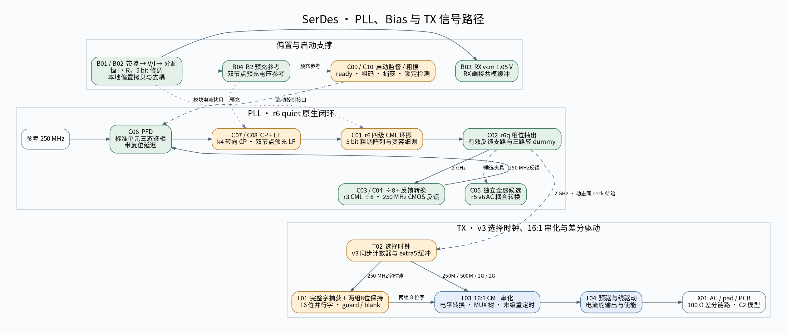
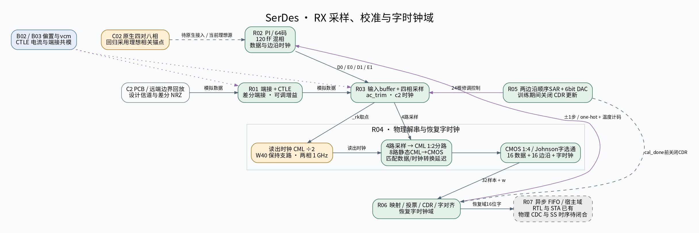

# 模块地图与设计入口

按 **SerDes → TX / Bias / RX / PLL / Channel → 子模块**组织。模块承载边界、约束模型、参数选择、局部实验和接口责任；r2/r5/r6是模块迭代，不是平级架构。

**当前采用与验证数字只查[current.md](../status/current.md)。** 本页保留模块归属与设计入口；执行顺序见[计划](../status/prelayout_plan.md)，跨模块信号/时钟域见[架构](architecture.md)。详细的旧覆盖表已保存为[2026-11-13整理前快照](../history/development_map_snapshot_20261113.md)，不能把其中尚未更新的失败判断当作当前状态。

## 1. 框图怎么读

[交互工作台](../../web/design/index.html)提供模块层次、边界、模型与资料引用，[使用说明](../../web/design/README.md)说明如何保存迭代。框号B/C/T/R/X继续作为稳定导航，不表示优先级或完成程度。PVT、噪声、失配、启动和物理验证分别判定。

### 时钟、偏置与 TX

### RX 与校准

框图以 r6q 时钟前端、v3 TX 和 W40 RX 字路径为基准。虚线连接标出待验证的原生时钟接口、候选夹具和控制接口；偏置支路使用点线。图源与重绘命令见[系统图目录](../figures/system/README.md)，旧 Xschem 入口见[历史原理图](../history/schematics.md)。

## 2. 各次迭代的验证边界

项目级结果与驱动身份见[current.md的模块表](../status/current.md#2-模块)和[TX源边界](../status/current.md#3-tx-被什么时钟驱动过)。每项记录区分：理想源、回放、开环原生、闭环原生；还需绑定修订、偏置/无源、负载、数据模式、初始化与测量窗口。[PVT口径](../verification/pvt_coverage.md)说明矩阵和继承规则。

配置选择入口：[PLL](../../config/pll_working_revision.toml)、[TX](../../config/tx_working_revision.toml)、[RX](../../config/rx_working_revision.toml)、[Bias](../../config/bias_working_revision.toml)、[LDO](../../config/ldo_working_revision.toml)。机器参数和历史身份保留，项目状态汇总不再复制到本页。

## 3. 时钟与偏置：逐框入口

| 框号 / 模块 | 责任与接口 | 设计资料 |
|---|---|---|
| B01 带隙/误差放大/V→I | 电压参考、修调、启动、恒I·R定义；主放大器属于带隙电路 | [Bias](../design/bias.md)；[ref_amp早期约束](../design/ref_amp.md) |
| B02 分配/本地偏置 | PMOS电流拷贝、局部二极管、实际支路扇出、去耦与共享扰动 | [Bias](../design/bias.md)、[功耗审计](../design/power_audit.md) |
| B03 RX vcm | 端接共模缓冲、实际负载及AC耦合充电 | [Bias](../design/bias.md)、[RX前端](../design/rx_frontend.md) |
| B04 B2预充 | LF双节点预充目标、建立、误差及释放 | [Bias](../design/bias.md)、[PLL环路](../design/pll_loop.md) |
| C01 VCO | 四级环、阵列/变容器、量程/窗口、寄生与噪声 | [VCO](../design/pll_vco.md)、[粗码窗口](../design/pll_coarse_windows.md)、[PLL版图](../layout/pll_r6.md) |
| C02 抽出/dummy | 相位抽头、buffer隔离、支路等效加载与功耗 | [VCO](../design/pll_vco.md)、[PLL环路](../design/pll_loop.md)、[架构决定](../status/architecture_decisions.md) |
| C03 ÷2/÷8 | 再生、保持、级间buffer、原生源/启动及尾管余量 | [CML 主线](../design/pll_divider.md)、[SAFF-TSPC 候选](../design/pll_tspc_reclock_divider.md) |
| C04 反馈接收 | 反馈CML→CMOS、PFD负载、停钟/复位 | [接收器](../design/clock_receiver.md)、[环路](../design/pll_loop.md) |
| C05 历史/外部全速接收 | 与反馈接收及RX静态数据转换分别表征 | [接收器](../design/clock_receiver.md) |
| C06 PFD | 标准单元复位环时序、死区、失配与相位窗 | [PLL环路](../design/pll_loop.md)、[数字PLL](../../digital/pll/README.md) |
| C07 CP | 转向电流、控制电压窗口、净电荷、决策余量 | [CP窗口](../design/pll_cp_window.md)、[CP v4 PDK](../../analog/pll/cp/layout/variants/v4_pdk/README.md) |
| C08 LF | 实体R/MIM、电源分接、控制端导纳与预充 | [环路](../design/pll_loop.md)、[融合版图 v2](../../analog/pll/loop_filter/layout/variants/fused_pdk/README.md) |
| C09 启动/锁定 | ready、粗搜、捕获/失锁、看门狗、质量测量 | [环路](../design/pll_loop.md)、[监测](../design/monitor.md)、[数字PLL](../../digital/pll/README.md) |
| C10 粗码/背景切码 | 搜索/停止策略、跨位动态、跨供电域驱动 | [粗码窗口](../design/pll_coarse_windows.md)、[CP窗口](../design/pll_cp_window.md)、[监测](../design/monitor.md) |
| 供电 | quiet/host域、HV18静态配置、参考/尾偏置路径及预算 | [LDO](../design/ldo.md)、[r4](../design/ldo_r4.md)、[定时复核](../design/pll_timing_supply_review.md)、[供电方案](../design/pll_supply_options.md) |

## 4. TX 与信道：逐框入口

| 框号 / 模块 | 责任与接口 | 设计资料 |
|---|---|---|
| T01 字捕获/保持 | word clock接收、两组保持、标签/guard/blank、建立保持 | [字捕获](../design/tx_word_capture.md)、[入口](../design/tx_ingress.md)、[launch hold](../design/tx_launch_hold.md)、[完整入口](../design/tx_parallel_serializer.md) |
| T02 选择时钟 | 同步分发与复制路径、相对时序、真实扇出与供电敏感度 | [分发](../design/tx_clock_distribution.md)、[加载时钟](../design/tx_loaded_clock.md)、[尺寸约束](../design/tx_buffer_sizing.md)、[相对时序](../design/tx_relative_timing_screen.md) |
| T03 CML树/重定时 | 数据/选择路径、末级建立、位映射、内部幅度与ISI | [串化器](../design/tx_serializer.md)、[末级重定时](../design/tx_final_retime.md)、[需求卡](../design/tx_retime_demand.md)、[幅度](../design/tx_cml_amplitude.md) |
| T04 预驱/线驱动/使能 | 焊盘/端接/耦合历史、电流/应力、实际外围与回流 | [输出级](../design/tx_output_driver.md)、[耦合状态](../design/tx_coupling_state.md)、[物理负载](../design/tx_physical_load_card.md) |
| X01 Channel | TX/RX边界记录、RLC/PCB模型、链路门槛及挑战场景 | [信道模型](../design/channel_model.md)、[刺激来源](../../verification/stimuli/README.md) |
| 共用器件 | 物理R族/合法尺寸、AC导数、参考跟踪、摆幅目标 | [定宽负载](../design/fixed_load_resistors.md)、[宽电阻规划](../design/wide_load_planning.md)、[AC模型](../design/fixed_poly_ac_overlay.md)、[参考卡](../design/physical_reference_card.md)、[摆幅依据](../design/cml_swing_target.md) |

局部时钟模型系列：[local](../design/tx_buffer_local.md)、[cascade](../design/tx_buffer_cascade.md)、[heavy](../design/tx_buffer_heavy.md)。这些文档保留各自电路/负载边界，不因文件名相似就相互转移结论。

## 5. RX：逐框入口

| 框号 / 模块 | 责任与接口 | 设计资料 |
|---|---|---|
| R01 端接/CTLE | 实际共模/端接加载、EQ与信道、增益/零极点和失调 | [前端](../design/rx_frontend.md) |
| R02 PI | 原生相位锚点、混合、单调/跨扇区动态及控制时序 | [PI/采样](../design/rx_pi_sampler.md) |
| R03 采样/时钟 | 门限、共模/孔径、回踢、时钟加载和窗口 | [PI/采样](../design/rx_pi_sampler.md) |
| R04 分路/转换/deser16 | 真实读出负载、捕获/边沿映射、冷角数值与启动 | [PI/采样](../design/rx_pi_sampler.md)、[冷角](../design/rx_cold_convergence.md) |
| R05 DAC/SAR | 真实失配、两边沿校准、迟滞、温漂及训练/数据切换 | [PI/采样](../design/rx_pi_sampler.md)、[数字CDR](../design/rx_cdr_digital.md) |
| R06 映射/投票/CDR/对齐 | 生产参数、频偏/回卷、物理与行为路径区分 | [数字CDR](../design/rx_cdr_digital.md)、[混合仿真](../../verification/mixed_signal/README.md) |
| R07 宿主出口 | map→align→FIFO、共同纪元、容量/溢出/重训、CDC/STA | [宿主CDC](../design/rx_host_cdc.md)、[字时序](../design/rx_word_host_timing.md)、[数字RX](../../digital/rx/README.md) |

## 6. 模块开发流程

执行协议统一见[工作流](../status/workflow.md)：器件/版图可实现性与寄生 → 模型/参数规划 → 局部校准 → 受影响接口 → 必要全角。模块文档说明本轮问题、实际边界和结论；过程进历史，当前数字进current.md，采用参数进工作修订。

## 7. 证据入口与核对范围

| 证据类型 | 入口与用途 |
|---|---|
| 当前采用与验证 | [current.md](../status/current.md)中的模块表、实际时钟源、风险及对应来源 |
| 源码/机器参数 | [版本与工作修订](revisions.md)，以实际SPICE/RTL与运行输入核对 |
| 数据/原始运行身份 | [results/catalog](../../results/catalog/README.md)、[docs/data](../data/)；按固定campaign/工况找，不取“最新” |
| 历史覆盖核对 | [design_status_evidence.json](../data/design_status_evidence.json)、[审计器](../../verification/design_status_audit.py)；是固定时间点证据，不自动更新为当前资格 |
| 继承争议 | 原记录与实际deck/波形，历史入口见[索引](../history/index.md)；反例写到所属模块与问题编号 |
