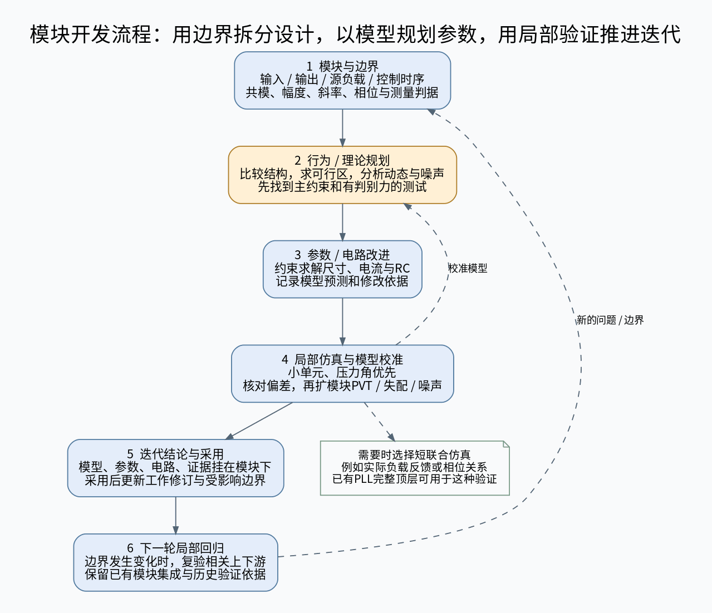

# 模块地图与设计入口

按 **SerDes → PLL / LDO / Bias / TX / RX / Digital / Channel** 组织。**当前采用组合与验证数字统一见 [current.md](../status/current.md)**，片级版图与 2026-11-26 实装复核见 [chip_floorplan_20261123.md](../layout/chip_floorplan_20261123.md)，完整架构与时钟域见 [architecture.md](architecture.md)。

也可通过 **[交互设计工作台](../../web/design/index.html)**（[使用说明](../../web/design/README.md)）按树形结构浏览模块边界、模型推导与证据。

---

## 1. 主推 5.0 Gb/s 双速（Plan-C `serdes_5g_top_pdk`）模块导航

| 模块 | 源码目录 | 权威设计文档 | 签核物理版图 |
|---|---|---|---|
| **5G 八边形 LC-VCO + 正交 ÷2** | `analog/pll/vco_5g/` | [5G 签核台账](../../results/catalog/serdes_5g_signoff_20261126.json) · [pll_loop.md](../design/pll_loop.md) | [`lc_vco_5g_oct_pdk`](../../analog/pll/vco_5g/layout/variants/lc_vco_5g_oct_pdk/summary.json) · [`ind_oct_2n5_pdk`](../../analog/pll/vco_5g/layout/variants/ind_oct_2n5_pdk/summary.json) |
| **5G 双速 A/B 分频（÷8/÷10）** | [`analog/pll/divider/`](../../analog/pll/divider/README.md) | [pll_feedback_data_dividers.md](../design/pll_feedback_data_dividers.md) | [`div_ab_5g_v2_pdk`](../../analog/pll/divider/layout/variants/div_ab_5g_v2_pdk/summary.json) |
| **PLL CP v4 / 融合 LF / PFD / `r5`** | `analog/pll/{cp,loop_filter,pfd}/`, `analog/common/cml_to_cmos/` | [pll_cp_v4.md](../design/pll_cp_v4.md) · [clock_receiver.md](../design/clock_receiver.md) | [`cp/v4_pdk`](../../analog/pll/cp/layout/variants/v4_pdk/README.md) · [`lf/fused_pdk`](../../analog/pll/loop_filter/layout/variants/fused_pdk/README.md) · [`pfd/pdk`](../../analog/pll/pfd/layout/variants/pdk/README.md) · [`r5_pdk`](../../analog/common/cml_to_cmos/layout/variants/r5_pdk/README.md) |
| **HV18 Kelvin LDO & BIAS v2** | [`analog/ldo/`](../../analog/ldo/README.md), [`analog/bias/`](../../analog/bias/README.md) | [ldo_v2.md](../design/ldo_v2.md) · [bias_v2.md](../design/bias_v2.md) | [`v2_cur_kelvin_pdk`](../../analog/ldo/layout/variants/v2_cur_kelvin_pdk/README.md) · [`bias/v2_pdk`](../../analog/bias/layout/variants/v2_pdk/README.md) |
| **5G TX CMOS/SST v5（4/5 Gb/s）** | [`analog/tx/sst/`](../../analog/tx/README.md) | [tx_sst_v4.md](../design/tx_sst_v4.md) | [`tx/sst/v5_pdk`](../../analog/tx/sst/layout/variants/v5_pdk/summary.json) · [`v4p5_pdk`](../../analog/tx/sst/layout/variants/v4p5_pdk/summary.json) |
| **5G RX CMOS 顶层（W3 CTLE + PI v3 + 5G Slicer）** | [`analog/rx/cmos_rx/`](../../analog/rx/README.md) | [rx_cmos_v2.md](../design/rx_cmos_v2.md) | [`rx_top_5g_pdk`](../../analog/rx/cmos_rx/layout/variants/rx_top_5g_pdk/summary.json) · [`ctle_shunt_5g_w3_pdk`](../../analog/rx/cmos_rx/layout/variants/ctle_shunt_5g_w3_pdk/summary.json) · [`v5g_4ph_v3_pdk`](../../analog/rx/cmos_rx/layout/variants/v5g_4ph_v3_pdk/summary.json) · [`slicer_5g_pdk`](../../analog/rx/cmos_rx/layout/variants/slicer_5g_pdk/summary.json) |
| **5G 32-bit 端口协同数字顶层 `v4p1`** | `digital/pnr/rtl_v4_32b/`（[`digital/`](../../digital/README.md)） | [digital_top_v3.md](../design/digital_top_v3.md) · [5G 签核台账](../../results/catalog/serdes_5g_signoff_20261126.json) | [`hd_pnr_v4p1_5g_coopt`](../../digital/pnr/variants/hd_pnr_v4p1_5g_coopt/serdes_digital_top_v4/summary.json) |
| **5G Plan-C 全片装配与紧缩去耦** | [build_chip_top_5g_pdk.py](../../verification/layout/build_chip_top_5g_pdk.py) · [decap_5g_tiles.py](../../verification/layout/decap_5g_tiles.py) | [chip_floorplan_20261123.md](../layout/chip_floorplan_20261123.md#9-50-gbs-plan-c-全片物理装配与层级签核2026-11-26) | [chip_physical_audit_20261126.json](../../results/catalog/chip_physical_audit_20261126.json) |

---

## 2. 4.0 Gb/s 无电感环振对照基线（`v1.0` / `full_v8`）模块导航

| 模块 | 源码目录 | 权威设计文档 | 签核物理版图 |
|---|---|---|---|
| **VCO r6 + PTAT & PLL v4 闭环** | [`analog/pll/`](../../analog/pll/README.md) | [pll_vco_r6_perf.md](../design/pll_vco_r6_perf.md) · [pll_vco_r6_ptat.md](../design/pll_vco_r6_ptat.md) · [pll_loop.md](../design/pll_loop.md) | [`sym9_clean`](../../analog/pll/vco/layout/variants/sym9_clean/README.md) · [`ptat_bias_pdk`](../../analog/pll/vco/layout/variants/ptat_bias_pdk/README.md) |
| **SAFF-TSPC ÷8（4G）** | [`analog/pll/divider/`](../../analog/pll/divider/README.md) | [pll_tspc_reclock_divider.md](../design/pll_tspc_reclock_divider.md) | [`saff_reclock_2g_pdk`](../../analog/pll/divider/layout/variants/saff_reclock_2g_pdk/README.md) · [`saff_reclock_2g_v2_pdk`](../../analog/pll/divider/layout/variants/saff_reclock_2g_v2_pdk/summary.json) |
| **HV18 LDO v2_cur & 慢尾滤波** | [`analog/ldo/`](../../analog/ldo/README.md) | [ldo_v2.md](../design/ldo_v2.md) | [`v2_cur_pdk`](../../analog/ldo/layout/variants/v2_cur_pdk/README.md) · [`bias_filter_r4_pdk`](../../analog/ldo/layout/variants/bias_filter_r4_pdk/README.md) |
| **TX SST v4.3 & RX CMOS v2.2** | `analog/tx/sst/`, `analog/rx/cmos_rx/` | [tx_sst_v4.md](../design/tx_sst_v4.md) · [rx_cmos_v2.md](../design/rx_cmos_v2.md) | [`tx/sst/v4_pdk`](../../analog/tx/sst/layout/variants/v4_pdk/README.md) · [`rx/cmos_rx/v2_pdk`](../../analog/rx/cmos_rx/layout/variants/v2_pdk/README.md) |
| **Digital Top v3.1 / v3.2** | `digital/pnr/rtl_v3/` | [digital_top_v3.md](../design/digital_top_v3.md) | [`hd_pnr_v3_unified`](../../digital/pnr/variants/hd_pnr_v3_unified/serdes_digital_top_v3/summary.json) · [`hd_pnr_v3p2_cmos_rx`](../../digital/pnr/variants/hd_pnr_v3p2_cmos_rx/serdes_digital_top_v3/summary.json) |

---

## 3. 模块开发闭环与共享基础设施

执行协议见[工作流](../status/workflow.md)。从器件可实现性与版图寄生，推进到模型、局部压力点、受影响接口与全角回归。源码与版本见[版本说明](revisions.md)和[主线工作修订](../../config/mainline_working_revision.toml)。

- **信道与监控**：[PCB 信道族 C0–C5](../design/channel_model.md) · [辅助监测](../design/monitor.md)
- **物理版图与自动布线/摆位**：[版图总入口](../layout/README.md) · [VCO 版图规范](../layout/vco_sym9_layout_lessons.md) · [`route_manhattan.py`](../../verification/layout/route_manhattan.py) · [`floorplan_opt.py`](../../verification/layout/floorplan_opt.py)
- **验证方法与优化工具**：[验证文档总入口](../verification/README.md) · [测量约定](../verification/measurement_conventions.md) · [PVT 覆盖](../verification/pvt_coverage.md) · [统计与 MC](../verification/statistics.md) · [$g_m/I_D$ 与多目标优化](../verification/optimization_toolkit.md)
- **结果与退役存证**：[results/catalog/README.md](../../results/catalog/README.md)（早期全 CML 演进与历史文档归档在 git 历史 `v1.0` / `b10e989`）
