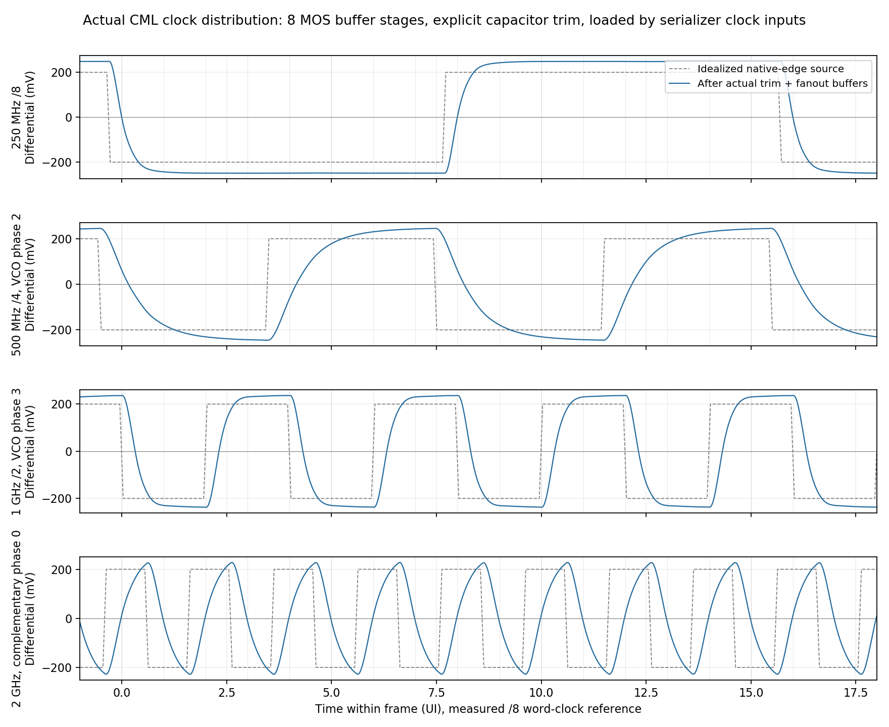
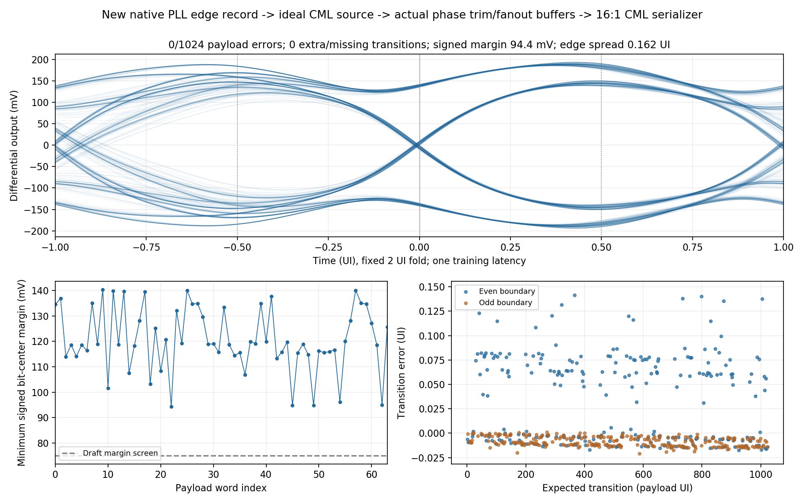

# 原生PLL、实际CML相位分发与buffer驱动串化器

本轮新运行原生闭环PLL，保存连续的VCO各相、抽出buffer、slave/master分频节点。
按用户指定，在源端理想化后接真实MOS相位微调/扇出buffer，再直接驱动现有CML串化器的时钟输入负载。

**64个负载字共1024 bit无位中心错误，唯一训练标记正确，零额外/漏跳变。**
实际分发相位达到本轮±0.03 UI观察范围；长码流边沿散布仍为0.162 UI，略高于暂设0.15 UI比较线，
所以未把整体工程检查标成全部通过。

## 本轮实际路径

每路两级CML buffer，共8级；buffer输出连接实际串化器的8/4/2/3组本地时钟源跟随器。
最后一级的3组包括选择器及两只重定时锁存器。之前只有VCO抽出buffer；
这次补齐的是源端理想边界之后、直接承担选择器负载的分发buffer。

**理想化的确切含义**：保留原生记录每个零交越的时刻、频率、占空比和所选相位，
将源电压设置为共模1.63V、差分400mVpp、完整边沿0.08 UI。
因此本轮不是原始模拟波形逐点回放；buffer后的斜率、电平、负载耦合由真实MOS电路产生。
没有逐路数值时间平移，也没有时钟周期重复/延拓。

理想边沿源在记录起点只放入完整20ps边沿，1GHz路窗口起点的半边沿被裁剪，
使最初两个原生过零未形成源跳变，约4 UI后恢复一致；该差异只在初始化保护区内。
各路在16–1180 UI的运行区间已逐个核对原生过零时刻，均一致；实际训练在约48 UI之后才开始，负载区间更晚。
初始化保护区不参与训练或负载判决，没有用截取边界的假边沿当作发射时钟。

## 新的原生PLL记录

PLL仍保留原生VCO/变容管、四路匹配抽出buffer、完整接收/分频分支、PFD、CP和理想RC环路滤波器；
没有修改原来的环路增益参数或引入全节点cshunt。
这次为获取时钟而用预充LF及预先对齐的参考相位初始化到近锁定点，**不是重新测量自主上电捕获时间**。

- 原生运行实际保存到2560 UI，首个持续满足窗口结束在848 UI，之后保持1712 UI。
- 最后512 UI观察窗频差+1.635 ppm，展开相差跨度0.000789 UI。
- 本次发送源取848–2048 UI（连续1200 UI），源窗VCO平均频差+5.817 ppm；后续原生记录确认该区间之后仍持续稳定。
- 源片段长度覆盖完整发射：4个训练字+64个负载字、起始稳定等待及末端保护；串化仿真时长1184 UI，没有补出不存在的时钟。

原生8相按实际差分正/反极性排列，排序后相邻相位间隔为：

45.0074°, 45.0128°, 45.0022°, 44.9955°, 44.9862°, 44.9878°, 44.9981°, 45.0099°。

这些是本TT仿真与边沿插值的结果，不是PVT或版图相位精度保证。所有相位、分频slave/master电压保存到原始记录，见[源摘要](data/native_pll_physical_phase_source.json)。

## 固定相位路由及实际元件

| 选择级 | 原生源节点正/负 | 电容微调增量，每端 | 驱动级Wn/Wtail/R | 实际时钟负载 |
|---|---|---:|---|---:|
| 250MHz | d08p / d08n，VCO相位0÷8 | 100fF | 64µm / 64µm / 100Ω | 8组 |
| 500MHz | d24p / d24n，VCO相位2÷4 | 500fF | 40µm / 32µm / 200Ω | 4组 |
| 1GHz | d32p / d32n，VCO相位3÷2 | 160fF | 24µm / 16µm / 400Ω | 2组 |
| 2GHz | b0n / b0p，抽出相位0的互补极性 | 270fF | 32µm / 24µm / 300Ω | 3组 |

每路前置微调buffer为Wn=20µm、Wtail=12µm、R=400Ω；每端还有2fF基值电容。
电容位于预驱动输出，后级buffer承担扇出。所有阶段是非反相CML MOS级，未使用行为延迟。
源相位/极性是固定路由配置；自动相位选择、确定相位复位/校准逻辑尚未实现。

[电路网表](../analog/tx/clock_distribution/spice/cml_clock_distribution.spice)、
[标定记录](data/physical_clock_buffer_calibration.json)、
[路由及电容配置](data/physical_clock_phase_route.json)。

## 实际负载下的时钟

相位以加载后的250MHz下降沿为参考，目标为[0,0.16,0.32,1] UI。

| 时钟 | 测得相位 | 相位误差范围 | 差分峰峰值 | 平均共模 |
|---|---:|---:|---:|---:|
| 250 | 0.0000 UI | [+0.0000, +0.0000] UI | 498.1mV | 1.6505V |
| 500 | 0.1621 UI | [-0.0016, +0.0050] UI | 490.6mV | 1.6580V |
| 1g | 0.3199 UI | [-0.0020, +0.0018] UI | 474.5mV | 1.6676V |
| 2g | 0.9817 UI | [-0.0194, -0.0172] UI | 456.7mV | 1.6452V |

时钟自身的周期叠图、过零放大及源触发传播延迟分析见[时钟叠图诊断](clock_overlay_results.md)；该诊断不修改下述数据眼图时基或验收结果。

## 数据与完整长码流结果

训练为0xAAAA、0xAAAA、0xD3A5、0x6C9E。
前两字测量一个常数输出延迟，后两字唯一确定整数位对齐；负载数据不参与对齐或调相。
随后发送独立LFSR7生成的64字，d0先出；眼图仍用固定4Gb/s UI=250ps、2UI窗口及2UI步进。

输入字按实际÷8时钟边沿加标定后的分发延迟同步更新。这里是明确的激励接口约定，
**尚未加入真实并行字捕获寄存器**，不能把它当作任意输入到达时间均可接受。

| 长码流观察量 | 结果 |
|---|---:|
| 负载字 / 位 | 64 / 1024 |
| 负载位中心错误 | 0 |
| 唯一训练标记错误 | 0 |
| 训练选定整数位平移 | 0 UI |
| 最小有符号中心裕量 | 94.4mV |
| 配对跳变散布 | 0.162 UI |
| 额外零交越 / 漏跳变 | 0 / 0 |
| 输出差分峰峰值，含瞬态 | 388.4mV |
| 固定训练延迟 | 1.314 UI |
| 新增时钟分发电源轨功耗 | 14.42mW |
| 串化/输入/偏置/时钟分发所列电源轨合计 | 53.37mW |

0.15 UI是之前提出的串化比较草案线，不是已定稿的PLL规格。
本次只有跳变散布一项未达到这条线，位正确性、无多余/漏跳变、中心裕量和实际加载相位均满足本轮检查。
本轮和此前0.169 UI回放同时改变了源初始化、理想化边界、相位分发与输入字约定，不能把差异全部归因于buffer。

## 字更新保持时间的试验

首个8字试跑把新输入字提前1 UI更新，产生4/128负载位错误及2个标记错误；
所有负载位错误都在字内第15位，是旧字末位在被锁存前遭到新字覆盖。
改为同步边界更新后，8字测试0/128错误；再分别提前/延后0.125 UI的两次8字测试也为0/128错误、零额外/漏跳变。
这是三个到达时刻的验证，不是完整建立/保持时间扫描。最初失败记录保留，不用于最终长码流结论。

## 验收边界与后续

- 本次已经仿真真实分发buffer输出阻抗、真实选择器扇出和数据对时钟节点的耦合。
- 按要求，PLL端与分发电路之间仍隔着理想源；没有验证新增输入负载反作用到PLL的效果。
- 固定路由/电容只验证当前TT启动状态；自动复位/相位选择/上电校准、PVT和版图寄生尚未验证。
- 电阻/电容是理想无源参数，功耗只覆盖所列电源轨，不包含完整芯片ESD/封装/通道，也不是统计BER/相噪结果。
- 后续可保持本轮源窗口、标记和负载序列，继续优化高速数据/锁存路径及0.15 UI余量，避免同时改变激励。

新PLL在已写完2560 UI检查点满足持续源记录条件后由控制器结束，退出码−15有明确控制器原因，
不是把计划最大3072 UI全部自然跑完。过程、实际长度与波形SHA256在controller_completion.json。

测试定义：[原生PLL采集](../analog/pll/top/tb/clock_harvest/case.toml)、
[实际buffer标定](../analog/tx/clock_distribution/tb/phase_fanout/case.toml)、
[完整串化试验](../analog/tx/serializer/tb/physical_clock/case.toml)。
结果汇总见[CSV](data/physical_clock_distribution_results.csv)。

完整长码流运行：

`/home/host/Desktop/workspace/simple_serdes/results/analog/tx/serializer/physical_clock/20261028T090856Z_ngspice_tt_native_buffered_clock_64words`

源、电路、元件配置、预期字序列、原始波形、逐位/逐字判决、标记对齐和2UI眼图均有快照及输入SHA256。

## 绘图折叠UI对照

标称UI、实测频率UI、数据过零散布最优UI及1UI起点平移对照见[绘图微调记录](eye_fold_ui_sweep.md)。原眼图及上面的判决和工程比较线保持不变。

原生PLL多频多相时钟及实际分发边沿套叠见[250ps时基时钟眼图](pll_multiphase_clock_overlay.md)。

保持原长码流结果不变的内部节点追踪及四组短片段对照见[UI偏差溯源](serializer_timing_root_cause.md)。
