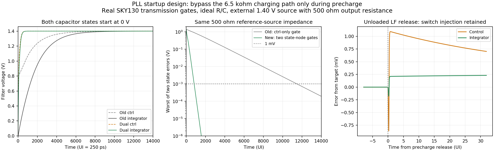
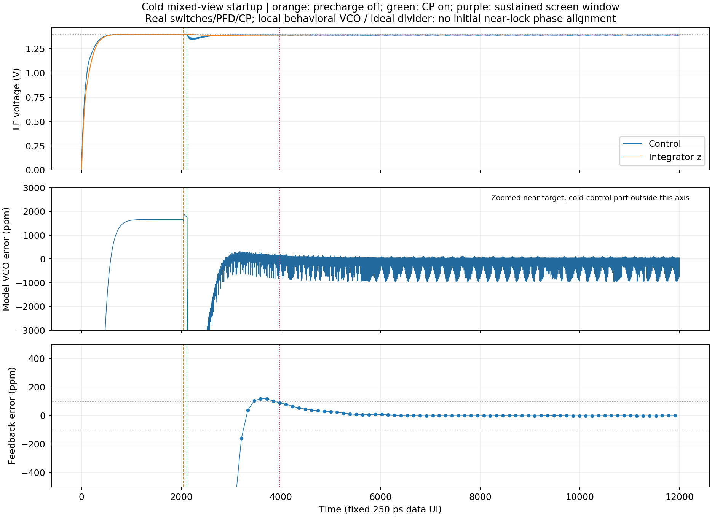

# PLL启动优化：双节点预充与接管监督

本轮选择PLL方向，先改善冷态预充、交接和状态管理。正常CP电流及6.5kΩ/40pF/2pF候选RC值保留，未先扩大闭环带宽；新开关寄生和门延迟仍可能影响实际环路。RX本轮未启动。

## 双节点预充

原单点预充从ctrl经6.5kΩ给40pF积分电容充电。新电路对ctrl与积分节点z分别设置实际SKY130 CMOS传输门，启动时旁路这条慢充电路径，关闭后保留原RC拓扑及开关寄生。旧电路保留，新版独立存在。

- [双节点LF](../analog/pll/loop_filter/spice/passive_rc_precharge.spice)：ctrl端NMOS/PMOS宽4/8µm，z端16/32µm。
- [可禁用CP](../analog/pll/cp/spice/charge_pump_enabled.spice)：实际CMOS AND门控制UP/DN，禁用不等于零漏电。
- [平衡核心的新接口](../analog/pll/top/spice/pll_balanced_startup_core.spice)：暴露pre_ref、pre_en、cp_en、PFD复位和z状态，保留四路匹配抽出/dummy。
- [可综合监督器](../digital/pll/rtl/pll_startup_supervisor.sv)：独立参考时钟域RTL。

两状态均从0V开始，外部1.40V参考各经相同500Ω源阻抗供电，TT、1.8V、27°C。两节点均进入目标±1mV并持续保持才计建立。

| 观察量 | 原单点预充 | 双节点预充 |
|---|---:|---:|
| 两状态建立 | 11472 UI / 2868.0ns | 818.4 UI / 204.6ns |
| 参考源峰值电流 | 0.521mA | 2.619mA |

本条件下LF建立约加快14倍，不等于整个PLL锁定加快14倍。历史2.67µs记录没有这500Ω源阻抗，不能与本表当作完全相同夹具。

512ns释放的独立LF记录中，释放1ns后ctrl扰动约+1.036mV、z约+0.214mV。开关注入未隐藏，释放误差是单独观察量，不能算作释放前的预充建立误差。此释放夹具未接完整VCO/CP动态负载。

预充参考仍是外部理想电压源加有限电阻的接口模型，片内参考/DAC及能承担约2.6mA峰值的输出缓冲尚未设计。1.40V是现有带载TT局部中心附近的工程设定，没有用精确拟合的初始电压/相位假定已经锁定。

## 接管顺序与状态

~~~mermaid
flowchart LR
 I[IDLE] --> W[等待bias和pre_ref有效]
 W --> P[双节点预充128周期]
 P --> G[关预充：死区2周期]
 G --> F[PFD运行：CP仍关2周期]
 F --> A[CP开启：ACQUIRE]
 A -->|连续好窗| T[TRACK / locked]
 T -->|连续坏窗：保留LF状态| A
 A -->|超时或范围故障| X[FAULT：CP关闭]
 T -->|偏置或监测故障| X
~~~

250MHz参考下，128周期=2048UI=512ns；随后死区2周期=32UI=8ns，再让PFD运行2周期=32UI=8ns，最后开启CP。模拟模板从预充开始计，在2048、2080、2112UI改变控制；RTL另有WAIT_READY时间，偏置/参考的建立不在这些数字里。

普通失锁返回ACQUIRE，保留LF状态；不因单次扰动强制重新预充。严重故障进入FAULT并关CP，需start明确重试。连续好窗同时要求频率和相位合格，过期测量不累积判锁，TRACK长时间没有新测量也撤销状态。

**监督器已实现，频率/细相位测量前端尚未实现。** quality_valid/frequency_good/phase_good是明确的外部接口。RTL测试中的好坏窗是激励，不能证明模拟PLL已经锁定。原[软件判锁约定](../verification/contracts/pll_lock_screen.toml)也不能直接称为片上硬件检测器。

32参考周期内简单数反馈边沿的分辨率约1/32，无法独立证明100ppm。后续硬件应先用计数排除停振/大频差，再结合经校准的细相位窗口与漂移监测；不能假定250MHz逻辑直接采到20ps脉冲。

abort_async需由独立时钟的参考看门狗产生，可在参考停钟时立即钳制输出，再经两级同步进入FAULT；看门狗本身未实现，信号需保持至确认。其他输入须在ref_clk域内稳定，ready需无毛刺，reset异步置位、同步释放。[RTL接口说明](../digital/pll/README.md)包含故障码和重启规则。

时间参数当前是综合参数，尚无运行期CSR。50/500MHz参考模式必须重新设定预充时间及超时；500MHz×÷8超出2GHz目标，反馈比例也需另选。锁后粗码冻结，±1粗搜和变容余量监测仍沿用[校准计划](vco_coarse_calibration.md)，本轮没有宣称这些硬件已完成。

## 控制验证与交接模板

Icarus已验证正常交接、频率正确但相位错误不误锁、连续好/坏窗、过期测量、失锁再捕获、超时、范围/偏置故障、停钟外部abort、重启及禁用。默认参数另核对512ns/8ns/8ns。Verilator lint和Yosys通用综合check通过，计数器宽度按参数裁剪。

这些检查不包含SKY130映射后STA、CDC/复位签核或RTL与模拟实时联仿。[输入哈希及命令](../results/digital/pll/startup_supervisor/nominal_smoke/checks.json)。

| 层次 | 测试入口 | 本轮状态 |
|---|---|---|
| LF冷充/释放 | [双节点模板](../analog/pll/loop_filter/tb/precharge/tb_lf_dual_precharge_ngspice.cir.in) | TT冷充和512ns释放已运行 |
| PFD/CP/LF接管 | [校准混合视图](../analog/pll/top/tb/startup/tb_pll_startup_mixed_ngspice.cir.in) | 实际PFD/CP，局部行为VCO/理想÷8 |
| 完整原生闭环 | [原生冷启动模板](../analog/pll/top/tb/startup/tb_pll_startup_native_ngspice.cir.in) | 本轮未运行，保留Sparse和四路匹配负载 |
| RTL控制与故障 | [功能场景](../digital/pll/tb/tb_pll_startup_supervisor.sv)、[默认时序](../digital/pll/tb/tb_pll_startup_default_timing.sv) | 功能/lint/通用综合检查通过 |
| 条件与收集 | [contract](../verification/contracts/pll_startup.toml)、[case](../analog/pll/top/tb/startup/case.toml) | 外部依赖及收集量明确 |

模板的@MODEL_LIBRARY@、@PROJECT_ROOT@、@CORNER@按已有约定展开，.spiceinit使用hsa兼容模式。应保存两个LF状态、全部接管控制和参考源电流，并冻结输入文件与哈希。退出码0或Vctrl平坦不能代替判锁。

接手重点：原生VCO控制负载下的预充与释放；关断寄生对滤波极点的影响；新增CP门控后的净电荷—相差曲线、静态偏移与死区；任意初相及分频状态的持续捕获；片内参考驱动和供电爬升。PVT、相噪/杂散、失配及版图寄生交给用户安排的其他模型，本轮没有执行这些扫描。

[LF数值](data/pll_dual_precharge_results.json)、[配置](../config/pll_startup.toml)。模拟运行均保留快照和SHA256。旧核心、旧捕获结论及旧带宽参数未被覆盖；本轮不宣称完整自主PLL已经完成。

## 标称混合视图接管结果

已完成3µs连续记录：供电/偏置已建立，两LF状态初值为0；行为VCO初始分频相位0.35周期，参考不作近锁定初相对齐。precharge结束512ns，PFD释放520ns，CP使能528ns。预充两状态约204.5ns进入±1mV，512ns释放后ctrl的1ns扰动约1.037mV。

沿用32参考周期窗口、8周期步进、频差<100ppm、展开相差跨度<0.08UI及1280UI保持，首个持续满足窗口结束约3976.1UI（994.0ns，自预充开始计）；距CP使能约1864.1UI（466.0ns），完成保持后距CP使能约3144.1UI。之后持续保持约8024UI至记录结束。

末128ns反馈平均频差约+0.288ppm，展开相差跨度约0.000149UI。400–510ns关闭CP并充分稳定时，电流均值约0.007nA；整个充电/释放过程的端口电流还含位移电流，不能把其最大值解释为静态漏电。

这是实际PFD/新增CP逻辑门/实际预充开关、理想RC与局部相位域VCO/理想÷8的闭环。VCO模型在冷LF电压下会外推，不能用其预充期间的频率推断原生VCO启动；捕获附近才在既有局部拟合范围内。并未实时联仿RTL和测量前端；控制PWL只复现PRECHARGE/GAP/FLUSH/ACQUIRE时序。

因此这些数值不能与先前原生预充后2560UI捕获直接作快慢比较，也不定义完整芯片上电到锁定的时间。原生启动宏的子电路展开检查通过，原生冷启动瞬态仍交给后续测试。

[混合视图数值及波形SHA256](data/pll_startup_mixed_results.json)。首次缺少DFF公共依赖的失败预检已保留，补齐依赖后的完整运行独立归档。

监督器模拟控制直接取自保留的一热状态位，未用多位二进制状态组合译码驱动预充/CP开关；state_id仅用于诊断。混合视图图中的瞬时频率包含CP脉冲纹波，100ppm判据采用窗口平均值，并未据此宣称相噪或参考杂散达标。
