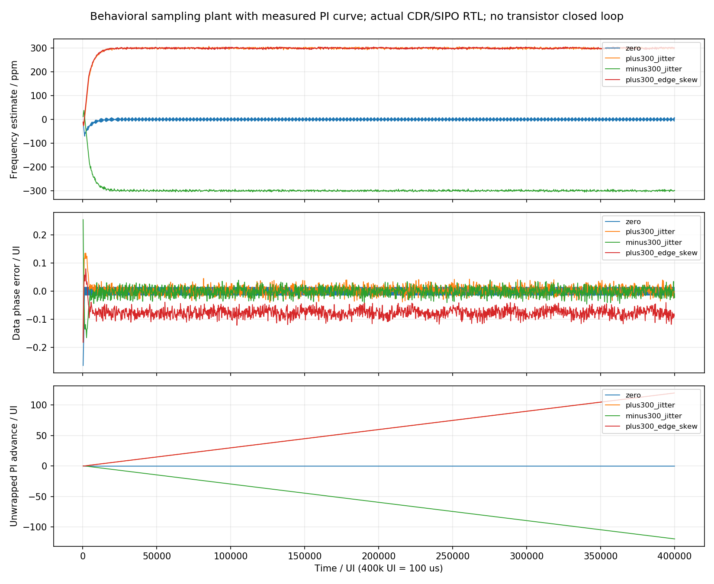
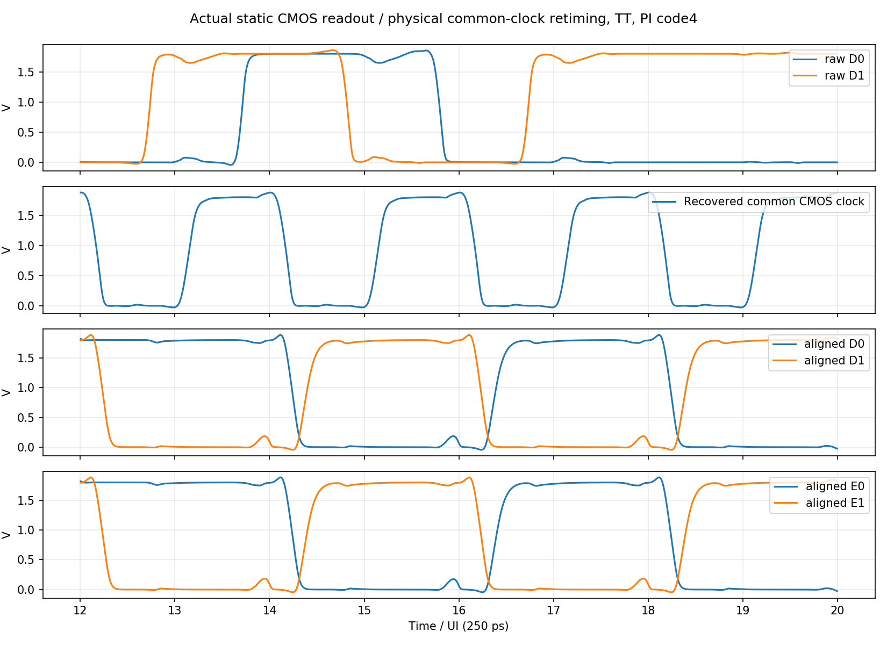
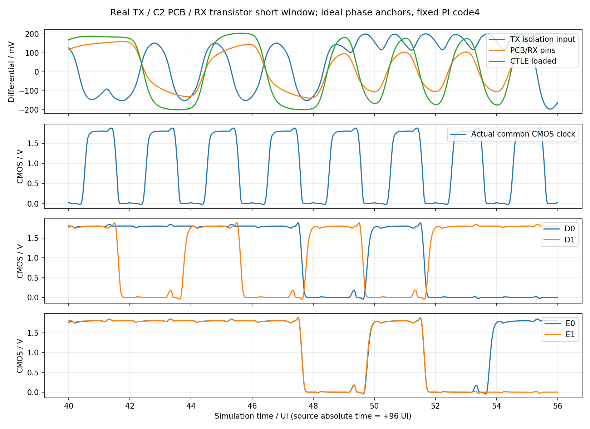

# RX闭环RTL、CMOS判决读出与16位串转并

2026-10-29。新增Q16相位/频率跟踪RTL、训练字对齐与16位串转并，静态CML→CMOS数据接收器及真实CMOS公共时钟重定时。当前为功能原型与名义模拟接口验证，未冻结整个SerDes物理实现。

## 阶段完成点

完成CDR、判决、串转并并验证真实链路，可以结束固定4 Gb/s原始SerDes功能阶段。这里还包含字边界、频偏持续跟踪、启动/质量指示；16位输出先留在恢复时钟域。它不自动包含编码、协议互通、跨公共系统时钟域速率匹配、PVT/噪声/版图签核。

当前已经做到：CDR/SIPO实际RTL配行为采样器长时闭环；CMOS读出与公共时钟对齐的真实晶体管短窗。按用户确认，RX沿用现有TX PLL，不再把原生PLL重新联验单列为本阶段待办，也未要求自环测试。后续具体接口工作是16UI降速/数字时序、PI控制端驱动与更新时序，以及前端采样/读出延迟的模型衔接。验收分层见[契约](../verification/contracts/rx_cdr.toml)。

分块、隔离和混合模型是本阶段采用的验证方法；已通过的模拟短窗和RTL闭环各自在声明边界内有效。后续用实际负载、电平、斜率、周期索引和延迟约束连接这些证据，不以是否完成单一全晶体管长仿真作为有效性的判据。

## CDR电路与控制

每路RX继续使用共享本地PLL的PI组，不调共享VCO。数字控制在恢复字时钟域运行，标称250 MHz/16 UI；到不相关系统时钟域的弹性FIFO/空闲补偿另做。半速四相采样与独立相位跟踪的架构背景见[AMD RX CDR](https://docs.amd.com/r/en-US/am002-versal-gty-transceivers/RX-CDR)，本项目性能来自下面的本地测试。

投票器后接二阶控制：频率积分器记录长期旋转速度，相位债务累加频率预测与比例校正；只有交接器报告applied才扣除实际相位步进，done前保持单个在途命令，避免busy时丢请求。无跳变时保持频率估计并继续预测；不能凭恒定数据无限期保证同步。

| 参数 | 初版 |
|---|---:|
| Q格式 | 每PI步65536 |
| 符号比例校正KP | 8192，即0.125步/次 |
| 频率积分KI | 32，即1/2048步/控制周期/次 |
| 频率限制 | ±32768，即±0.5步/控制周期；开发限制，不是频偏保证 |
| 质量窗口 | 128个控制周期 |
| 宣告质量锁定 | 连续4个好窗口 |
| 质量失锁迟滞 | 4个坏窗口 |
| 无跳变超时 | 256个控制周期，约1.024 µs |

locked来自早晚票平衡、跳变数、相位债务和范围状态的组合，不是BER保证。没有足够跳变的质量窗不直接判坏，而由超时处理。512 ns同码保持、超时、恢复跳变后重新确认与频率饱和都另有定向测试。

初次集成发现：直接用locked门控串转并会在质量短暂抖动时丢样本。现在接收链连续移位，质量状态独立标记。真正复位/失去采样时钟时应重新训练，不能静默拼接跨缺口的字。

## 实际RTL长时闭环

激励为行为NRZ数据和采样时钟，使用已有64码PI实测曲线；投票、控制器、交接器、训练对齐和串转并均运行实际RTL。时钟相位累计展开后调度真实采样事件，63/0处不把展开计数清零；记录多圈旋转及源数据索引，查连续丢/重位。

每组400000 UI，约100 µs，前20 µs为重复训练字，之后PRBS7。额外数据包处理延迟分别2/4个字周期，RTL自身流水另外实际存在。5 ps是确定有界边沿扰动幅值，不是随机抖动RMS。±20 ps边沿孔径偏移及5 ps两路差异是探索压力参数，**没有宣称来自完整RX校准**。

| 场景 | ppm | 首次质量标志 / µs | PI回卷 | 比较16位字 | 错字/字缺口/位滑移 | 峰值数据相位误差 / UI |
|---|---:|---:|---:|---:|---:|---:|
| zero | 0 | 2.578 | 1 | 19936 | 0/0/0 | 0.0146 |
| plus300 | 300 | 4.113 | 61 | 19936 | 0/0/0 | 0.0412 |
| minus300 | -300 | 3.603 | 61 | 19936 | 0/0/0 | 0.0406 |
| plus300_jitter | 300 | 3.601 | 61 | 19936 | 0/0/0 | 0.0526 |
| minus300_jitter | -300 | 3.603 | 60 | 19936 | 0/0/0 | 0.0555 |
| plus100_latency | 100 | 4.122 | 29 | 19936 | 0/0/0 | 0.0704 |
| minus100_latency | -100 | 3.610 | 32 | 19936 | 0/0/0 | 0.0725 |
| plus300_holdover | 300 | 3.601 | 61 | 19936 | 0/0/0 | 0.0526 |
| plus300_edge_skew | 300 | 3.089 | 61 | 19936 | 0/0/0 | 0.1382 |
| minus300_edge_skew | -300 | 3.603 | 61 | 19936 | 0/0/0 | 0.1377 |

相位误差统计在30 µs后；首次质量标志是状态定义下的时间，不是噪声条件下捕获时间签核。10组共199360个字比较均正确。无额外孔径偏移组峰值误差≤约0.073 UI；孔径压力组约0.138 UI，说明固定鉴相偏移会移动数据采样中心，不能只看能否锁定。未建立统计BER、抖动容限或传输带宽规范。

## 静态CMOS读出与周期对齐

数据接收器使用真实source follower、镜像负载差分级及两级反相器，支持DC0/1和长同码，不使用只能保持时钟边沿的旧clock restorer。真实PI/CTLE/采样器接入后，三个码点各50位、350/425 ps两个读数共100次均正确；250 ps读数过早，不能用它判为采样器错误。输出10 fF负载；6个转换器的供电约3.94 mW，其中2个是DC验证支路，不是每lane必须有6个。

公共时钟来自真实CML→CMOS时钟接收器、边沿相位的反极性及两级真实buffer；四个CMOS DFF重定时D0/D1/E0/E1。最初对数据相位取公共时钟太晚，主锁存器的关闭延迟造成跨周期取数；把时钟前移125 ps后数据两路正确。E0的转换边沿仍与取样窗口重叠，用两个真实反相器及各20 fF电容延迟，使其在公共时钟下确定取前一个E0。没有对绘图移动输出或使用理想延迟块。

| PI码 | 对齐数据位 | 错位 | 早/晚票 |
|---|---:|---:|---:|
| 0 | 48 | 0 | 0/20 |
| 4 | 48 | 0 | 0/20 |
| 8 | 48 | 0 | 20/0 |

检查在公共时钟后350 ps读出，不能把这个读出延迟忽略后直连下级。后续数字shift/比较路径仍需库映射与时序收敛。该固定延迟方案只验证TT，不能据此保证PVT下周期对应关系。

读出后的鉴相零点在码4至8之间，和早期CML符号数值判读的码4净零不同；转换门限、边沿解析与真实取样路径必须纳入最终模型。上面的孔径偏移场景只是压力测试，尚未完成这项校准。

## 16位输出与字边界

rx_deserializer16以按时间排序的2位CMOS pair为输入，bit0先到，16位输出bit0仍最早。训练阶段识别连续4个可编程0xb5e3训练字，再转入payload；这不是8b/10b码，也不是完整协议。所有16种初始bit偏移均检查，合计320个定向payload字正确。长CDR场景同时检查训练、字顺序和源数据索引连续性。

当前输出是恢复pair时钟域的16位数据和每8个pair周期一次valid。需要公共250 MHz系统接口时，还要物理时钟分频/分发、时序约束和必要的CDC/弹性缓冲；不能把valid直接当作任意系统时钟。2 GHz下的数字映射与训练比较路径尚无STA结果。

## 实际输出驱动器与PCB短窗

真实TX隔离/驱动—封装/AC—C2 6dB PCB—单套终端—CTLEeq3—PI四相采样—静态CMOS读出—实际公共时钟重定时已完成24ns。源为原始串化记录24–48ns，未压缩/延长/复制；输出级在100ps启用，舍弃前4ns热身。固定时钟中心由旧交替训练的边沿延迟+0.5UI及35ps前端补偿确定，未拟合本次payload。比较80位，错0位；实际CMOS对送入串转并RTL，训练使用旧夹具唯一6c9e标记（一次），比较3个payload字99dd/0fea/4304均正确。该短窗使用理想锚点和固定PI码4，没有物理闭环CDR或原生PLL。

CMOS电压数值判为逻辑pair后单独运行串转并RTL，仅验证字序；不是物理数字移位寄存器的时序验证或实时混合信号闭环。

首次夹具把旧边沿训练延迟误作位中心，少算0.5 UI；该诊断记录未计通过。最终源恢复既有B源pwl表达、保留全部原始点并修正位中心。慢速/错误相位及性能探索记录已标为中止，不用于本页指标。

## 证据和边界

[完整数据](data/rx_cdr_closed_loop.json) · [证据哈希](data/rx_cdr_closed_loop_evidence.json) · [RTL](../digital/rx/README.md) · [模拟采样/读出](../analog/rx/sampler/README.md)。

所有长闭环结果来自行为采样plant，不是100 µs完整晶体管仿真；模拟短窗用于独立检查真实加载和时序。原生PLL没有扩展/周期复制，当前锚点为明确标注的理想源。冻结TX/PLL未修改，未新增持久化Python脚本。PVT、失配、噪声、布局提取和协议互通交给后续阶段。
