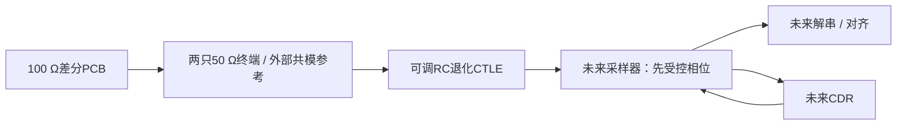
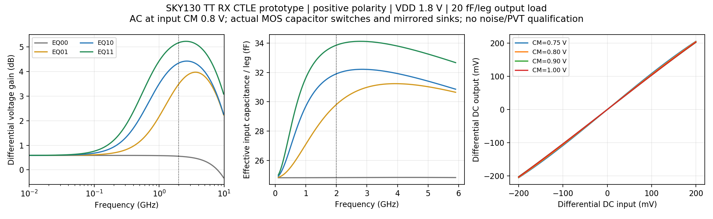
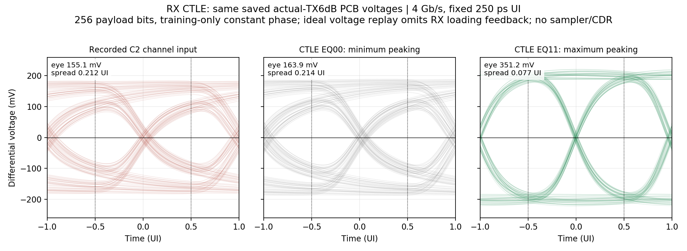

# RX第一步：输入接口与CTLE

先设计接收模拟前端：100 Ω差分终端/共模接口→线性CTLE→真实采样器→CDR与解串。CTLE保留模拟波形并修正短脉冲、拖尾和采样余量；采样器负责判决，CDR负责恢复采样时刻，三者分别验证。现有CML→CMOS模块是时钟接收器，未按4 Gb/s随机数据、约0.8 V输入共模验收，不直接作为数据RX。

本轮建立`analog/rx/input`、`ctle`及后续`sampler/cdr/top`层次。输入终端和CTLE已有SPICE原型；采样器、CDR、真实共模偏置缓冲、pad/ESD尚未实现。PLL和TX冻结包未修改。

## 第一版接口与电路

- 4 Gb/s NRZ、250 ps/UI；优先C2 6 dB通道，C3 10 dB仍为后续挑战。
- 接收输入共模关注0.8–0.9 V。此前0.9 V偏置下的AC耦合启动窗口实际约0.8 V，因此不能只在0.9 V验证。额外扫0.75和1.0 V用于探索，不宣称该共模范围已合格。
- [输入终端](../analog/rx/input/spice/rx_input_termination.spice)是两只50 Ω到外部vcm。正式连接替换原两只终端，不并联第二套；vcm参考/缓冲及实际回流仍待设计。
- [CTLE](../analog/rx/ctle/spice/rx_ctle_rc.spice)用W24/L0.15 LVT差分输入、600 Ω/端电阻负载、两个W48/L0.5 LVT镜像sink，源极之间600 Ω退化电阻。
- eq0/eq1通过真实互补MOS传输门连接200/400 fF支路，共四档。00保留同一放大/共模转换路径，只有最小峰化，不是输入输出直接短接。电阻、电容是名义理想元件，开关导通电阻/寄生由MOS模型给出；关闭支路有1 GΩ电阻定义DC板极电位。
- 外部理想50 µA电流驱动W8/L0.5 LVT参考管，生成vbias；并未实现片内电流基准。测试负载20 fF/端是未来采样器预算。

输入升高会使相反标记的输出节点下降，故`V(outp)-V(outn)`与输入同极性。约0.8 V线端共模通过有源级转换到约1.62 V输出共模，便于后续接口设计；输出共模目前由电阻和实际电流决定，没有CMFB或PVT校准。

源极RC退化使低频退化较强，高频由电容减小退化。忽略体效应、尾管有限输出阻抗、开关和器件寄生时，桥接R/C的零点约为`1/(2πRC)`、源极相关极点约为`(1+gm*R/2)/(2πRC)`；输出负载还引入极点。结构和半电路推导可参考[Berkeley技术报告4.3节](https://www2.eecs.berkeley.edu/Pubs/TechRpts/2019/EECS-2019-23.pdf)。本项目最终数值采用SKY130电路结果，不直接拿理想公式作为增益保证。

## DC与AC首轮表征

TT、27°C、1.8 V；4个共模×4个静态码，共16组完整OP/AC/DC。DC差分输入−200至+200 mV、2 mV步进；AC从1 MHz扫至20 GHz请求上限，100点/dec。输入由理想平衡差分源驱动，终端在此测试台显式存在。

输入共模0.8 V时：

| EQ码(eq1 eq0) | 名义接入电容 | 2 GHz电压增益 | 相对低频峰化 | 2 GHz输入电容/端 |
|---|---:|---:|---:|---:|
| 00 | 0 fF | 1.066 | −0.03 dB | 24.8 fF |
| 01 | 200 fF | 1.494 | 2.90 dB | 29.8 fF |
| 10 | 400 fF | 1.649 | 3.76 dB | 31.9 fF |
| 11 | 600 fF | 1.814 | 4.59 dB | 33.9 fF |

四档低频增益均约1.070，平衡输出共模约1.622 V，供电功耗含50 µA参考约1.159 mW。输入共模0.9 V时最大档2 GHz相对峰化约5.08 dB。输入电容是平衡差分小信号下`Im(-I(Eip)/V(inp))/ω`的每端等效值，实部还包括50 Ω终端导纳，不是大信号/PVT电容上界。

低共模仍有余量限制：0.8 V平衡时源极约0.153 V，通道回放中的最低源极约0.123 V。不能据此宣布尾管始终饱和或完整共模范围合格；后续需结合器件工作区、噪声/失调及PVT评估电流sink顺从电压。DC扫描和标称回放只证明当前点的传输行为。

## 6 dB真实通道电压记录驱动CTLE

使用此前[真实TX+C2通道运行](../results/analog/tx/output_driver/pcb_channel/20261028T140212Z_ngspice_tt_C2_loss6/metrics.json)的0–100 ns原始差分及共模，重建`ip=CM+Vdiff/2`、`in=CM−Vdiff/2`两个PWL电压源，驱动实际晶体管CTLE。没有重复或延长记录，没有强改输入共模。源记录已包含50 Ω/端终端和100 fF/端输入代理，回放测试台不再增加终端。

**这是独立CTLE电压回放，尚未把真实输入门电容/导纳反馈到PCB。** 正式全链路应替换原100 fF/端总代用负载，而非在其上再次叠加真实RX。当前约25–34 fF小信号门电容不等于已完成加载兼容验证。

每档固定整个记录，先32 bit交替训练得到一个固定边沿相位，接着32 bit唯一标记消除整数2UI歧义，再测同一256 bit。固定250 ps/UI、2UI折叠，没有按负载重新拟合采样相位。当前采样仍是数值插值和0 V差分门限，无实际比较器或CDR。

| 观察点/模式 | 总峰峰值/mV | 采样眼高/mV | 最小有符号裕量/mV | 过零散布/UI |
|---|---:|---:|---:|---:|
| 输入C2记录 | 366.3 | 155.1 | 76.6 | 0.21192 |
| CTLE 00 | 377.1 | 163.9 | 81.0 | 0.21371 |
| CTLE 01 | 378.1 | 269.3 | 134.2 | 0.12009 |
| CTLE 10 | 399.0 | 325.9 | 161.7 | 0.07642 |
| CTLE 11 | 442.8 | 351.2 | 175.1 | 0.07727 |

所有档位均为0/256采样错误，32 bit唯一标记正确，130个预期跳变无多余/漏跳变。最大档眼高/总摆幅约0.79，输入约0.42，因此改善不只是整体电压放大。00保留原有ISI，说明普通平坦增益不能替代均衡。码10/11各有摆幅与峰化差异，暂未确定芯片默认码，也没有自适应选择硬件。

回放中输入共模约0.803–0.815 V，最大档输出共模约1.614–1.626 V，CTLE供电均值含外部50 µA参考支路约1.172 mW。该数值不包含未来采样器/CDR、vcm偏置缓冲或完整RX功耗。

## 文件与验证边界

- [参数](../config/rx_frontend.toml)、[分层约定](../verification/contracts/rx_frontend.toml)。
- [DC/AC模板](../analog/rx/ctle/tb/ac_dc/tb_rx_ctle_ac_dc_ngspice.cir.in)、[DC/AC结果](data/rx_ctle_ac_dc.json)。输入共模、EQ控制、模型路径为占位符。
- [电压回放模板](../analog/rx/ctle/tb/channel_replay/tb_rx_ctle_replay_ngspice.cir.in)、[四档回放结果](data/rx_ctle_channel_replay.json)。可直接复用各run/raw/stimuli.inc；数据来源和SHA256在parameters.json中。
- 各运行含完整SPICE输入快照、hsa兼容设置、命令、日志和输入哈希；回放还含逐位采样、边沿残差和2UI数组。没有新增Python执行脚本。

16组OP/AC/DC和4组100 ns回放已完成；收集核对记录长度、有限数值、时间单调、输入快照哈希、训练及跳变。没有完整TX+PCB+CTLE联仿、真实采样器、CDR、噪声/失调、PVT或版图提取结果；也没有时间步/网格收敛签核。之前的TX通道结果没有被回放结果覆盖。

真实RX输入负载已在[缩小模型联合测试](rx_loaded_link.md)中接回C2，替换原终端和输入代理，且用原负载重现完整串化链检查截断边界。该结果与本页独立电压回放分别归档；被裁去上游的反向反馈不在联合模型内。

下一步加实际采样器，用受控相位检验灵敏度、时间孔径和kickback，再设计CDR捕获/跟踪和解串。可优先考虑2 GHz半速采样，但采样器结构、时钟相位数和恢复环路尚未定稿。C0无峰化、C3更大损耗及C4/C5反射/偏斜属于后续前端覆盖。
