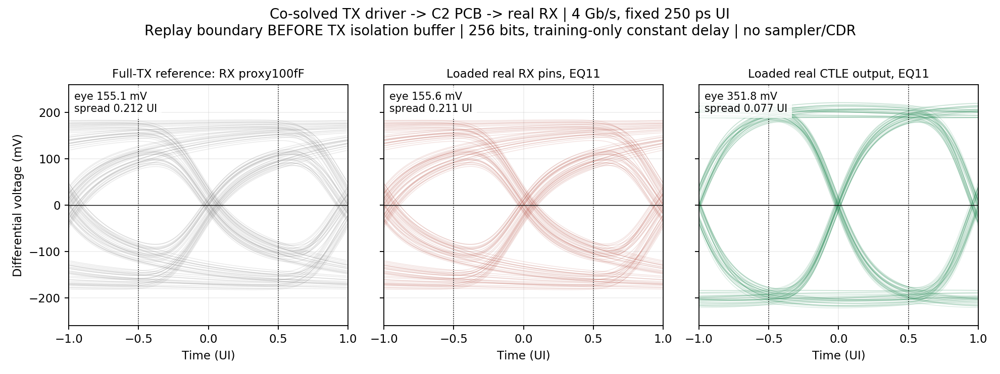
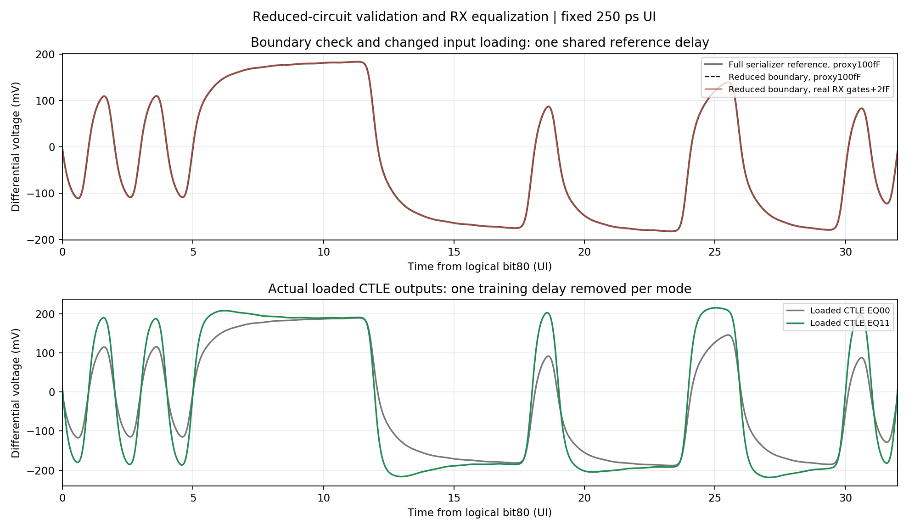

# TX输出驱动器、PCB与RX输入级联合仿真

用户提出利用已有隔离buffer和完整串化链电压记录，只仿输出级—信道—输入级。本轮采用这个边界：在真实TX隔离buffer输入回放串化器电压，保留其后完整电路；原100 fF负载的对照用于检查边界近似在当前标称点的误差。

## 边界和隔离含义

源记录来自完整真实TX+C2的100 ns瞬态，用`cmout±dout/2`重建串化器两根输出线。保留全部29983个原始时间点的共模、幅度、边沿、码型、时长和相位关系，没有压缩、延拓或重复记录。该源置于TX小输入隔离buffer的门极之前，之后三个有源驱动层、源端阻抗及非线性仍真实存在。

最终激励表示为B电压源的`pwl(time,...)`函数，使用相同的全量时间—电压表。ngspice支持以time控制分段线性B源，见[官方手册第5.1节](https://ngspice.sourceforge.io/docs/ngspice-manual.pdf)。它与独立V源PWL描述的是同一分段线性函数，但数值时间步选择可能不同；先做50 ns短窗对照，再用100 ns完整对照验证精度。B源只用于测试台边界激励，TX、RX有源级均保持真实MOS实现。

在TX焊盘或RX输入直接接理想记录电压会钳住该节点，不能用来验证相同节点的阻抗/反射/加载影响。只有保留有限驱动阻抗，或用经过验证的等效端口，加载变化才能反映到线路电压。本轮选择真实输出驱动器。

隔离buffer是有限增益/有限反向耦合的电路，不是绝对单向边界。PWL源使其输入电压固定，因此排除了新负载返回串化器、PLL和原共享偏置网络的扰动。原负载对照验证同一标称点的重现误差；不能据此保证任何负载、工艺角或共享电源条件都可以永久删除上游。

本轮的TX/RX电源、地及偏置参考仍理想或独立。通过共享供电/回流绕过信号buffer的耦合不在此测试范围内。若需评估这些路径，应把对应电源/偏置网络纳入同一电路。

## 三组相同源记录的测试

1. `proxy100f_boundary`：保留原100 fF/端远端代理，与此前完整串化器+驱动器+C2波形、采样及过零散布对照。
2. `real_rx_eq00`：替换为实际CTLE门输入+2 fF/端残余布线，CTLE无峰化。
3. `real_rx_eq11`：同一真实输入加载结构，CTLE最大峰化。

后两组不存在原100 fF代理，也没有重复并联远端终端。两只50 Ω通过RX终端子电路接0.9 V理想偏置，CTLE另用真实参考MOS和两个电流sink，外部理想50 µA参考。20 fF/端仍为未来采样器预算；RX pad/ESD与布线没有提取。

TT、27°C、1.8 V、C2 6 dB信道，最大步长4 ps、目标终点100 ns。保留DC时TX尾管关闭、4 ns后开启的过程，AC电容状态自然求解，不强设为稳态。当前输出共模/电源均值仍属于启动窗口。

前32 bit交替训练确定固定相位，随后32 bit唯一标记消除整数2UI歧义；相同64–319 bit用于收集，固定250 ps UI与2UI折叠。没有使用负载重新拟合UI或相位，没有实际采样器/CDR、噪声、失调或PVT签核。

## 复现文件

- [联合测试模板](../analog/rx/top/tb/loaded_link/tb_tx_channel_rx_ngspice.cir.in)与[测试条件](../analog/rx/top/tb/loaded_link/case.toml)。
- 输入源是`results/analog/tx/output_driver/pcb_channel/20261028T140212Z_ngspice_tt_C2_loss6/raw/waveforms.tsv`的`dout/cmout`，不是此前CTLE独立回放使用的远端`line_rx/line_cmrx`。
- 每组运行保存相同stimuli.inc、所有子电路快照、参考运行/波形SHA256、命令、日志、实际记录终点和预期bit。没有新增Python执行脚本。
- [汇总指标](data/rx_loaded_link.json)与本文后续结果记录包含边界检查、远端及CTLE输出的采样/边沿指标。

## 完成结果

三组均完整记录至100 ns。原负载边界检查：通过。以下比较不重调延迟，在完整链路相同物理采样时刻评价差值；波形RMS也使用相同物理时间轴。

全部29983点/端的源表已逐点核对，电压系数误差小于10 pV。导出文本的时间/电压舍入造成源电压回查残差小于0.2 µV，验证时按0.5 µV文本精度容差检查；这与上表源函数系数一致性分别验证。各run/validation.json记录完整性和来源检查。早期慢速独立V源PWL尝试已明确标为中止且不可用，不参与本页指标；选用批次见results/analog/rx/top/loaded_link/selected_batch.json。

| 位置 | 固定旧相位最大采样差/mV | 同物理时间波形RMS差/mV | 过零散布变化/UI |
|---|---:|---:|---:|
| driver_input | 0.0773 | 0.0395 | 0.000011 |
| tx_diff | 0.0908 | 0.2082 | 0.000100 |
| rx_diff | 0.0929 | 0.1282 | -0.000398 |

检查阈值为最大采样变化小于5 mV、散布变化小于0.01 UI、采样错误数一致且标记/跳变有效。这是本次工程探索的误差阈值，不是接口标准或隔离度签核；原负载一致性检查也不等于验证任何新负载的上游扰动都为零。

| 场景/位置 | 总摆幅/mVpp | 采样眼高/mV | 最小裕量/mV | 过零散布/UI | 已知相位采样错误 |
|---|---:|---:|---:|---:|---:|
| proxy100f_boundary / rx_diff | 366.3 | 155.2 | 76.7 | 0.21152 | 0/256 |
| real_rx_eq00 / rx_diff | 366.4 | 155.3 | 76.7 | 0.21118 | 0/256 |
| real_rx_eq00 / ctle_diff | 377.2 | 164.1 | 81.2 | 0.21299 | 0/256 |
| real_rx_eq11 / rx_diff | 366.4 | 155.6 | 76.8 | 0.21094 | 0/256 |
| real_rx_eq11 / ctle_diff | 443.2 | 351.8 | 175.3 | 0.07703 | 0/256 |

各观察点用训练段确定一个固定延迟。标记均正确，全部测量点的130个预期跳变无额外/漏跳变。当前0/256是理想门限/已知相位的数值采样，不能当作实际RX或统计BER。

此前独立RX电压回放与本轮真实输入加载的对照如下。前者使用原100 fF夹具产生的远端电压；本轮由实际CTLE门极、2 fF布线、TX与PCB共同决定远端波形。因此差异包含输入负载替换及相应非线性反馈，不是仅比较后处理绘图。

| 模式 | 旧回放眼高/mV | 实际加载眼高/mV | 旧回放散布/UI | 实际加载散布/UI |
|---|---:|---:|---:|---:|
| EQ00 | 163.9 | 164.1 | 0.21371 | 0.21299 |
| EQ11 | 351.2 | 351.8 | 0.07727 | 0.07703 |

| 模式 | RX输入共模/V | CTLE输出共模/V | RX供电均值含50µA参考/mW |
|---|---:|---:|---:|
| real_rx_eq00 | 0.8033–0.8147 | 1.6181–1.6228 | 1.164 |
| real_rx_eq11 | 0.8033–0.8147 | 1.6138–1.6258 | 1.173 |

远端共模仍属于AC耦合早期启动状态；线输出电源窗口均值包含电容能量和偏置源交换，不用作稳态功耗。RX功耗不包含未来采样器/CDR及真实共模偏置缓冲。

本轮已验证缩小模型内部的真实输入加载，仍排除了被删除串化器/PLL的反向反馈、实际共享供电/回流/偏置、RX pad/ESD提取以及未来采样器kickback。下一步可以在同一夹具加入真实采样器，替换20 fF输出代理，并先用受控时钟验证。

- [proxy100f_boundary运行](../results/analog/rx/top/loaded_link/20261028T160209Z_ngspice_tt_proxy100f_boundary/metrics.json)：输入、日志、哈希与终点见同目录。
- [real_rx_eq00运行](../results/analog/rx/top/loaded_link/20261028T160209Z_ngspice_tt_real_rx_eq00/metrics.json)：输入、日志、哈希与终点见同目录。
- [real_rx_eq11运行](../results/analog/rx/top/loaded_link/20261028T160209Z_ngspice_tt_real_rx_eq11/metrics.json)：输入、日志、哈希与终点见同目录。
