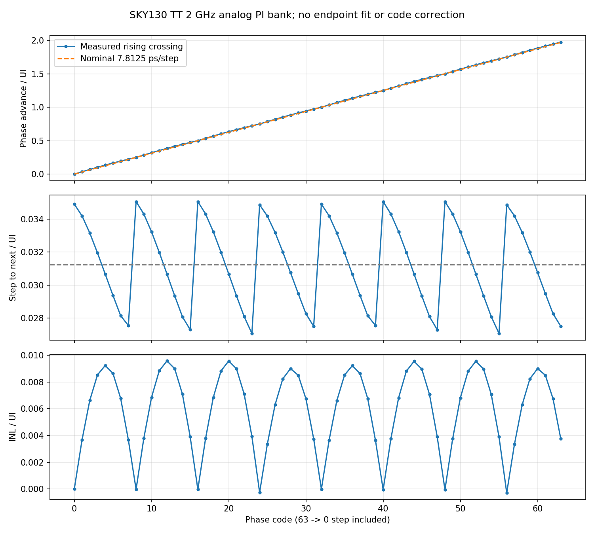
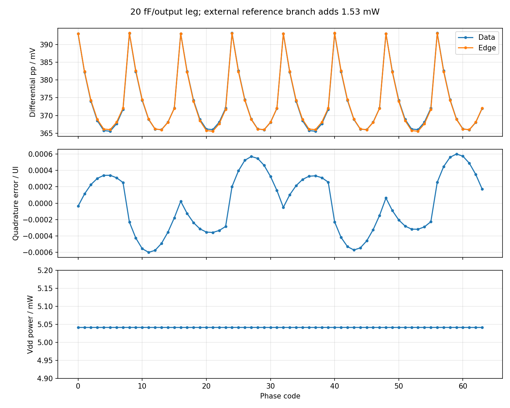
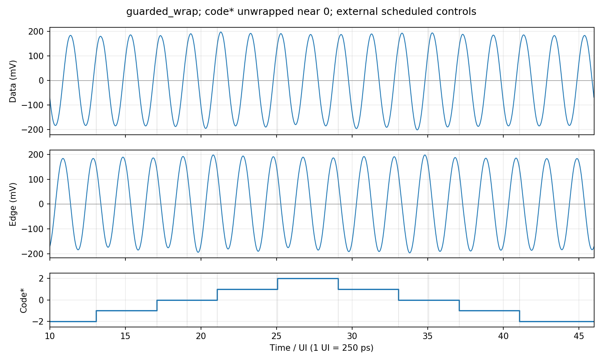

# 2 GHz、64码PI模拟原型

本文保留PI独立表征阶段的测试范围；后续新增采样器及交接RTL，见[采样器与PI控制](rx_sampler_control.md)。

2026-10-29。真实SKY130 MOS相位选择、电流插值与CML恢复输出已完成TT/27°C/1.8 V独立表征。它是每RX的模拟时钟单元；硬件译码/重定时、采样器和数字CDR尚未实现。

## 电路和接口

四对输入按相位超前0/45/90/135°排序，互补极性补齐8个锚点。各对先经CML隔离buffer，再经差分传输门选择邻接A/B。每个混合器使用8个等权真实MOS尾电流单元，温度计码将单位电流选择给A或B输入。两个混合器的锚点偏移90°。

两对差分输出共提供数据0/180°、边沿90/270°四相。2 GHz周期为2 UI，邻接四相间隔0.5 UI。互补极性复用避免4个重复插值器。真实采样器的时钟共模、摆幅和kickback接口仍需共同设计。

混合负载600 Ω、每腿200 fF；整圈bank输出恢复buffer为输入总宽48 µm、尾管12 µm、负载600 Ω。独立单扇区探索使用较小恢复级24/6 µm、800 Ω，不要把两类指标混作同一测试。

入口：[电路目录](../analog/rx/pi/README.md)、[整圈网表](../analog/rx/pi/spice/pi_rotator.spice)、[静态模板](../analog/rx/pi/tb/rotation/tb_pi_rotation_ngspice.cir.in)、[交接协议](../analog/rx/pi/tb/rotation/wrap_protocol.md)。

## 静态64码

输入为理想相关2 GHz、差分400 mVpp、共模1.65 V的tanh-sine；每输出腿20 fF为负载代理。记录4 ns、最大步长4 ps，取最后2 ns过零量测。没有接原生PLL，没有相位误差修正、端点拟合、码表校准或人为逐相对齐。

| 名义量测 | 结果 |
|---|---:|
| 全圈码数，含63→0步进 | 64 |
| 全部步进向前 | True |
| 实测步长 | 6.765–8.768 ps |
| 名义步长 | 7.8125 ps = 0.03125 UI |
| DNL | -0.134–0.122 LSB |
| 最大绝对INL | 2.394 ps = 0.0096 UI |
| 数据/边沿偏离125 ps的最大值 | 0.150 ps |
| 输出差分摆幅 | 365.5–393.2 mVpp |
| 数据占空比 | 49.999–50.002% |
| bank Vdd功耗 | 5.041–5.041 mW |

功耗含输入buffer、相位选择器、两套混合器/恢复buffer与控制反相器，**不含外部参考支路1.53 mW**（理想850 µA源、真实二极管连接MOS、独立1.8 V电源）。若计入测试参考支路，总供电约6.571 mW。可共享的真实偏置参考、PLL、多相分发树、译码器、采样器及CDR均不在bank功耗内。

正交精度来自理想相关输入和完全匹配原理图，不能替代原生ring相位误差、失配或提取后的结果。亚皮秒数值由离散波形线性过零插值得到，尚未做更细时间步长的数值收敛表征，不能视为亚皮秒精度保证。

## 短窗正反向回卷

逻辑码c=8q+f。偶数扇区A=q、B=q+1、nB=f；奇数扇区交换A/B、nB=8-f。跨扇区保持承载电流的输入，改变空闲输入并留建立时间。“零权重”指尾电流选择，未选管的寄生电容仍真实存在。

序列62→63→0→1→2→1→0→63→62，在零权重时切换空闲B支路，留500 ps建立；细码间隔1 ns、控制斜率20 ps。13 ns瞬态最大步长2 ps，t≥2 ns检查；1 ns节奏是压力测试，不代表CDR实际更新率。

| 更新时刻 | 输出 | 正/负过零数 | 最短/最长半脉冲 | 最短/最长周期 |
|---|---|---:|---:|---:|
| 避开边沿 | data | 22/22 | 241.060/257.082 ps | 490.109/509.921 ps |
| 避开边沿 | edge | 22/22 | 238.241/258.988 ps | 488.545/508.047 ps |
| 接近数据上升沿 | data | 22/22 | 240.249/257.621 ps | 491.638/509.329 ps |
| 接近数据上升沿 | edge | 22/22 | 236.046/256.341 ps | 488.878/509.824 ps |

这些规定序列在窗口内没有额外/缺失过零与窄脉冲；调相期间周期发生有限变化。它支持继续实现交接逻辑，**不是任意时刻跳码无毛刺的证明**。全扇区动态交接、多个整圈连续旋转、闭环ppm跟踪尚未验证。硬件译码、重定时和亚稳态防护尚未实现，因此配置中“glitch_free_phase_wrap_implemented”保持false。

## 选择理由和下一步

初试40 fF混合电容时，谐波使等权电流的时刻步进不均匀。200 fF使波形较平滑；300 fF改善单扇区线性但降低摆幅。因此选200 fF并加强恢复buffer，保留真实电路非线性，没有在绘图中修正。线性电流权重不天然等于线性相位，可参考[作者公开的PI线性研究](https://sudip.sites.olt.ubc.ca/files/2023/04/77.-Improving_Linearity_in_CMOS_Phase_Interpolators.pdf)。本项目指标来自实际网表。

下一步先做受控相位码交接、数据/边沿采样器，再接数字bang-bang相位/频率控制环。长时行为测试需覆盖±300 ppm探索范围及多次回卷，晶体管短窗检查关键瞬态。

接原生PLL必须量测真实八相顺序，保留VCO对称抽取/dummy和隔离；新增输入buffer不证明PLL已有足够扇出。20 fF负载代理不能替代真实采样器及kickback。尚无PVT、Monte Carlo、相位噪声或版图提取，名义夹具可供其他模型扩展验证。无DFE，冻结TX/PLL未改，也未新增持久化Python脚本。

完整数据：[JSON](data/rx_pi_first_design.json)；输入/输出哈希：[证据清单](data/rx_pi_evidence.json)。run中保留展开网表、控制激励、参数、命令、日志、原始波形与summary。静态批次：results/analog/rx/pi/rotation/batch_20261028T184303Z.json；动态批次：results/analog/rx/pi/rotation_dynamic/batch_20261028T184337Z.json。历史单扇区扫描与动态结果亦保留。
