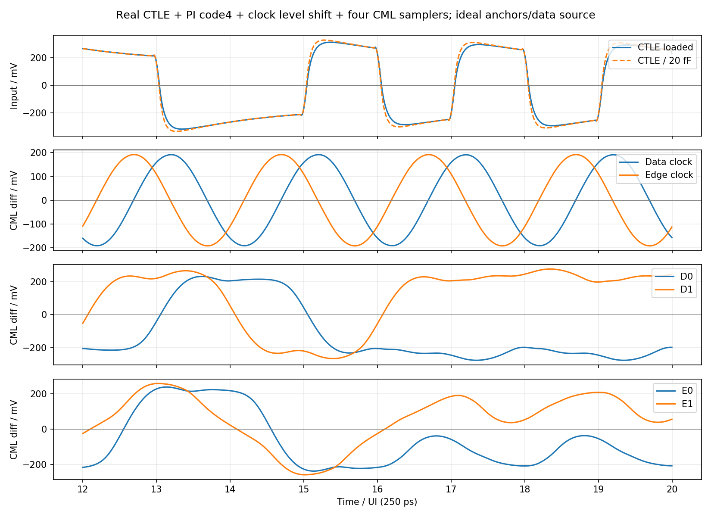
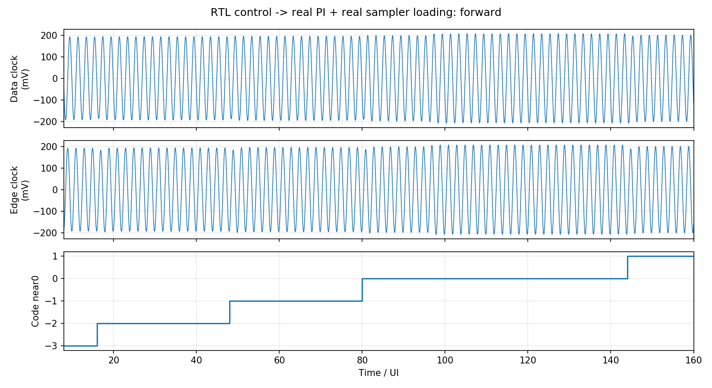

# 四相采样器与PI交接控制

本文为采样器/交接阶段记录；后续静态CMOS读出、公共时钟对齐及数字闭环见[RX闭环结果](rx_cdr_closed_loop.md)。

2026-10-29。主架构沿用共享PLL、每RX独立PI-CDR，新增真实CML采样器、逐步调相交接RTL及早晚投票RTL。未构成CDR闭环。

## 电路选择

使用静态CML主从DFF采数据和边沿，优先复用已有锁存器并适配差分时钟。两对2 GHz差分时钟的互补极性产生四相：上一D1→E0→D0→E1→D1，每段125 ps。输入先经W24/尾W12/600 Ω隔离buffer；两个时钟source follower把约1.65 V共模移至约0.95 V，再驱动四个DFF。每个DFF两级锁存器，数据/保持/时钟/尾总宽16/48/32/12 µm、600 Ω。输出仍是CML，测试负载5 fF/腿。

静态CML会持续耗电，但时钟接口和保持行为容易沿用现有设计。本轮采样组约9.29–9.30 mW，包含输入buffer、两组共模移位与四个DFF；不含外部850 µA参考支路1.53 mW、PI、CTLE、CMOS读出、降速/对齐和数字环。尚未做省电尺寸优化。

输入buffer与时钟移位各有传播延迟，外部理想125 ps位置不是最终采样中心。单位测试中边沿早晚判定在25–50 ps附加时钟延迟之间翻转，属于这条数据/时钟路径的固定偏移；PI可整体补偿。不是已量定的孔径、setup/hold或失调。

## 已运行测试

7组单元测试：350 mVpp输入，时钟偏移-25/0/25/50/75/100 ps；另加80 mVpp、75 ps偏移一点。每组54个源数据位，分别在采样边沿后180和350 ps读取真实CML输出，共108个读数，均未错。低摆幅一点不能作为灵敏度保证，也未测输入等效失调或亚稳态概率。

真实PI接入两组时钟移位器，真实CTLE接采样输入buffer；输入仍为理想相关多相锚点及CTLE输入端理想PRBS7，未包含原生PLL、PCB、封装。PI代理20 fF被实际时钟门负载取代；另克隆CTLE以20 fF/腿作加载比较。每组静态16 ns，最大步长2 ps。

| PI码 | 数据位比较 | 最小输出判决裕量 | 时钟差分摆幅 | 早/晚投票 | 超前净票 |
|---|---:|---:|---:|---:|---:|
| 0 | 0/51错 | 196.4 mV | 414.3 mVpp | 0/22 | +22 |
| 4 | 0/51错 | 197.3 mV | 384.3 mVpp | 11/11 | +0 |
| 8 | 0/51错 | 190.6 mV | 413.2 mVpp | 22/0 | -22 |

码0偏晚，应增加码使相位超前；码8偏早，应减码，方向与负反馈一致。码4窗口内早晚票平衡，不代表已经锁定或抖动最优。这些都是确定短码流的功能比较，不能当统计BER。约190 mV是输出判决电压裕量，不是输入灵敏度。

CTLE实际加载相对20 fF代理，最大瞬态差约57.5 mV，RMS约14.9 mV；当前短窗仍正确采样。尚需接回真实TX—PCB—CTLE夹具检查ISI、输入反冲及端接影响，不把本次理想输入结果外推为实际链路验收。

靠近数据跳变的边沿通道可出现低幅度或判决延后，图中E0/E1可见；后续对齐/重定时需给解析时间。本次在180 ps后数值读出其符号，不替代真实CMOS读出或亚稳态表征。

## RTL及模拟控制回放

交接器只接受±1码的valid/ready请求。细码每次只变一个温度计单元；相位粗选只切零权重支路，端点恢复与新锚点建立分别等待保护周期。默认250 MHz、保护1周期=4 ns。applied与done分别表示相位已变化和整个交接已完成，busy期间没有请求队列。1/2/3保护周期各跑390次正反向步进，覆盖全扇区、多个回卷及方向反转，检查onehot、温度计、空闲支路与完成码。

从实际RTL寄存器轨迹截取正向/反向回卷，控制端20 ps斜率，驱动真实PI、CTLE与采样器，记录40 ns、最大步长4 ps。不是对输出时钟做人工相移，也不是数字闭环。

| 控制轨迹 | 数据比较 | 数据/边沿正负过零 | 最短半脉冲 |
|---|---:|---:|---:|
| forward | 0/144错 | 各76/76 | 238.39 ps |
| reverse | 0/144错 | 各76/76 | 248.48 ps |

检查t≥2 ns时钟窗口，未见额外/缺失过零或窄脉冲；数据比较在3–39 ns的实际采样时刻后180 ps进行。不是全扇区任意更新相位、标准单元驱动斜率、CDC或亚稳态签核。

投票RTL输入是已经降速并对齐的16个数据/16个边沿样本（16 UI=4 ns），bit0最早。edge[k]介于前后两个数据样本间；数据不跳变则无票，edge等于后数据投+1（时钟偏晚），等于前数据投-1。它符合[Alexander/bang-bang鉴相模型](https://www.mathworks.com/help/serdes/ref/serdes.cdr-system-object.html)的采样思路；具体相位符号由本项目定义并用真实结果交叉检查。

已验证正负满票、抵消、无跳变、跨窗口首跳变和无效bundle；真实CML输出数值判读形成9个16位窗口，再送入实际RTL，投票全部一致。物理CML→CMOS、降速和样本对齐仍未实现，不能将四路高速CML输出直接连到250 MHz投票模块。两个RTL均通过Verilator全警告lint和Yosys proc/opt/check；未做库映射或250 MHz时序收敛。

## 下一步与证据

下一步处理静态数据读出、降速/样本对齐和物理控制重定时，再闭合相位/频率数字跟踪环。鉴相器常量偏置、PI量化、更新延迟、无跳变保持及环路系数仍需联合评估。频偏±300 ppm、多圈追踪、捕获/失锁指示尚未验证。原生PLL抽取需保留对称dummy和隔离，当前仍未接原生PLL。

本轮没有PVT、失配、噪声、版图提取或统计BER。测试参考电路未设计为真实片内偏置。PI/CTLE夹具有一个850 µA参考和一个50 µA参考，共1.62 mW独立参考电源；早期静态parameters的scope文字误写two50u branches，实际网表和本页以一个50 µA为准。对照夹具有两个CTLE，Vdd总功耗不直接作为每lane预算。

[采样电路与模板](../analog/rx/sampler/README.md) · [RTL与测试](../digital/rx/README.md) · [完整数据](data/rx_sampler_control.json) · [哈希证据](data/rx_sampler_control_evidence.json)。原有冻结TX/PLL没有修改；本轮未新增持久化Python脚本。
