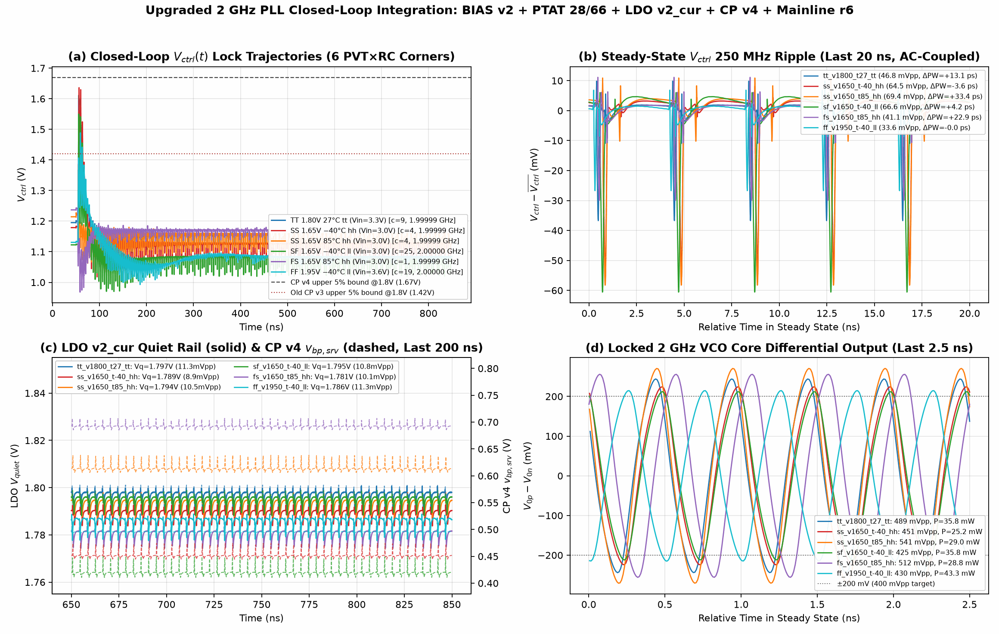
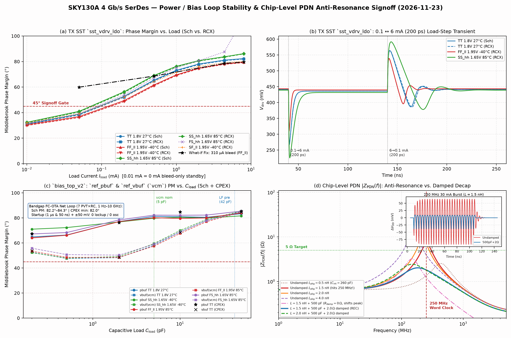

# 当前状态（唯一入口）

**这一页是项目级采用状态与验证数字的唯一汇总。** README、模块地图、计划和工作台均引用本页；模块设计文档保留详细分析、参数推导与原始边界，工作修订保留机器参数和历史身份。规则见 [架构决定](architecture_decisions.md) 与 [文档职责](../README.md)。

截至 **2026-11-23（4 Gb/s Zero-CML 初稿签核发布）**，主线采用组合已全面升级为 **4 Gb/s Zero-CML SerDes**：
- **PLL v4**：VCO `r6` + BIAS v2 PTAT (`28/66`, `sym9_clean` CPEX) + CP `v4`/`v4.1` + 融合 LF v2 + `pll_pfd_sc_dly` + SAFF-TSPC 重定时 ÷8 + `r5` CML→CMOS 接收器
- **供电与偏置**：HV18 LDO `v2_cur` + 慢尾偏置滤波 `bias_filter_r4` + `BIAS v2`
- **TX**：Zero-CML SST `v4.3`（16:4 CMOS 串化 + 4 相 N-over-N 28-slice SST 含 2-tap FFE）
- **RX**：Zero-CML CMOS RX `v2.2`（100 Ω 端接 + CTLE + 2 GHz 64 码纯 CMOS PI + 四分之一速 Double-Tail 采样 + 8→32 解串）
- **数字顶层**：统一精简宏 `serdes_digital_top_v3`（v3.1，多速率 `250 / 125 / 62.5 MHz`）
- **片级版图规划**：`845.4 × 601.4 µm = 0.5084 mm²`（21 个已签核功能宏 + 12 个阻尼 PDN 去耦阵，957.9 pF 总片上电容，0 重叠）

历史 CML 基准标签 `baseline-prelayout-20261113` 及历史 `v0.1-design-freeze-20261028` 原样保留可追溯。

---

## 1. 一句话状态

**4 Gb/s Zero-CML SerDes 全部六大子系统（PLL v4、LDO v2_cur、BIAS v2、TX SST v4.3、RX CMOS v2.2、Digital Top v3.1）均已完成 SKY130A PDK 版图签核（DRC = 0 / LVS = MATCH）、各自后仿验证（TX 22/22 RCX、RX 3/3 CPEX、PLL 7/7 闭环锁定、Digital 3 角 STA + 4/4 VCS SDF GLS）及 `0.5084 mm²` 真实尺寸片级规划。** 顶层全芯片版图互连布线（Top-Level Routing）与跨宏片级联合瞬态闭环列为下一阶段集成收口项。

---

## 2. 当前 4 Gb/s Zero-CML 主线模块状态

“驱动 / 边界”一栏注明该条证据实际采用的激励与寄生边界；局部通过不自动替代顶层芯片级联合后仿。

| 模块 | 当前修订 / 版图目录 | 驱动 / 边界 | 验证结果 | 待集成 / 未覆盖边界 |
|---|---|---|---|---|
| **[PLL v4 闭环顶层](../design/pll_vco_r6_perf.md)** | `pll_top_r6_v4_upgrade`（[闭环台](../../analog/pll/top/tb/lock_v4/verify_pll_v4_closed_loop.py)） | 真实 BIAS v2 + HV18 LDO `v2_cur` + VCO `r6` PTAT + CP v4 + 融合 LF + SAFF-TSPC ÷8，7 PVT 角 | **7/7 角通过 320 ns 锁定合同**（保持 `416–640 ns`，频偏 `−4.75..+2.25 ppm`，`TT +12.2 ps` 静态相差，250 MHz 杂散 `−40..−59 dBc`，`TIE_pp 0.74–4.11 ps`，LDO 安静域 `1.781–1.797 V`，`TT 35.8 mW`） | 顶层全寄生回灌联调；从零上电自动粗搜全时序联合瞬态 |
| **[VCO r6 + PTAT](../design/pll_vco_r6_ptat.md)** | `r6` + PTAT `28/66`（[sym9_clean](../../analog/pll/vco/layout/variants/sym9_clean/README.md) · [ptat_bias_pdk](../../analog/pll/vco/layout/variants/ptat_bias_pdk/README.md)） | `sym9_clean` CPEX 5 角 + 135 条件原理图 + 相噪/抖动标定 | 45/45 跨三温单码覆盖；`sym9_clean` CPEX 八相正交误差 `≤ 0.76 ps (0.54°)`；`TT L(1M/10M) = −88.5/−109.2 dBc/Hz`；PLL v4 RMS 抖动 `1.91 ps` TT / `2.29 ps` 最差（CDR `14.07σ = 0.272–0.296 UI`，余量 41%） | VCO + PTAT + 分频器芯片级顶层 RCX 耦合 |
| **[CP v4 / v4.1 & 融合 LF v2](../design/pll_cp_v4.md)** | `pll_cp_steer_v4`（[v4_pdk](../../analog/pll/cp/layout/variants/v4_pdk/README.md)）· `lf_k4_fused`（[fused_pdk](../../analog/pll/loop_filter/layout/variants/fused_pdk/README.md)） | 全 PVT 窗口 / MC + DRC/LVS/PEX；v4.1 `up_wn=4.0, up_wp=12.0, up_ln=0.30` | CP v4 主动伺服宽摆幅签核（DRC=0/LVS=MATCH）；v4.1 进一步将 `Vctrl` 开关毛刺降低 `2.2–3.5×`、参考杂散降至 `−60 dBc`；LF `6,382 µm²`（`ctrl` CPEX −41.4%） | v4.1 尺寸同步至 `v4_pdk` 几何并重跑联合环路 RCX |
| **[SAFF-TSPC ÷8 & r5 接收器](../design/pll_tspc_reclock_divider.md)** | `tspc_reclock_prescaler8_2g`（[saff_reclock_2g_pdk](../../analog/pll/divider/layout/variants/saff_reclock_2g_pdk/README.md)）· `r5` v6（[r5_pdk](../../analog/common/cml_to_cmos/layout/variants/r5_pdk/README.md)） | 45 角 CPEX / RCX + 200 样本失配 MC | ÷8 面积 `1,705 µm²`，DRC=0/LVS=MATCH，CPEX 功能 45/45、44/45 偏斜 `< 30 ps`，`RCX_BOTH` 5/5；`r5` v6 CPEX 45/45、原生 RCX 6 压力点通过、TT/SS 冷 200/200 MC 通过 | SAFF-TSPC `SS 1.65 V −40 °C` 失配下 `Xtg2` 路径偏斜边界（168/200 正常分频） |
| **[HV18 LDO v2_cur](../design/ldo_v2.md)** | `pll_supply_hv18_v2_cur`（[v2_cur_pdk](../../analog/ldo/layout/variants/v2_cur_pdk/README.md) · [bias_filter_r4_pdk](../../analog/ldo/layout/variants/bias_filter_r4_pdk/README.md)） | 全 PVT DC/AC/瞬态/RCX + 轻载泄放复核 | 面积 `27,826 µm²`（DRC=0/LVS=MATCH），PLL v4 闭环中安静域 `1.781–1.797 V`、`vbp_srv` 漂移 `≤ 0.0016 mV`；`Xrbleed l=5.0` 泄放调整将轻载 PM 由 `30.5°` 提至 `58.3°` | 全芯片上电时序与封装引线电感耦合 |
| **[BIAS v2](../design/bias_v2.md)** | `bias_top_v2`（[v2_pdk](../../analog/bias/layout/variants/v2_pdk/README.md)） | 135 角 PVT + 200 样本 MC + 启动 + RCX | 单级 FC-OTA + 真 CMOS `ref_pbuf` + 集成 `bias_top` 全套 DRC=0/LVS=MATCH；向 PLL/TX/RX 提供稳定 `Vbg`/`Vcm`/`Ibias`/PTAT | 芯片级跨宏长距离偏置分配寄生 |
| **[TX Zero-CML SST v4.3](../design/tx_sst_v4.md)** | `tx_sst_v4`（[v4_pdk](../../analog/tx/sst/layout/variants/v4_pdk/README.md)） | 真实 28-slice SST + `0.44 V` LDO + `C2_loss6` 信道，原生 RCX 后仿 | 面积 `231.50 × 146.98 = 34,026 µm²`，5/5 单元 DRC=0/LVS=MATCH，`pad_p/n = 46.5/42.9 fF`；**22/22 RCX 角全通过** | 与锁定 PLL v4 同 deck 动态联调；ESD + 封装焊盘实测寄生 |
| **[RX Zero-CML CMOS v2.2](../design/rx_cmos_v2.md)** | `rx_cmos_v2`（[v2_pdk](../../analog/rx/cmos_rx/layout/variants/v2_pdk/README.md)） | 真实 TX SST v4 (`FFE=3`) → `C2_loss6` 远端波形，45 角原理图 + 3 角 CPEX 后仿 | 面积 `245.30 × 195.40 = 47,932 µm²`，8/8 单元 DRC=0/LVS=MATCH；**45/45 端到端原理图 + 3/3 CPEX 后仿全通过**（`TT / SS −40°C / FF −40°C`：`0/64` 数据、`0/27..30` 边沿、`TT 36.11 mW`）；PI 64 码 TT CPEX `\|INL\| = 0.0177 UI`（100% 单调） | 45 角全量 CPEX 扩角；真实锁相 PLL 锚点 + 失配下门限校准 |
| **[数字顶层 v3.1](../design/digital_top_v3.md)** | `serdes_digital_top_v3`（[summary.json](../../digital/pnr/variants/hd_pnr_v3_unified/serdes_digital_top_v3/summary.json)） | 3 角 OpenRCX SPEF STA + 4 模式 VCS SDF 3.0 GLS + 122,608 SVA | 面积 `338.10 × 307.40 = 103,932 µm²`（较 v2 −43.9%），4,932 单元，`0` `hold_clkbuf_16`，DRT=0/ANT=0/DRC=0/LVS=MATCH；6 时钟域全 MET（`SS +0.074 ns`、`FF +0.125 ns`）；**4/4 VCS SDF GLS PASS**（0 同步违例、0 PLL 毛刺、`±300 ppm` 闭环 CDR 通过） | 顶层模拟-数字跨宏接口寄生与片级 IR drop |
| **[片级规划与阻尼 PDN](../layout/chip_floorplan_20261123.md)** | `chip_floorplan_20261123`（[plan_chip_floorplan.py](../../verification/layout/plan_chip_floorplan.py)） | 全部 21 个签核 `.mag`/`.def` 真实外框 + 12 个阻尼 MIM1+MIM2 去耦阵 | 核心 **`845.4 × 601.4 µm = 0.5084 mm²`**，功能宏 `302,393 µm²`（59.5%）+ 阻尼去耦 `761.0 pF`（`R_eq = 1.51 Ω`）总填充 `81.0%`，`0.0 µm²` 重叠，总片上电容 `957.9 pF` | 顶层电源环/焊盘环（Padring）与顶层金属布线整合 |

---

## 3. 历史 CML 路线状态留存（Reference Baseline）

早期全 CML 架构（PLL `r6k4q`、TX `v3/extra5` 45/45 理想源、RX `ac_trim/c2/W40`、HV18 LDO `r4`、Bias `B2`）的完整源码、测试台、证据卡及 2026-11-15 阶段版图审阅均按原始身份保留，便于对比功耗、面积与架构演进：

- **历史 CML TX**：[tx_final_retime.md](../design/tx_final_retime.md)（理想 2 GHz 源 45/45，最差 FS 1.65 V 85 °C 焊盘 136.0 mV / 0.138 UI）与 [tx_clock_distribution.md](../design/tx_clock_distribution.md)
- **历史 CML RX**：[rx_pi_sampler.md](../design/rx_pi_sampler.md)（C2 信道 135 条件无读出窗口最差 0.8125 UI）
- **历史 CML ÷8 与阶段审阅**：[pll_divider.md](../design/pll_divider.md)、[pll_acceptance_20261115.md](../layout/pll_acceptance_20261115.md)、[pll_review_20261115.md](../layout/pll_review_20261115.md)（原三叠层 CML ÷8 的全量原生 RC 分支 `LAYOUT-PLL-DIV-RC-01` 仍标记暂停，主线已切换至 SAFF-TSPC CMOS ÷8）

---

## 4. 开放集成项与已知风险

1. **顶层芯片级互联与联合瞬态**：当前已闭合全部 21 个宏的独立 DRC/LVS 与模块级后仿（TX RCX、RX CPEX、PLL 闭环、Digital SDF GLS），但尚未完成顶层金属互连（Top-Level Integration）、Padring/ESD 拼接及“锁定 PLL → 动态 TX → PCB → RX → 数字 CDR”的完整顶层联调。
2. **SAFF-TSPC ÷8 极冷低压失配边界**：`SS 1.65 V −40 °C hh` 下 200 样本 CPEX MC 为 168/200 正常分频（故障集中于 `Xtg2` 路径），需在后续量产良率迭代中加宽 `Xtg2` 或进一步降低该节点寄生。
3. **RX CPEX 45 角扩角**：RX v2.2 原理图已通过 45/45，CPEX 后仿已完成 3 个代表性压力角（`TT`、`SS −40 °C`、`FF −40 °C`）3/3 全通过；剩余 42 角 CPEX 扩角待顶层集成阶段排期执行。
4. **物理同步小修订**：CP v4.1（`up_wn=4.0, up_wp=12.0, up_ln=0.30`）与 LDO `Xrbleed l=5.0` 已在电路仿真复核通过，后续顶层合图前同步重生成对应 `.mag` 宏即可。
