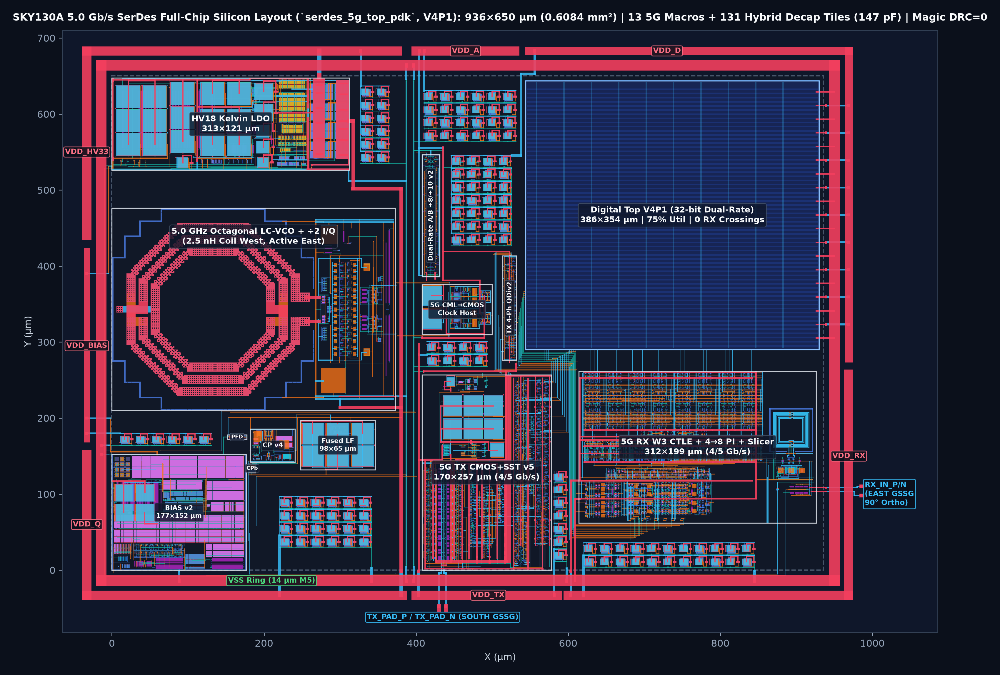

# 当前状态（唯一入口）

**这一页是项目级采用状态与验证数字的唯一汇总。** README、模块地图、计划和工作台均引用本页；模块设计文档保留详细分析、参数推导与原始边界，工作修订保留机器参数和历史身份。规则见 [架构决定](architecture_decisions.md) 与 [文档职责](../README.md)。

截至 **2026-11-26**，仓库收敛为两条清晰、可复核的 SKY130A 物理实现线：
- **主推设计 — 5.0 Gb/s 双速（4/5 Gb/s）LC-PLL SerDes（`serdes_5g_top_pdk`，Plan-C）**：`936 × 650 µm = 0.6084 mm²`，完成全部 8/8 模拟加固单元真 CPEX/RCX 签核、端口协同 32-bit 双速数字宏 `v4p1` 签核与 Plan-C 全片物理装配签核（Magic `DRC=0`、`55.43 MB` GDS、层级 `ext2spice lvs` `28/28` 连通 & `41/41` 隔离）。固定台账见 [5G 签核台账](../../results/catalog/serdes_5g_signoff_20261126.json) 与 [4G/5G 实装物理复核](../../results/catalog/chip_physical_audit_20261126.json)。
- **无电感对照基线 — 4.0 Gb/s 环振 SerDes（`v1.0` / `full_v8`）**：保留 2 GHz 四级环振 PLL v4（`r6` + PTAT `28/66` + CP v4 + 融合 LF）、SAFF-TSPC ÷8、HV18 LDO `v2_cur` + BIAS v2、TX SST v4.3、RX CMOS v2.2、数字顶层 v3.1/v3.2 及 `full_v8` 核心装配（`DRC=0`）。固定记录见 [主线工作修订](../../config/mainline_working_revision.toml)、[v1.0 子系统证据](../../results/catalog/v1_0_subsystem_evidence.json) 与 [片级集成证据](../../results/catalog/chip_integration_20261124.json)。

早期全 CML 路线（`baseline-prelayout-20261113`）与 `v0.1` 历史冻结归档在 git 历史（标签 `v1.0` / 提交 `b10e989`）。

---

## 1. 一句话状态

**5.0 Gb/s 双速 Plan-C 与 4.0 Gb/s 环振 `full_v8` 均已完成核心物理装配（Magic `DRC = 0`）与独立宏签核。** 下一阶段转入流片前片顶封口：补齐参考/复位/使能顶层连接、修复 4G `icml` 短接、合入 Padring/ESD 与独立全片 LVS、复算带载 RCX / 静态与动态 IR/EM / 工艺填充，以及完成实际分频与生产数字的冷启动闭环联调，见 [执行计划](prelayout_plan.md) 与 [问题登记](open_issues.md)。

---

## 2. 5.0 Gb/s 双速主线（Plan-C `serdes_5g_top_pdk`）签核状态

“物理与提取签核 / 关键实测边界”均基于独立隔离 PDK 变体的 Magic CPEX/RCX、OpenRCX SPEF STA 与真实层级提取，固定证据索引见 [5G 签核台账](../../results/catalog/serdes_5g_signoff_20261126.json) 与 [片级版图报告第 9 节](../layout/chip_floorplan_20261123.md#9-50-gbs-plan-c-全片物理装配与层级签核2026-11-26)：

| 子系统 | 隔离变体 / 入口 | 物理与提取签核 | 关键实测边界 |
|---|---|---|---|
| **5G 八边形 LC-VCO + 正交 ÷2** | [`lc_vco_5g_oct_pdk`](../../analog/pll/vco_5g/layout/variants/lc_vco_5g_oct_pdk/summary.json) | `DRC=0 / LVS=MATCH`（`266.0 × 372.5 µm`） | 6/6 角 + **125 °C 冻码** 3/3 PASS（全角公共交集 `4.469–5.350 GHz`）；`SS +85 °C` 24/24 `_mm` MC 100% 锁定，I/Q `σ = 0.645 ps` |
| **5G 双速 A/B 分频器** | [`div_ab_5g_v2_pdk`](../../analog/pll/divider/layout/variants/div_ab_5g_v2_pdk/summary.json) · [A/B 分频](../design/pll_feedback_data_dividers.md) | `DRC=0 / LVS=MATCH / M5=0%`（`160.4 × 23.0 µm`） | 6/6 角（12/12 `÷8 / ÷10`）PASS（`SS −40 °C` `H=206.5 / S=131.4 ps`）；50/50 `SS −40 °C` MC 100% 达标（`\|diff_sk\| ≤ 4.77 ps`） |
| **供电与偏置加固** | [`v2_cur_kelvin_pdk`](../../analog/ldo/layout/variants/v2_cur_kelvin_pdk/README.md) · [`v4p5_pdk`](../../analog/tx/sst/layout/variants/v4p5_pdk/summary.json) · [BIAS v2](../design/bias_v2.md) | `DRC=0 / LVS=MATCH` | HV18 Kelvin `R_eff −92.9%` / `PSRR ≥ 28.7 dB` / 100× RCX MC 本体 `3σ ≤ 10.76 mV`；TX VDRV LDO 200× CPEX MC `3σ ≤ 15.60 mV` |
| **5G TX SST 顶层** | [`tx/sst/layout/variants/v5_pdk`](../../analog/tx/sst/layout/variants/v5_pdk/summary.json) · [TX 设计](../design/tx_sst_v4.md) | `DRC=0 / LVS=MATCH`（`256.8 × 169.6 µm`，38 端口） | 真 CPEX **16/16（12 路 5G + 4 路 4G）PASS**：散布 `0.006–0.145 UI`，`Vdrv_rip ≤ 44.3 mVpp`（零冷角直通），裕量 `100.1–226.7 mV` |
| **5G RX 集成顶层** | [`rx_top_5g_pdk`](../../analog/rx/cmos_rx/layout/variants/rx_top_5g_pdk/summary.json)（`v5g_4ph_v3_pdk` + `slicer_5g_pdk` + `W3 CTLE`）· [RX 设计](../design/rx_cmos_v2.md) | `DRC=0 / FP=0 / DC & Open LVS=MATCH`（`312.1 × 199.4 µm`，72/74 端口） | W3 CTLE 45/45 AC + 400× MC；`slicer_5g` 6/6 + 250/250 MC（`3σ ≤ 20.30 mV`）；`PI v3` 6/6 标称 `ALL_OK` + 24×冷角 MC `0/24` 翻转/停振、`20/24 < 30 ps`（余 4 尾差归因 `pi4_diff_rec` SVT-PMOS） |
| **5G 数字顶层 `v4p1`** | [`hd_pnr_v4p1_5g_coopt`](../../digital/pnr/variants/hd_pnr_v4p1_5g_coopt/serdes_digital_top_v4/summary.json) · [`rtl_v4_32b`](../../digital/pnr/rtl_v4_32b/serdes_digital_top_v4.sv) | `DRC=0 / LVS=MATCH`（`385.9 × 353.6 µm`，`-7.2%`） | 32-bit 降频双速（`160 MHz` host），6 角 ±5% OCV 5G/4G 全 MET（`setup ≥ +0.059 ns / hold ≥ +0.073 ns`），CDC `26/26`，RX 33-bit `0` 交叉 |
| **5G 端到端闭环联调** | [`serdes_5g_top_cosim_20261124.png`](../figures/system/serdes_5g_top_cosim_20261124.png) | 原理图含真实提取电感寄生（LC-VCO + CTLE） | 3/3 PVT + 真单 Deck TT 端到端闭环通过；实际全提取后仿与生产数字带载联调见 I-TOP-04 |
| **5G Plan-C 全片装配** | `serdes_5g_top_pdk`（[装配脚本](../../verification/layout/build_chip_top_5g_pdk.py)） | **Magic `DRC=0` / `55.43 MB` GDS / 层级 `ext2spice` `28/28` 连通 & `41/41` 隔离** | `936 × 650 µm = 0.6084 mm²`（`-21.8%` vs Plan A），13 宏密度 `70.3%`，131 紧缩 Direct/Damped/HV33 瓦片 `10.9%`（`147.03 pF`），8 供电域严格独立，`icml` 已独立 |

Plan C 的片顶装配通过已登记的几何和提取门控。参考、复位、LDO 使能及环路预充等端点仍待回接，Pad/ESD、独立全片 LVS、带载 I/Q 寄生和实际供电签核随片顶集成收口。[4G 与 5G 实装复核](../layout/chip_floorplan_20261123.md#10-实装金属与分析缺口复核2026-11-26)

---

## 3. 4.0 Gb/s 无电感环振基线（`v1.0` / `full_v8`）模块状态

“驱动 / 边界”一栏注明该条证据实际采用的激励与寄生边界；局部通过不自动替代顶层芯片级联合后仿。

| 模块 | 当前修订 / 版图目录 | 驱动 / 边界 | 验证结果 | 待集成 / 未覆盖边界 |
|---|---|---|---|---|
| **[PLL v4 闭环顶层](../design/pll_vco_r6_perf.md)** | `pll_top_r6_v4_upgrade`（[闭环台](../../analog/pll/top/tb/lock_v4/verify_pll_v4_closed_loop.py)） | 原理图闭环，固定粗码、预充后捕获。冻结顶层用 `clock_frontend_r6q` 的 CML ÷8 和 `cml_to_cmos_pvt_candidate`，CP 为 v4。六点用真实 HV18 `v2_cur`，SF 热点直供 1.65 V | **7/7 角通过 320 ns 锁定合同**（保持 `416–640 ns`，频偏 `−4.75..+2.25 ppm`，TT 静态相差 `+12.2 ps`，250 MHz 杂散估计 `−40..−59 dBc`，`TIE_pp 0.74–4.11 ps`，TT `35.8 mW`） | 接入 `r5` + SAFF-TSPC 后复核原生闭环，继而验证带载、顶层 RCX 与从零自动粗搜 |
| **[VCO r6 + PTAT](../design/pll_vco_r6_ptat.md)** | `r6` + PTAT `28/66`（[sym9_clean](../../analog/pll/vco/layout/variants/sym9_clean/README.md) · [ptat_bias_pdk](../../analog/pll/vco/layout/variants/ptat_bias_pdk/README.md)） | `sym9_clean` CPEX 5 角 + 135 条件原理图表征。相噪由 ISF 合成，PLL/CDR 抖动由环路模型估算 | 45/45 跨三温单码覆盖，`sym9_clean` CPEX 八相误差 `≤ 0.76 ps`。TT `L(1M/10M) = −88.5/−109.2 dBc/Hz`，10 kHz–100 MHz 模型 RMS 抖动 `1.91 ps` TT / `2.29 ps` 最差，CDR `14.07σ = 0.272–0.296 UI` | VCO、PTAT、分频器与真实互连带载后的 RCX 和系统预算 |
| **[CP v4 & 融合 LF v2](../design/pll_cp_v4.md)** | `pll_cp_steer_v4`（[v4_pdk](../../analog/pll/cp/layout/variants/v4_pdk/README.md)）· `lf_k4_fused`（[fused_pdk](../../analog/pll/loop_filter/layout/variants/fused_pdk/README.md)） | CP v4 独立 135 角 DC、AC/瞬态和压力点 CPEX | 独立 DRC=0/LVS=MATCH；LF `6,382 µm²`（`ctrl` CPEX −41.4%）；复核记录见[证据索引](../../results/catalog/v1_0_subsystem_evidence.json) | 与实载片顶互连的联合环路回归 |
| **[SAFF-TSPC ÷8 & r5 接收器](../design/pll_tspc_reclock_divider.md)** | `tspc_reclock_prescaler8_2g`（[saff_reclock_2g_pdk](../../analog/pll/divider/layout/variants/saff_reclock_2g_pdk/README.md)）· `r5` v6（[r5_pdk](../../analog/common/cml_to_cmos/layout/variants/r5_pdk/README.md)） | 45 角 CPEX / RCX + 200 样本失配 MC | ÷8 面积 `1,705 µm²`，DRC=0/LVS=MATCH，CPEX 功能 45/45、44/45 偏斜 `< 30 ps`，`RCX_BOTH` 5/5；`r5` v6 CPEX 45/45、原生 RCX 6 压力点通过、TT/SS 冷 200/200 MC 通过 | 原版 `SS 1.65 V −40 °C` 失配边界 `168/200`；加固候选 `v2` 见第 4 节 |
| **[HV18 LDO v2_cur](../design/ldo_v2.md)** | `serdes_pll_supply_hv18_v2_cur`（[v2_cur_pdk](../../analog/ldo/layout/variants/v2_cur_pdk/README.md) · [bias_filter_r4_pdk](../../analog/ldo/layout/variants/bias_filter_r4_pdk/README.md)） | 电流参考供电宏独立 DRC/LVS、CPEX/RCX 提取及 PLL 预充后闭环 | 生产宏 `37,958.68 µm²`、DRC=0/LVS=MATCH。六个带 LDO 闭环条件的安静域 `1.781–1.797 V` | 实际芯片上电、负载与封装引线电感耦合；Kelvin 加固见 5G `v2_cur_kelvin_pdk` |
| **[BIAS v2](../design/bias_v2.md)** | `bias_top_v2`（[v2_pdk](../../analog/bias/layout/variants/v2_pdk/README.md)） | 135 角 PVT + 200 样本 MC + 启动 + RCX | 单级 FC-OTA + 真 CMOS `ref_pbuf` + 集成 `bias_top` 全套 DRC=0/LVS=MATCH；向 PLL/TX/RX 提供稳定 `Vbg`/`Vcm`/`Ibias`/PTAT | 芯片级跨宏长距离偏置分配寄生 |
| **[TX SST v4.3](../design/tx_sst_v4.md)** | `serdes_tx_sst_top`（[v4_pdk](../../analog/tx/sst/layout/variants/v4_pdk/README.md)） | 理想 1 GHz 四相。22 项后仿记录含驱动器 ZQ/S11 与完整 TX（RLC16/C2 CPEX & RCX） | 原理图 MOS45 通过，原后仿完整 TX 十项均满足焊盘及各台远端门槛 | 锁定 PLL 动态联调及 Pad/ESD/封装；5G/4G 双速加固见 `v5_pdk` |
| **[RX CMOS v2.2](../design/rx_cmos_v2.md)** | `serdes_rx_cmos_top`（[v2_pdk](../../analog/rx/cmos_rx/layout/variants/v2_pdk/README.md)） | 六个压力点原理图同 deck；MOS45 原理图与 3 点 CPEX 回放逐角 TX SST `FFE=3`、`C2_loss6` 波形，理想 PI 锚点 | 面积 `245.30 × 195.40 = 47,932 µm²`，8/8 单元 DRC=0/LVS=MATCH。**45/45 原理图回放 + 3/3 CPEX 回放通过**（`0/64` 数据错，TT `36.11 mW`）。PI TT 64 码 CPEX 单调，`\|INL\| = 0.0177 UI` | 45 角全量 CPEX；实际锁相 PLL 锚点及失配门限校准 |
| **[数字顶层 v3.1](../design/digital_top_v3.md)** | `serdes_digital_top_v3`（[summary.json](../../digital/pnr/variants/hd_pnr_v3_unified/serdes_digital_top_v3/summary.json)） | 3 角 OpenRCX SPEF STA。VCS 回归含 1 个 RTL 参考与 3 个 SDF GLS 工况 | 面积 `338.10 × 307.40 = 103,932 µm²`，4,932 单元，DRT=0/ANT=0/DRC=0/LVS=MATCH。6 时钟域全 MET（SS `+0.074 ns`、FF `+0.125 ns`）。四模式每模式 122,608 项 SVA 通过，`±300 ppm` CDR 通过 | 顶层模拟-数字跨宏接口寄生与片级 IR drop |
| **[信道 C0–C5](../design/channel_model.md)** | 合成 100 Ω 差分 PCB 族（[配置](../../config/channel_family.toml)） | SST/RX 主线验证采用 `C2_loss6` 的 SPICE 等效；TX 近无损筛查用 RLC16 | C2 是设计与回归基线；C3–C5 是挑战和诊断条件 | 实际 PCB / 封装 S 参数、串扰与链路验收边界 |
| **[4G 片级规划](../layout/chip_floorplan_20261123.md)** | `chip_floorplan_20261123`（[plan_chip_floorplan.py](../../verification/layout/plan_chip_floorplan.py)） | 21 个 `.mag`/`.def` 功能宏实测外框与 12 个去耦预留矩形 | 核心 **`845.4 × 601.4 µm = 0.5084 mm²`**，功能宏 `302,393 µm²`（59.5%），含去耦区域总填充 `81.0%`、外框零重叠 | 见第 4 节 `full_v8` 实装复核 |

---

## 4. 4G `full_v8` 片级集成与收口核查

| 验证对象 | 已复核结果 | 适用边界与待收口 |
|---|---|---|
| **`full_v8` 核心装配** | Magic 全规则 **DRC=0**，`52.09 MB` GDS，111 条登记信号网通过，208 块混合去耦瓦片（`245.2 pF`）。层级提取查 42 组应连接端和 45 组应独立端均通过。数字宏为 v3.2 | 2026-11-26 独立层级复核确认 **四路 CML→CMOS 的偏置与 `VSS` 短接**（5G Plan-C 已根除）；参考、复位、LDO 使能、环路预充、Pad/ESD、独立全片 LVS、带载 RCX 与同版 IR/EM 随 I-TOP-01..03 收口。[实装复核](../layout/chip_floorplan_20261123.md#10-实装金属与分析缺口复核2026-11-26) · [审计台账](../../results/catalog/chip_physical_audit_20261126.json) |
| **PLL v4.2 候选** | 由 4× `r5` 和加固 ÷8 `v2_cand` 直接反馈。TT、SS 冷、FS 热 **3/3 完成预充后短窗功能筛查** | 固定粗码、预充偏置 +20 mV，140 ns 原理图台。三角最终 40 ns 频差 `+597 / −229 / −200 ppm`，缺少工程判锁 320 ns 保持纪录；实际带载与互连待回灌 |
| **短窗 4 Gb/s 模拟联合台** | 同源 PLL→TX→`C2_loss6`→RX 的分段 TT、SS 冷、FS 热三角回放每点 **0/64 数据错**，PI 中心及 ±8 码通过 `0.50 UI` 跨度门槛且 BBPD 翻向。TT 同 deck **0/80 数据错、0/34 确定边沿错** | 76 ns 台的 PLL 内部仍用旧 CML ÷8；FF 冷角在低温 PNP OP 数值上未完成；采用反馈、独立 RX 时基、RTL CDR/FIFO 与正式锁定待验 |
| **加固 SAFF ÷8 候选** | 原理图 PVT **45/45**，SS 冷和 FS 热各 200 样本 MC 为 **199/200 和 200/200**。叶单元 [`saff_reclock_2g_v2_pdk`](../../analog/pll/divider/layout/variants/saff_reclock_2g_v2_pdk/summary.json) 独立 DRC/LVS 通过，**7/7** 压力点 CPEX 通过 | 失配运行的候选 ÷8 为原理图，接收器为 CPEX；候选自身布局的完整 MC/RCX 与实际反馈锁定仍待补齐 |
| **数字 v3.2 / v3.3 收口核查** | `full_v8` 实装 v3.2 宏级 DRC=0、LVS=MATCH、STA **18/18**（SS `+14.5/+223.9 ps`），VCS 四模式功能通过（复位纪元有 3/1 条提示）。后续 32-bit 降频架构已在 5G `v4p1` 中彻底闭合 1.65 V 冷角 6 角 ±5% OCV 时序 | 固定复核收据见 [digital_v3p3_audit_20261125.json](../../results/catalog/digital_v3p3_audit_20261125.json) 与 [chip_integration_20261124.json](../../results/catalog/chip_integration_20261124.json)；SDF 带延时回归随 I-TOP-04 复测 |

[问题登记](open_issues.md)维护关闭条件，[执行计划](prelayout_plan.md)维护执行队列、首片 DFT 入口与流片前验收顺序。
