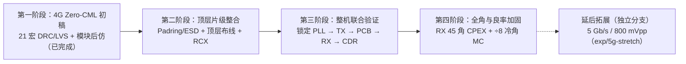

# 执行计划与里程碑

> **阶段状态（2026-11-23）**：**4 Gb/s Zero-CML SerDes 初稿全子系统签核（PLL v4、LDO v2_cur、BIAS v2、TX SST v4.3、RX CMOS v2.2、Digital Top v3.1 与 `0.5084 mm²` 片级阻尼 PDN 规划）已全部闭合**，详细验证数字与边界统一见 **[current.md](current.md)**。本页现维护下一阶段**顶层芯片集成与良率加固**的执行队列与退出条件。

---

## 1. 当前主线与路线图

---

## 2. 下一阶段可执行队列（顶层集成与加固）

| 顺序 / 任务 | 目标与最小动作 | 退出条件 | 关联项 |
|---|---|---|---|
| **1 / TOP-SYNC** | 将已仿真通过的两项 4G 微修同步进对应 `.mag` 宏：CP v4.1（`up_wn=4.0, up_wp=12.0, up_ln=0.30`，杂散 `−60 dBc`）与 TX LDO `Xrbleed l=5.0`（轻载 PM `58.3°`） | 两个宏重新通过 `review_cell.py --rc`（DRC=0 / LVS=MATCH）并更新 `summary.json` | [pll_cp_v4.md](../design/pll_cp_v4.md)、[ldo_v2.md](../design/ldo_v2.md) |
| **2 / TOP-ROUTE** | 基于 [chip_floorplan_20261123.md](../layout/chip_floorplan_20261123.md)（`845.4 × 601.4 µm`）完成 21 功能宏 + 12 阻尼 PDN 阵的顶层金属互连、电源环与 Padring/ESD 拼接 | 顶层 Magic full-rule `DRC = 0`、Netgen `LVS = MATCH`，2 GHz 钟树等长偏斜 `< 5 ps` | [chip_floorplan_20261123.md](../layout/chip_floorplan_20261123.md) |
| **3 / TOP-COSIM** | 在同一激励边界下验证“锁定 PLL v4 → 动态 TX SST v4.3 → `C2_loss6` → RX CMOS v2.2 → 数字顶层 v3.1 CDR/FIFO”完整数据流 | 典型角与关键压力角端到端零误码、PLL 带载保持锁定、CDR 正常跟踪 | [current.md](current.md) |
| **4 / YIELD-HARDEN** | 1) RX v2.2 CPEX 从当前 3 角（3/3 PASS）扩至 45 PVT 全角；2) 加固 SAFF-TSPC ÷8 `SS 1.65 V −40 °C hh` 下 `Xtg2` 路径失配良率（当前 168/200） | RX 45/45 CPEX 全通过；÷8 `SS -40 °C` 200 样本 CPEX MC 达标 | [rx_cmos_v2.md](../design/rx_cmos_v2.md)、[pll_tspc_reclock_divider.md](../design/pll_tspc_reclock_divider.md) |

---

## 3. 已完成与历史里程碑记录（2026-11-13 — 2026-11-23）

早期 CML 阶段规划（M0–M6）在架构演进为 **4 Gb/s Zero-CML** 后已通过各子系统独立版图签核与后仿逐项闭合：

| 早期阶段项 | 闭合状态与去向 |
|---|---|
| M0 管理与文档体系 | 已完成；2026-11-23 进一步完成面向 GitHub 发布的目录重构（`analog/bias/`、`analog/ldo/` 独立提升）与文档统一 |
| M1–M4 PLL 闭环、噪声与物理版图 | 已由 **PLL v4** 闭合（7/7 闭环锁定、VCO `sym9_clean` CPEX 八相误差 `≤ 0.76 ps`、RMS 抖动 `1.91/2.29 ps`、CP v4 / LF v2 / SAFF-TSPC ÷8 / LDO v2_cur / BIAS v2 全部 DRC=0/LVS=MATCH） |
| M2/M5 TX、RX 与数字宏 | 已由 **TX SST v4.3**（22/22 RCX）、**RX CMOS v2.2**（45/45 原理图 + 3/3 CPEX）与 **Digital Top v3.1**（3 角 STA + 4/4 VCS SDF GLS + 122,608 SVA）闭合；仅剩全芯片顶层互联与整机联调转入上表第 2 节 |
| 延后方向（5 Gb/s / 800 mVpp / 1.5 V 域） | 统一登记在 [next_iteration.md](next_iteration.md)；5G 试验代码隔离保留于本地分支 `exp/5g-stretch` |
