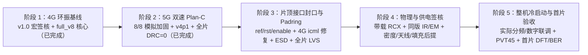

# 执行计划、首片 DFT 与流片验收顺序

**阶段状态（2026-11-26）**：5.0 Gb/s 双速主线（Plan-C `serdes_5g_top_pdk`）已完成全部 8/8 模拟单元真 CPEX/RCX 加固、端口协同 32-bit 数字顶层 `v4p1` 与全片物理装配（Magic `DRC = 0`、`55.43 MB` GDS、层级提取 `28/28` 连通 & `41/41` 隔离）；4.0 Gb/s 无电感环振基线（`v1.0` / `full_v8`）同步保留对照。实装金属与接口审计见[当前状态](current.md)及[片级实装复核](../layout/chip_floorplan_20261123.md#10-实装金属与分析缺口复核2026-11-26)。

---

## 1. 当前主线与路线图

---

## 2. 下一阶段可执行队列（片顶流片收口）

| 顺序 / 任务 | 目标与最小动作 | 退出条件 | 关联项 |
|---|---|---|---|
| **1 / TOP-HOOKUP** | 补齐 5G Plan-C 与 4G `full_v8` 缺失的顶层控制连接（PFD `ref/rst_b`、数字 `ref_clk`、LDO `enable`、LF `pre_en`、TX/RX `rst_n`、粗调/就绪与首片低速 DFT 入口）；修复 4G `full_v8` 的 `BIAS/icml` 短接至 `VSS`；将 `must_differ` 门控升级为预期连接表（端点存在 + 全网连通 + 显式 NC） | 预期连接表 100% 闭合，零悬空必需端口、零隐蔽偏置短路；在独立片顶原理图上通过全片 Netgen LVS | [I-TOP-01](open_issues.md)、[实装复核](../layout/chip_floorplan_20261123.md#10-实装金属与分析缺口复核2026-11-26) |
| **2 / TOP-PADRING** | 锁定同一张 Pad Map（供电、地、4 路高速差分、参考/复位/低速测试与封装引脚），合入 SKY130 I/O ESD 与供电顺序/应力 ERC；把高速 Pad/ESD 电容与回流放回 TX/RX 信道模型；同步评估 5G 24-bit PI 控制端口重排与 CMOS I/Q 支路匹配 | Padring 装配后全片 Magic DRC=0、LVS=MATCH、ERC 无 3.3 V/1.8 V 越限，含 Pad/ESD 的信道眼图与回损满足规格 | [I-TOP-01 / 02](open_issues.md)、[规格](../overview/spec.md) |
| **3 / TOP-RCX-IREM** | 基于同一最终版 GDS 执行带载 RCX（5G CMOS I/Q 树、4G 八相树、`CP→LF→VCO`、高阻偏置与字边界），重算同版静态 IR/EM 与动态供电 droop（优先查 `VDD_Q` LDO→VCO 支路）；执行工艺密度、天线与金属填充，并将 5G LC-VCO/CTLE 电感周边填充与屏蔽纳入 EM 与填充后 PEX | 带载偏斜与串扰满足门槛；静态压降与瞬态 droop 满足各域预算；密度/CMP/天线全过并留存填充后提取收据 | [I-TOP-02 / 03](open_issues.md)、[IR/EM 复核](#irem-修正与剩余验证) |
| **4 / TOP-COSIM-YIELD** | 用实际 `div_ab_5g_v2` / `SAFF-TSPC ÷8` 与生产数字顶层（`v4p1` / `v3`）完成冷启动、掉锁重获、时钟停复和带载 TX→PCB→RX→CDR/FIFO 闭环，补 SDF 带延时回归；收口 5G PI v3 `pi4_diff_rec` 冷角尾差与 4G RX MOS45 CPEX / ÷8 冷角提取 MC，更新纳入封装的系统抖动与 BER 预算 | 典型与压力角带载闭环锁相、位映射与 CDR 跟踪通过；45 PVT 功能门槛全通，系统抖动与实验室 BER 边界定版 | [I-TOP-04 / 05 / 06](open_issues.md)、[当前状态](current.md) |

---

## 3. 首片 DFT 最小测试入口与 IR/EM 复核口径

### 首片 DFT 最小测试入口

| 硅上要定位的阶段 | 最小测试入口与验收 |
|---|---|
| **上电、参考和 PLL** | 保留参考时钟、复位、PLL 启停。用低速接口读 `pll_locked / state_id / fault_code` 和 VCO 粗码；通过独立缓冲读出分频时钟，区分参考未到、反馈无边沿和有反馈但未锁。低速接口的读写与复位须在 **PLL 失锁时仍可用** |
| **TX 独立发射** | 在现有并行字域选择固定图样、训练字和 PRBS7/31（或可持续供数的外部 BERT 路径）。通过实际 TX Pad、板线与仪器观察摆幅、眼图与位序 |
| **RX 独立接收** | 外部 BERT 从 RX Pad 注入数据和可控 ppm。通过一致跨域快照读 `rx_cdr_locked`、PI 码、`rx_aligned`、`host_error` 以及累计有效位、误码、失锁与溢出。检查器须注明观测点，失锁期间显式记事件；额定 BER 用全路径观测点验收 |
| **整链和数字定位** | 板上回环覆盖 TX/RX Pad、ESD、封装与互连；先同源回环，再用独立时钟验证 `±300 ppm` 频偏跟踪。现有异步 FIFO 做功能性写满、读空、位序和跨复位测试 |

- **寄存器通道与计数位宽**：现有数字顶层 RTL（[`serdes_digital_top_v4.sv`](../../digital/pnr/rtl_v4_32b/serdes_digital_top_v4.sv) / [`serdes_digital_top_v3.sv`](../../digital/pnr/rtl_v3/serdes_digital_top_v3.sv)）已具备多数状态与启停信号，须随 Pad Map 接出失锁可用的低速管理接口。若片上做 BER 统计，有效位计数器至少 **42 bit** 并以一致跨域快照读出：4 Gb/s 下零误码需累计约 `3×10¹² bit`（约 `12.5 min`；5 Gb/s 下约 `10.0 min`），单侧 95% 置信上界才接近 `10⁻¹²`；训练与失锁事件另行记录。
- **量产可测性扩展边界**：首片以最小可定位入口随 Pad Map 收口；若面向量产或有数字故障覆盖率目标，再在综合与 P&R（[`run_v4p1_5g_coopt_pnr.py`](../../digital/pnr/run_v4p1_5g_coopt_pnr.py)）早期引入 Scan/ATPG、测试模式 STA 与 JTAG（当前 FIFO 由标准单元实现，出现 SRAM 宏时再评估 MBIST）。

### IR/EM 修正与剩余验证

早期几何代理假设的电源干道与实装金属存在差异（以 4G 实装为例：`VDD_Q` 从 LDO `quiet` 到 VCO `vdd_q` 经 M5 `18.4/12 µm`、`256.74/14 µm`、`63.7/12 µm` 串 24 孔 `via4` 与 M4 `8.6/11 µm`，按 `0.036/0.056 Ω/□`、`0.89 Ω/孔` 及 `22.5 mA × 0.92` 估得单支路约 `0.99 Ω / 20.4 mV`，高于原 15 mV 模型预算；`VDD_A` 内侧去耦干道亦有窄于代理的段）。

后续静态 IR/EM 与动态供电签核统一要求：
1. **基于同版提取网表重算**：先提取 LDO、VCO、CP 及高开关域（TX/RX/Digital/CLK）的实际供电、过孔与地回流网络，核实交接形状、阵列分流与负载同时性；
2. **更新动态 PDN 仿真**：在 [动态 PDN 稳定性台](../../verification/stability/verify_supply_stability.py) 中替换为实装 Pad/键合线、每域紧缩去耦瓦片与回流 RC，注入上电、TX 训练切 PRBS、数字忙闲切换与 RX 重获锁电流，重点验收 VCO 端 `VDD_Q − VSS`、LDO 压差、环路抖动及各域端点压降/过孔电流（EM）。

---

## 4. 流片前验收顺序

1. **Pad Map、ESD/ERC 与信道回灌**：在同一张 Pad Map 锁定供电、地、功能、测试与封装；完成 ESD、供电顺序、掉电倒灌及 3.3 V/1.8 V 器件应力 ERC；将高速 I/O 保护电容与回流路径放回 TX/RX 信道模型复核。[SKY130 I/O 用户指南](https://skywater-pdk.readthedocs.io/en/main/contents/libraries/sky130_fd_io/docs/user_guide.html)
2. **最终 GDS 全片物理签核与带寄生时序**：对最终 GDS 执行全片 Netgen LVS、工艺要求 DRC/密度/金属填充/天线检查，并留存填充后提取收据；数字 STA 与带延时 SDF GLS 绑定实际数字宏版本，跨宏时钟与数据使用最终提取寄生（先核参考、复位、供电与 ready/enable，再核高频多相时钟、字时钟与 32/33-bit RX 回接）。[SKY130 天线规则](https://skywater-pdk.readthedocs.io/en/main/rules/antenna.html) · [片级问题登记](open_issues.md)
3. **同版 IR/EM、冷启动闭环与 PVT45/BER 签核**：基于同一提取版本完成静态 IR/EM 与动态供电签核（优先复测 `VDD_Q` 与压力角）；使用实际分频器与生产数字控制完成冷启动、掉锁重获与时钟停复验证；回归受改宏、封装信道、相噪与抖动预算，按 [规格](../overview/spec.md) 与 [PVT 覆盖约定](../verification/pvt_coverage.md) 记录 45 PVT 功能门槛及实验室 BER 验收边界。

延后拓展项（800 mVpp 高摆幅 TX、1.5 V 独立供电域、强损耗信道编码/DFE 等）登记在 [下一版候选](next_iteration.md)。
