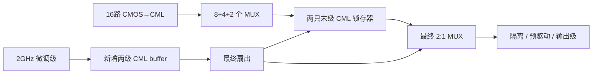
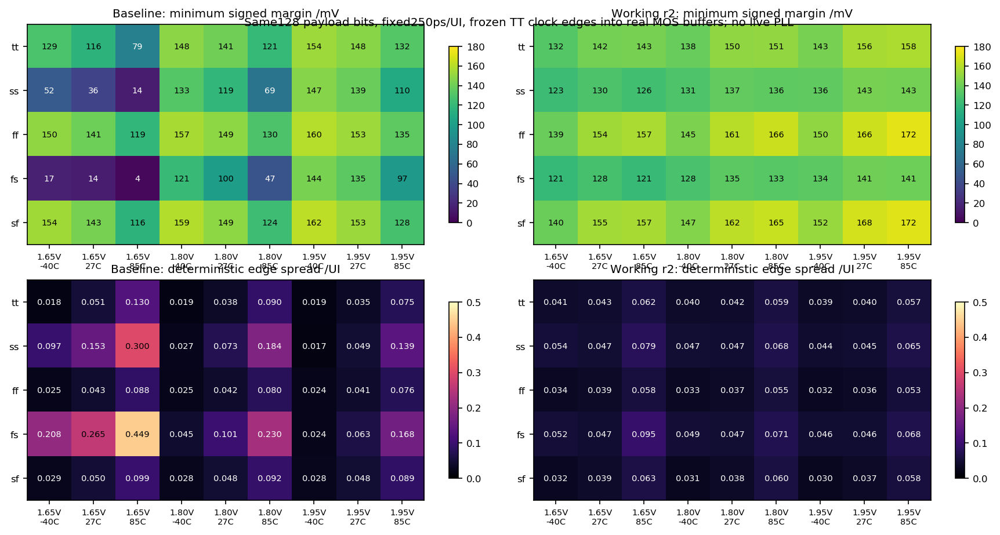
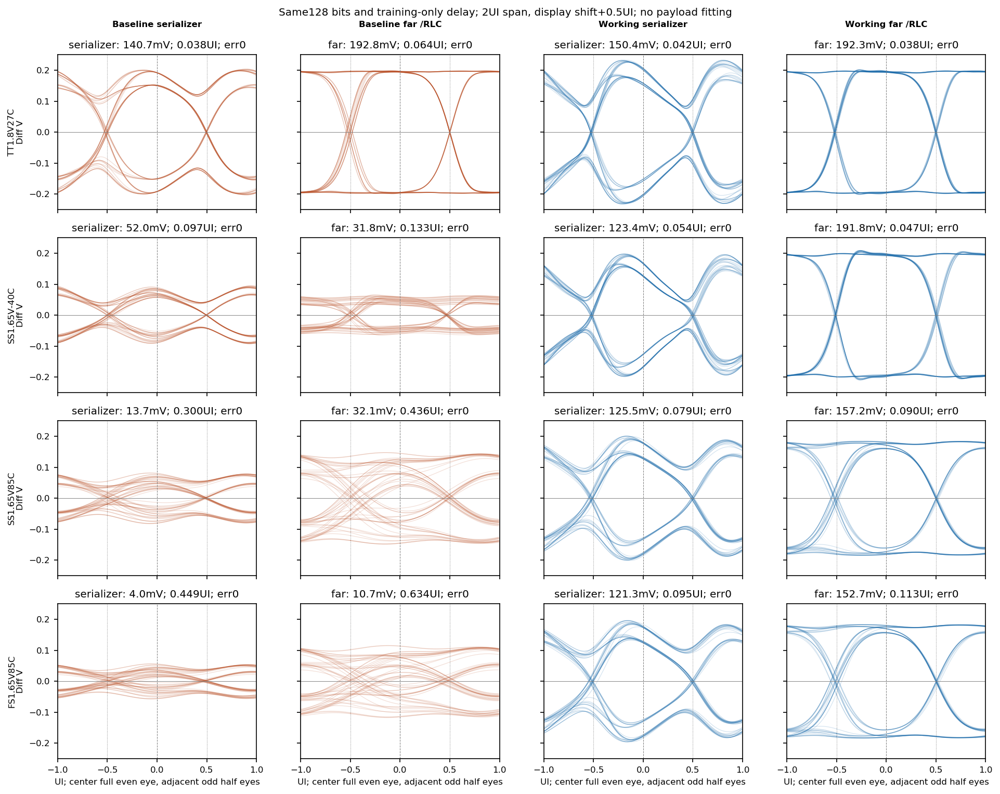
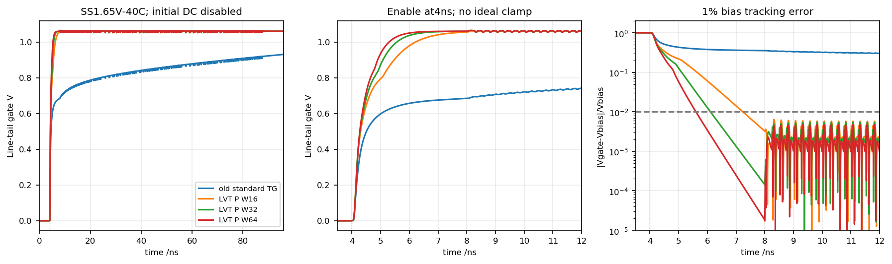
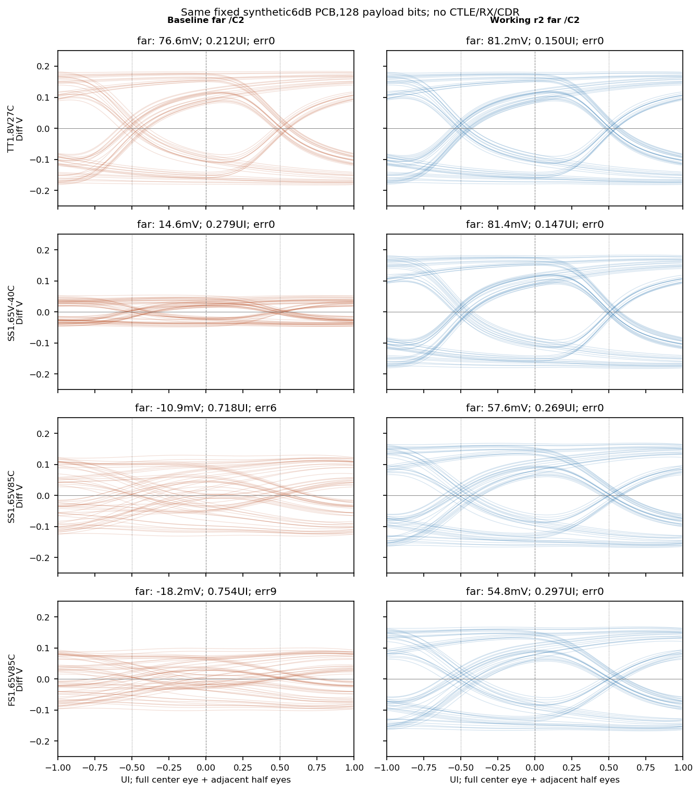
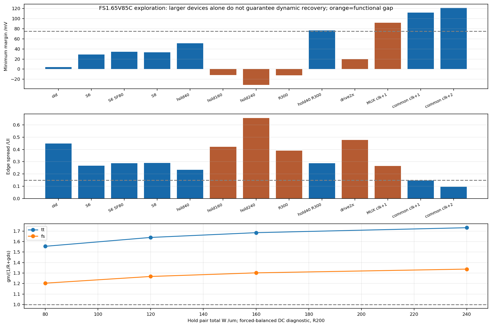

# TX 电流舵与输出级工作修订

2026-10-30。工作修订 r2 已完成：同一有限测试下，串化器满足原草案裕量门槛由 **36/45 → 45/45**，串化/输出/固定 RLC 全链功能 **45/45**；输出级从禁用初态启动 **45/45**。这是分层晶体管级表征，完整噪声、失配、无源极值和版图签核仍未完成。

当前参数入口：[工作版配置](../config/tx_working_revision.toml)；[完整数值](data/tx_optimization.json)；[证据](data/tx_optimization_evidence.json)；[运行与全部失败对照](../results/analog/tx/optimization/20261030T100258Z)。冻结 v0.1 及旧共享单元保留。

## 电路修改

串化逻辑尾偏置与时钟源跟随器偏置分开，用真实 NMOS/PMOS 镜产生每棵树一份的低过驱动逻辑偏置。MUX 尾管 W=72 µm、nf=24；末级两只锁存器尾管 W=144 µm、nf=24，均 L=0.5 µm。镜参考电流约为原比例的 1/6；宽度乘六不等于电流乘六。源跟随器仍使用全局偏置。

末级保持管 W=80→40 µm、每端负载 200→300 Ω，时钟选择管 W=96 µm、源跟随器 W=80 µm。前轮成熟基线已经是 24 µm 尾管/200 Ω 末级锁存器，本轮改善不是相对最初的小管版本计算。

2 GHz 分发的微调级与最终扇出级之间增加两级真实非反相 CML buffer（每级输入 W=24、尾 W=16 µm、R=400 Ω），共同驱动末级锁存器和 MUX 的时钟。其余三路时钟路由及四路 trim 仍为 [100,500,160,270] fF。

在 FS1.65V85°C 对照中，这两级令局部时钟相对源约延后 0.166 UI（约42 ps），加载后外部 2 GHz 差分峰峰值由360→528 mV，局部跟随器后234→341 mV。A 路 g3 数据交越到下一次跟踪转保持交越的中位间隔约0.250→0.417 UI；这是观测间隔，不能当作正式建立时间规格。增益恢复和时序余量一起起作用，不是纯理想延迟。

输出保留 Wout=256/Wtail=172 µm、原隔离/预驱动及两端端接，改模拟尾偏置的使能传输门：N-LVT W2/L0.15，P-LVT W32/L0.35 µm，PMOS 井仍接 VDD。新增 P-LVT 适配器单独引用，不修改 RX 使用的共享原语。没有理想钳位偏置或强制耦合电容初态。

## 同一128 bit 的前后对照

| 工况 | 串化最小裕量/mV（旧→新） | 边沿散布/UI（旧→新） | 远端最小裕量/mV（旧→新） |
|---|---:|---:|---:|
| TT1.8V27°C | 140.71 → 150.44 | 0.0384 → 0.0417 | 192.78 → 192.33 |
| SS1.65V−40°C | 51.96 → 123.40 | 0.0968 → 0.0540 | 31.78 → 191.76 |
| SS1.65V85°C | 13.66 → 125.52 | 0.2998 → 0.0789 | 32.07 → 157.18 |
| FS1.65V85°C | 3.96 → 121.30 | 0.4488 → 0.0953 | 10.67 → 152.74 |

45 条件范围为 TT/SS/FF/FS/SF × 1.65/1.8/1.95 V × −40/27/85°C；每条件128 bit，最小串化裕量 120.52 mV，最大确定性边沿散布 0.0953 UI。草案门槛仍为75 mV及0.15 UI，同时要求训练/marker正确、无错误/多余/缺失跳变。

眼图保持固定250 ps/UI，2 UI总宽，中央偶数位完整眼、左右奇数位半眼；只用训练字测一次常数延迟，不使用负载重拟合 UI、相位或逐位对齐。

## 输出使能与固定 PCB

原使能传输门在 SS 冷角96 ns内仍未达到1%尾偏置误差，早期远端幅度因此很小。低阈值开关32 µm候选在 SS1.65V−40°C 约6.107 ns后持续处于1%带内，距4 ns使能开始约2.107 ns。
全45独立输出条件最晚约 6.413 ns，即使能开始后 2.413 ns。启用直流线电流约 7.51–8.02 mA，最大禁用电流约 1.15 nA；预驱动仍通电，不是全 TX 掉电。

固定6 dB PCB只选四角，直接由真实串化器/线驱动器驱动，保留实际加载，不含 RX/CTLE/CDR。

| 工况 | 旧远端错误/128 | 新远端错误/128 | 新远端最小裕量/mV |
|---|---:|---:|---:|
| TT1.8V27°C | 0 | 0 | 81.23 |
| SS1.65V−40°C | 0 | 0 | 81.42 |
| SS1.65V85°C | 6 | 0 | 57.58 |
| FS1.65V85°C | 9 | 0 | 54.81 |

TT及FS低压热角另用连续原有源记录运行300 ns，检查1024 bit：
- FS / 1.65 V / 85°C：串化错误0/1024、多余0、缺失0；最小裕量117.82 mV、散布0.1149 UI；三个观测节点全部功能通过。
- TT / 1.80 V / 27°C：串化错误0/1024、多余0、缺失0；最小裕量146.96 mV、散布0.0508 UI；三个观测节点全部功能通过。

## 取舍及失败对照

- 尾宽比例6→8后 FS 动态收益接近消失，不继续仅扩大尾管。
- 保持管80→160/240 µm的强制平衡静态再生增益虽上升，动态锁存却出现错误；电容与跟踪/保持电流竞争不可忽略。
- 只给最终 MUX 的选择时钟加buffer，提高了位中心电压，但留下窄脉冲；最终选择共同移动锁存和MUX的2 GHz时钟。
- W512/nf4的时钟管试验超出有效PDK模型bin，属于无效仿真，不计为电路性能点。

MOS总栅面积ΣWL：串化核心1144.4→2129.3 µm²（约1.86倍，包含新增本地参考）；时钟分发164.0→194.4；输出213.65→224.25。三部分合计1522.05→2547.92 µm²（约1.67倍）。W是总宽，不再乘nf；输入转换、全局参考、电阻/电容、井、间距、布线未计，不能当实际版图面积。

TT同一早期128bit窗口中，串化核心/时钟/偏置合计41.27→43.22 mW（约+1.95 mW）；含16路输入转换和输出级的新总和约69.21 mW，不含PLL、RX和完整参考源。SS低压冷角同一部分31.81→36.01 mW；其中包含原先受限尾电流的恢复。旧输出级偏置未建立造成的低功耗，不能当作相同幅度/能力的节能基准。

## 验证边界

沿用冻结TT PLL的有限边沿记录，源边沿理想化后通过真实MOS微调/扇出与时钟负载；没有逐路时间搬移或延拓时钟。新r3分频buffer的原生相位/状态、确定性分频复位和重新标定仍见[相位核对](tx_clock_phase_audit.md)，尚未随本版全链重验。

工艺角覆盖MOS，负载R/C、封装、端接及合成PCB固定名义值；外部0.85 mA理想参考进入实际镜，基准源未资格验证。未做噪声、失配、统计BER、ESD、版图寄生、供电扰动或眼罩验收。当前也没有真实并行字捕获寄存器。有限码型零错误与层次化边界内的通过均保留其效力，但不外推为完整产品签核。
