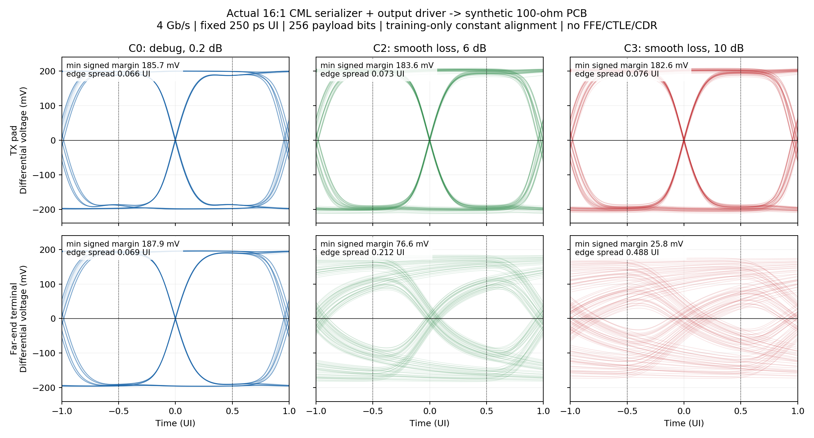
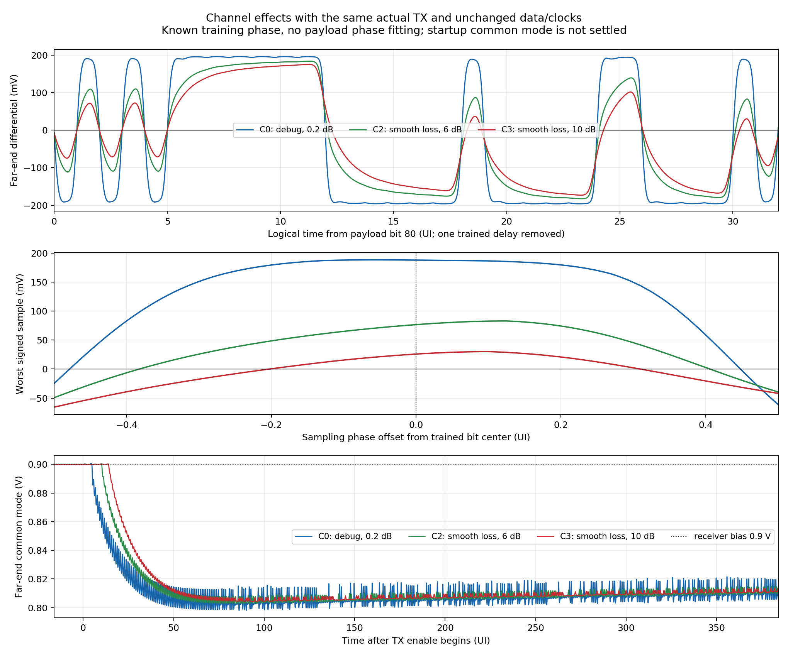

# 真实TX接入合成PCB：首轮结果

用户要求将TX信号送入新PCB。本轮在同一ngspice瞬态电路中，将真实SKY130 TT串化器、物理时钟buffer、输出预驱动/线驱动接入C0近无损、C2 6 dB、C3 10 dB合成PCB。PCB与非线性TX一起求解，包含通道负载对输出级的影响。数据端没有理想电压源回放，没有加入FFE、CTLE、DFE或RX。

6 dB时远端采样眼高比近无损基线下降约59%，总峰峰值却只下降约7%。总摆幅不能代替采样裕量。现有TX可继续作为RX/均衡开发基线；这次测试不改变已冻结PLL/串化器。

## 固定250 ps UI的2UI眼图

上排TX焊盘，下排远端终端，电压比例相同。每个观察点使用前32 bit交替训练确定一个固定分数UI延迟，32 bit唯一标记用于消除整数2UI歧义；未使用负载数据重新拟合主表采样相位。64–319 bit共256 bit用于测量，128个2UI片段覆盖同一负载，采样中心为−0.5/+0.5 UI。未修改UI、逐位移相或延拓原时钟记录。

| 通道损耗＠2 GHz | 远端总峰峰值/mV | 采样眼高/mV | 最小有符号裕量/mV | 过零散布/UI | 已知相位采样错误 |
|---|---:|---:|---:|---:|---:|
| C0：0.2 dB | 392.4 | 377.0 | 187.9 | 0.06855 | 0/256 |
| C2：6 dB | 366.3 | 155.1 | 76.6 | 0.21192 | 0/256 |
| C3：10 dB | 348.4 | 54.0 | 25.8 | 0.48752 | 0/256 |

采样眼高是所测位中心的最小高电平减最大低电平；有符号裕量以差分0 V为阈值。总峰峰值取完整负载窗口的电压极值，不能表示最弱短脉冲。长连码仍能接近较大幅度，短码型已明显衰减。

三个观察点、三组场景的唯一标记均正确匹配；每组负载预期130个跳变，均无额外或漏跳变。过零散布是匹配数据跳变后时间残差的峰峰值，包含码型相关延迟，不能直接视为随机相噪或可相加的独立抖动分量。

**这里的零错误属于理想阈值、已知训练相位下的有限码型电压采样，不是实际RX/CDR或统计BER验证。** 10 dB场景的26 mV最小裕量尚未扣除噪声、失调、采样孔径或PVT预算。

## 展宽主要出现在哪里

| 观察位置 | C0散布/UI | C2散布/UI | C3散布/UI |
|---|---:|---:|---:|
| 片内串化器 | 0.04186 | 0.04185 | 0.04186 |
| TX焊盘 | 0.06621 | 0.07324 | 0.07625 |
| 远端终端 | 0.06855 | 0.21192 | 0.48752 |

串化器结果基本相同，TX焊盘有少量通道负载相关变化，远端码型展宽显著。各位置峰峰值不可直接相减来分配独立抖动来源。TX焊盘总峰峰值为400.6/421.1/418.9 mV，也可见实际加载的变化，不能认为换通道后发射波形严格不变。

三组数据/时钟激励文件SHA256完全一致；仍使用保存的原生PLL边沿源加真实相位/扇出buffer，没有实时PLL联仿。加载后的2 GHz时钟，C2/C3相对C0上升沿最大变化分别为0.000065/0.000084 UI；平均周期均约1.999991 UI。本轮远端新增展宽主要对应通道ISI，现有证据不要求因这项通道测试而重调PLL。

上图只去掉各节点一个训练延迟，使用相同逻辑位、固定UI。第二幅的采样相位扫描是负载数据上的离线诊断，展示采样容限；没有使用其最佳相位更新主表或眼图对齐，也不是已经实现的CDR。C2离线最优相位偏移约+0.125 UI，最小裕量由76.6升至82.9 mV；C3约+0.095 UI，由25.8升至30.0 mV。一次平移不能消除拖尾和码型相关延迟。

## 夹具、共模与功耗

TT、27°C、1.8 V；真实16:1 CML串化器→隔离buffer→预驱动→线输出对→pad/封装/AC耦合→新PCB→远端终端。源端和远端均50 Ω/端，pad 200 fF/端、封装0.5 nH+0.3 Ω/端、AC电容10 nF/端、远端输入代理100 fF/端及0.01 Ω短连线；远端共模偏置0.9 V。沿用已有名义pad/封装代理，没有真实ESD或板线提取。

DC时线尾管关闭，4 ns后开启；未强设AC电容初态。100 ns瞬态覆盖的是较早启动过程，远端共模仍未恢复0.9 V。

| 场景 | 负载窗口远端共模/V | 隔离+预驱动供电均值/mW | 线输出供电均值/mW |
|---|---:|---:|---:|
| C0 | 0.7986–0.8216 | 4.820 | 7.461 |
| C2 | 0.8033–0.8147 | 4.820 | 7.513 |
| C3 | 0.8048–0.8133 | 4.820 | 7.548 |

功耗在各节点自身延迟对齐的负载窗口测量，仍有AC电容储能和远端偏置源的能量交换，不能作为稳态预算，也不能根据三者小差异宣称稳态节能。若RX需在这段时间工作，应容忍约0.8 V输入共模，或另定共模稳定等待条件。该100 Ω差分模型没有覆盖真实回流/共模通道。

## 复现、验证与下一步

- [晶体管TX+PCB模板](../analog/tx/output_driver/tb/pcb_channel/tb_serializer16_pcb_ngspice.cir.in)和[测试条件](../analog/tx/output_driver/tb/pcb_channel/case.toml)。替换项目/PDK/工艺角/通道占位符，复制声明的原始stimuli.inc并保留hsa兼容设置。各运行目录也保留完整输入快照。
- [汇总指标](data/tx_pcb_channel_integration.json)：训练延迟、采样、跳变、共模、供电窗口均值及诊断。各run/raw包含逐位采样、逐边沿残差和2UI数组。
- [C0运行](../results/analog/tx/output_driver/pcb_channel/20261028T140212Z_ngspice_tt_C0_debug/metrics.json)、[C2运行](../results/analog/tx/output_driver/pcb_channel/20261028T140212Z_ngspice_tt_C2_loss6/metrics.json)、[C3运行](../results/analog/tx/output_driver/pcb_channel/20261028T140212Z_ngspice_tt_C3_loss10/metrics.json)。同目录run.json含命令、PDK解析路径、输入SHA256、日志/记录终点状态。

三组均完整运行至100 ns，最大瞬态步长4 ps；收集时核对输入哈希、记录终点、有限数值、严格递增时间、训练标记及跳变匹配。尚未进行瞬态步长/网格收敛签核、噪声、失调、PVT、相噪、实际采样器或CDR验证。未改变v0.1冻结包。

本次只测C0/C2/C3；3 dB、残桩及偏斜场景仍仅有此前模型表征。先用C2设计带旁路、可调增益/峰化的RX CTLE，再加入实际采样器和噪声/失调预算，用C3判断是否需要TX一后游FFE或RX DFE。256 bit零错误不能决定无需均衡，也不能仅增加总输出摆幅来补偿所有ISI。
