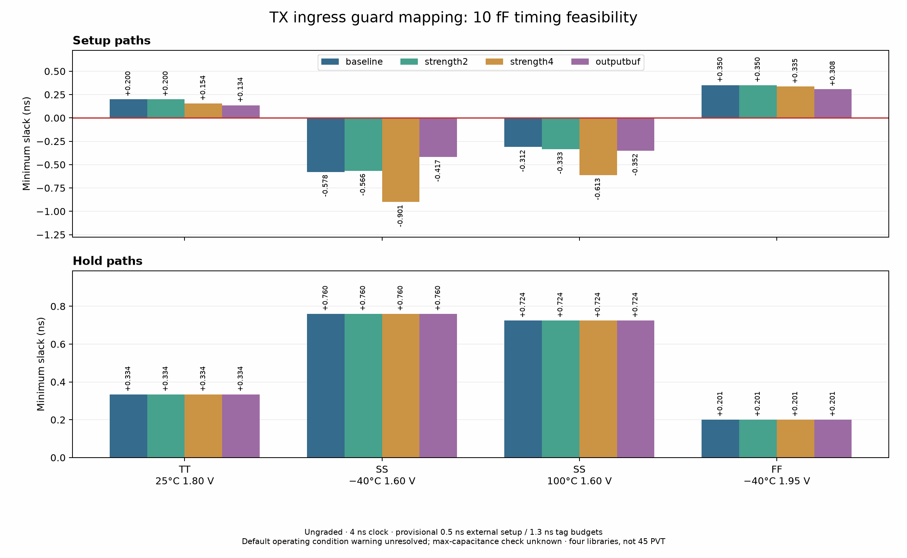

# TX guard 映射时序 review

接受为暴露接口约束问题的可行性实验；不采用任何候选映射，也不标记时序闭合。Terra完成TT库映射、四库三负载、驱动/缓冲对照；集成者检查路径、SDC、库单元存在性及单位，并在所有输入明确100 ps transition后独立复跑48组，归档为 `results/digital/tx/ingress_timing/20261107T052347Z`。

SS冷1.60 V、10 fF的原映射：ready FF驱动20扇出、38.7 fF，clk→Q约1.330 ns，后接`and2_0`约0.696 ns；至capture_valid的setup slack为−0.57753 ns。输入捕获数据同样不足。插输出buffer后，该路径改善但最差端点转为A标签，整体仍−0.41694 ns。仅增强部分门的输入电容反而增大ready负载，strength4为−0.90073 ns。四库没有同系列`dfrtn_2/4`，不能把不存在的强下降沿FF当作方案。

本次保留4 ns时钟、100 ps输入/时钟transition、50 ps setup/hold不确定度、数据/valid下降沿后0.05–0.2 ns到达、外部建立0.5 ns及标签提前1.3 ns的假设，未为了通过移动边沿或放宽约束。驱动候选只改网表，未改RTL。未做候选门级功能等价验证，后续采用前必须补做。

图的[小数据](../../data/tx_ingress_timing.json)独立解析16份10fF报告的最大/最小时序段，重取最差起点、终点、裕量并核对summary；所有输入报告带SHA。

**下一步先校准真实接口参数，再比较结构。** 0.5 ns建立时间和标签1.3 ns预算尚未由实际模拟DFF、标签接收器和走线共同定型；5/10/20 fF也是负载假设。当前结果足以拒绝“RTL行为通过就物理可用”，不足以判定任何HD映射必然不可用。应测实际DFF建立/保持、输入电容并确定标签消费位置，再用结构模型比较扇出分组、时序分配、复位/有效控制分工及适用单元，不继续无依据地统一加大门。

OpenSTA2.0.17能读取、链接并输出路径；默认operating condition警告仍保留，显式设置后的数值解释待核查，max-cap规则检查未知。复位被固定为1，仅正常工作态，未做recovery/removal。1.60 V/100°C、25°C库不等同项目1.65 V/85°C、27°C条件。TT/FF正裕量与SS负裕量均只是这组假设下的局部结论，不是45 PVT或版图后签核。
