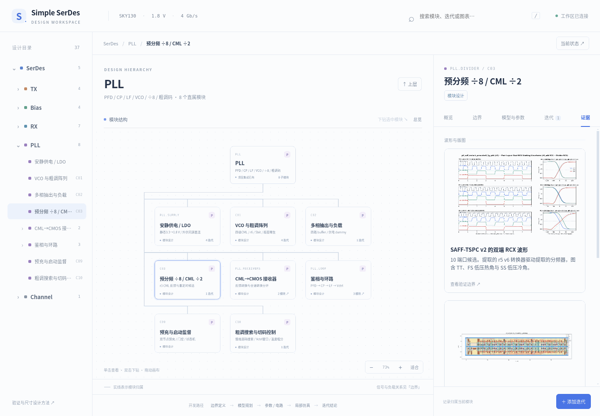

# SerDes 设计工作台

按 **SerDes → PLL / Bias & LDO / TX / RX / Channel → 子模块** 浏览 4/5 Gb/s 双速 SKY130A SerDes 架构。总览直达 5G Plan-C 全片签核（`serdes_5g_top_pdk` + 32-bit 数字宏 `v4p1`）与 4G `v1.0` / `full_v8` 参考基线，各子模块展示输入输出边界、SPICE/RTL 源码与波形/版图证据。



## 打开

可直接打开 [index.html](index.html) 浏览已有结构和资料索引；不需要构建或安装前端依赖。

要在页面中预览源码、文档和图片，或保存迭代，在仓库根目录运行：

```bash
uv run python -m serdes_flow.design_viewer --open
```

地址为 `http://127.0.0.1:8765`，可用 `--port` 更换端口。服务仅监听本机。

画布：单击查看模块，双击或点击「模块 ↗」下钻；拖动平移，按钮或 Ctrl+滚轮缩放；「上层」和面包屑返回父级。目录和搜索可直接定位子模块。画布连线表示归属，信号、时钟、负载与假设在「边界」页。

## 查看电路与 RTL

选中模块后点右侧「源码」。SerDes 总览提供 5G 32-bit 数字顶层（`serdes_digital_top_v4.sv` / `rtl_v4.f`）与 4G 16-bit 参考顶层（`serdes_digital_top_v3.sv` / `rtl_v3.f`），TX 字入口、PLL 粗搜与启动、RX CDR、字对齐和异步 FIFO 在各自子模块下。模拟电路从对应模块打开 SPICE，例如「PLL → 5G 八边形 LC-VCO 与 ÷2」、「Bias & LDO → HV18 Kelvin LDO 与尾偏置滤波」或「TX → CMOS 串化与 SST 驱动」。

本地服务模式下，点击文件可按行阅读，用下拉框跳到 SystemVerilog 的 `module` 或 SPICE 的 `.subckt`，也可切换同模块的其他文件。例如在 5G TX 驱动网表内跳到 `sst_slice_unit_5g`，或在 5G RX 宿主路径里跳到 `rx_word_host_32`。顶部搜索支持源码标题和文件名，例如 `async_word_fifo_32.sv`。直接打开 `index.html` 时，源码列表会打开原文件。

源码来自当前工作树。复核 4G 发布数字 RTL 时，按[主线工作修订](../../config/mainline_working_revision.toml)读取 `v1.0` 标签下的同路径文件。

## 查看证据

「证据」可直接预览模块波形与版图。点击图可查看原图，点「查看验证边界」可读激励、负载、修订和结论。搜索支持图名，例如 `Plan-C`、`LC-VCO` 或 `SAFF-TSPC`。总览提供[当前状态](../../docs/status/current.md)、[5G 签核台账](../../results/catalog/serdes_5g_signoff_20261126.json)与[执行计划](../../docs/status/prelayout_plan.md)入口。

## 数据与归属

| 内容 | 位置 | 维护方式 |
|---|---|---|
| 模块层次、结构摘要、模型规划与资料引用 | [design_catalog.json](../../config/design_catalog.json) | 模块用稳定 ID 和父级归属维护。`sources` 登记仓库相对路径，可附 `#子电路名` 或 `#RTL模块名` 定位；`figures` 登记图和原报告 |
| 采用状态、验证数字与实际驱动边界 | [current.md](../../docs/status/current.md) | 项目级唯一汇总；不在目录数据另抄一份数字 |
| 新增迭代 | `docs/design/iterations/<模块id>/<UTC>_<随机id>.json` | 页面「添加迭代」按需创建并追加独立记录；保留已有记录 |
| 静态浏览数据 | [catalog.js](catalog.js) | 派生数据，运行下面的导出命令更新 |
| 前端 | [index.html](index.html)、[style.css](style.css)、[app.js](app.js) | 原生 HTML/CSS/JS，无 CDN、框架或包管理依赖 |
| 本地资料与记录服务 | [design_viewer.py](../../src/serdes_flow/design_viewer.py) | Python 标准库；仓库文件读取与模块记录保存 |

```bash
uv run python -m serdes_flow.design_viewer --export
```

每次迭代可填写问题、模型规划、参数/电路修改、验证边界与结论，并附加已有仓库资料路径。阶段为规划、模型、电路、验证或结论。静态浏览模式可导出同格式 JSON；将其以唯一文件名放入对应模块目录后，重新导出即可纳入目录。

采纳一次改进时，更新模块设计文档、[当前状态](../../docs/status/current.md)与[主线工作修订](../../config/mainline_working_revision.toml)。迭代记录与结果波形继续按项目约定追加；验证数字在当前状态查阅。

## 接手

先从模块的「边界」和「模型与参数」了解问题，再查看「源码」与「证据」中的电路、版图与测试台入口。具体参数改进归属叶级模块；跨模块结构决策可归属 PLL、Bias & LDO、RX 或 TX 等父模块。

测试：`uv run pytest -q tests/test_design_viewer.py`。测试记录使用临时目录；实际前端保存的记录进入仓库文档目录。
